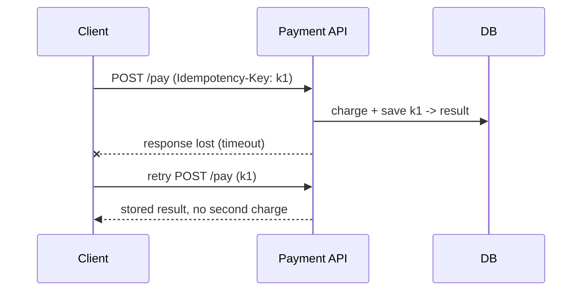

## 1. Core Concept

Mạng và service có thể lỗi bất cứ lúc nào, nên client **phải retry**; nhưng retry thao tác có tác dụng phụ (trừ tiền, tạo đơn) sẽ làm **chạy hai lần**. **Idempotency** là tính chất "làm một lần hay nhiều lần cho cùng kết quả", biến retry từ nguy hiểm thành an toàn. Mental model: *không thể biết request "mất" hay "response mất" — cách duy nhất để retry an toàn là làm cho thao tác **lặp lại được**.*

## 2. How It Works

- **Ngữ nghĩa giao nhận**: **at-most-once** (có thể mất), **at-least-once** (có thể trùng), **exactly-once** (thực tế = at-least-once + **xử lý idempotent**).
- **Idempotency tự nhiên**: `PUT`/`DELETE`, **upsert**, "set trạng thái = X" thay vì "cộng thêm 1".
- **Idempotency key**: client sinh khoá duy nhất (UUID) cho mỗi **ý định** và gửi kèm mọi lần retry; server lưu `key → kết quả` với **ràng buộc UNIQUE** và trả lại kết quả cũ nếu thấy key đã xử lý.
- **Retry đúng cách**: chỉ retry **lỗi tạm thời** (timeout, `503`, `429`), không retry `4xx` logic; dùng **exponential backoff + jitter** (`delay = random(0, base × 2^attempt)`), có **giới hạn số lần** và **deadline** tổng.
- **Timeout** ở mọi lời gọi; kết hợp **circuit breaker** để dừng retry khi dependency đã chết.
- **Dedup ở consumer**: lưu `messageId` đã xử lý (cùng transaction với tác dụng phụ) hoặc dùng upsert theo business key.

```sql
-- Đảm bảo một key chỉ được xử lý một lần, kể cả khi hai request đến đồng thời
INSERT INTO idempotency_keys (key, request_hash, status)
VALUES (:key, :hash, 'IN_PROGRESS')
ON CONFLICT (key) DO NOTHING;   -- 0 hàng chèn được => key đã tồn tại, trả kết quả đã lưu
```

## 3. Visual Diagram



## 4. Rules of Thumb & Trade-offs

- Mọi `POST` có tác dụng tiền bạc/đơn hàng nên hỗ trợ **idempotency key**; thiết kế thao tác theo kiểu **"đặt trạng thái"** thay vì "tăng/giảm".
- Retry ở **một tầng** (gần client nhất hoặc tại gateway); nhiều tầng cùng retry nhân lên (3×3×3 = **27 lần**).
- Giữ idempotency key **đủ lâu** (thường 24 giờ–vài ngày) để bao phủ cửa sổ retry.
- Trade-off: idempotency cần **lưu trạng thái và thêm bước ghi**, đổi lại độ an toàn khi lỗi.

## 5. Must Remember / Production Pitfalls

- **Retry storm**: dependency chậm → mọi client retry cùng lúc → sập hẳn; luôn **jitter** và giới hạn.
- **Hai request cùng key đến đồng thời**: kiểm tra-rồi-chèn không nguyên tử sẽ xử lý hai lần → dùng **UNIQUE constraint** làm cổng.
- **Cùng key nhưng payload khác** nên bị từ chối (`422`), không trả kết quả cũ.
- **Exactly-once là ảo tưởng ở tầng mạng**: broker "exactly-once" chỉ đúng trong phạm vi của nó; tác dụng phụ ra ngoài vẫn cần idempotent.
- Lỗi **timeout không có nghĩa là thất bại** — thao tác có thể đã thành công; phải truy vấn trạng thái hoặc retry idempotent.
- Interview trap: "Làm sao không trừ tiền hai lần?" → idempotency key + ràng buộc unique trong cùng transaction với việc trừ tiền.

## 6. Search Hooks

- `idempotency key pattern` — dùng khoá duy nhất để retry không lặp tác dụng phụ.
- `exponential backoff with jitter` — giãn cách retry có ngẫu nhiên để tránh dồn đồng loạt.
- `at-least-once vs exactly-once delivery` — ngữ nghĩa giao nhận và ý nghĩa thực tế.
- `retry storm retry amplification` — retry nhiều tầng làm quá tải dependency.
- `Stripe idempotent requests` — ví dụ tham chiếu triển khai idempotency key.
- `deduplication processed message id` — loại message trùng phía consumer.
