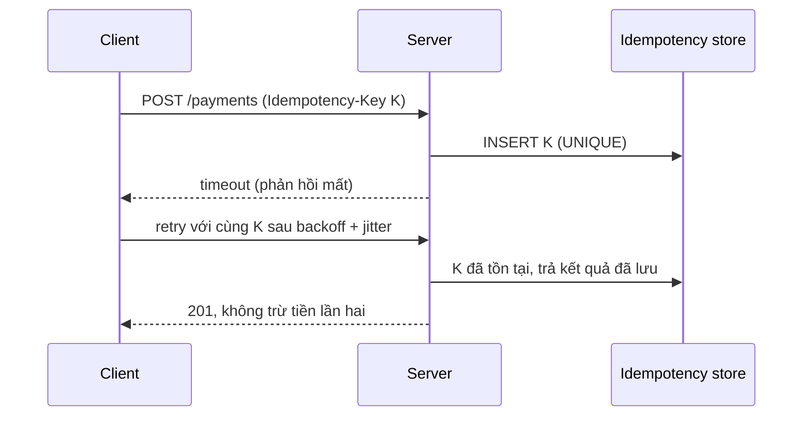

## 1. Core Concept

Trên mạng, **không thể phân biệt "yêu cầu thất bại" với "yêu cầu thành công nhưng phản hồi bị mất"** — một **timeout không có nghĩa là thất bại**. Vì vậy hệ thống phân tán **phải retry**, và khi retry thì thao tác phải **idempotent**: thực hiện lại **không gây thêm tác dụng**. Không có idempotency, retry biến sự cố tạm thời thành **trừ tiền hai lần, tạo đơn trùng**; không có backoff, retry biến sự cố nhỏ thành **retry storm** sập cả hệ thống.

**Mental model:** như **bấm nút thang máy**: bấm thêm vài lần cũng chỉ gọi **một** thang (idempotent) — an toàn khi bạn không chắc đã bấm chưa. Trái lại, **nút "mua ngay" không idempotent**: bấm hai lần mua hai món. Retry an toàn chỉ khi hành động giống nút thang máy.

## 2. How It Works

**Idempotent là gì**
- Làm một lần hay nhiều lần **cho cùng kết quả**. HTTP: `GET`, `PUT`, `DELETE` **idempotent**; **`POST` không**. Ví dụ `balance = balance + 50` **không** idempotent, còn `set status = 'PAID'` thì có.

**Idempotency key pattern**
- Client sinh **UUID** cho mỗi ý định (header **`Idempotency-Key`**) và gửi lại **cùng key** khi retry. Server **chèn key vào bảng có ràng buộc UNIQUE trước khi xử lý** (nguyên tử), lưu **kết quả** theo key (thường ~24 giờ): lần retry trả **kết quả đã lưu** thay vì xử lý lại; request song song cùng key nhận `409`/chờ; **cùng key khác payload** → `422`. (Ví dụ cách Stripe làm.)

```sql
INSERT INTO idempotency (key, request_hash, status) VALUES ($1, $2, 'IN_PROGRESS')
ON CONFLICT (key) DO NOTHING;      -- 0 hàng → đã có: trả kết quả cũ / báo đang xử lý
```

**Chỉ retry lỗi tạm thời**
- **Nên**: timeout, mất kết nối, `429`, `503`, `502/504`. **Không nên**: `4xx` lỗi do client (`400`, `401`, `403`, `404`, `422`) vì retry không thay đổi kết quả. Đặt **số lần tối đa** và **tổng deadline**.

**Exponential backoff với jitter**
- Chờ lâu dần: `sleep = random(0, min(cap, base × 2ⁿ))` (**full jitter**). **Jitter** (ngẫu nhiên) rải thời điểm thử lại để **không đồng loạt**; không có jitter, hàng nghìn client retry **cùng lúc** → **retry storm / thundering herd**.

**Retry amplification**
- Retry ở **nhiều tầng nhân lên**: 3 tầng × 3 lần thử = **27 lời gọi** xuống dependency đang yếu. Cách giảm: **retry ở một tầng**, **retry budget** (giới hạn tỉ lệ retry), kết hợp **circuit breaker** và **timeout**.

**At-least-once vs exactly-once**
- Messaging thực tế là **at-least-once** (có thể trùng). **"Exactly-once" ở biên hệ thống = at-least-once + xử lý idempotent**: **idempotent consumer** (bảng `processed_message_id`, upsert theo business key, ràng buộc UNIQUE) và **message deduplication** (ví dụ SQS FIFO khử trùng trong 5 phút).

```python
def retry(fn, attempts=5, base=0.2, cap=10, deadline=30):
    start = time.monotonic()
    for n in range(attempts):
        try: return fn()
        except TransientError:
            if n == attempts - 1 or time.monotonic() - start > deadline: raise
            time.sleep(random.uniform(0, min(cap, base * 2 ** n)))   # full jitter
```

## 3. Visual Diagram



## 4. Rules of Thumb & Trade-offs

| Tình huống / Nhu cầu | Chọn gì |
| --- | --- |
| Thao tác tạo/thanh toán có thể retry | Idempotency key + lưu kết quả |
| Retry lỗi tạm thời | Exponential backoff + jitter, giới hạn số lần và deadline |
| Retry nhiều tầng | Retry ở một tầng + retry budget + circuit breaker |
| Consumer nhận message trùng | Idempotent consumer (dedup theo id/UNIQUE) |
| Cập nhật nên idempotent | Đặt trạng thái tuyệt đối thay vì cộng dồn |
| Lỗi 4xx của client | Không retry |

- **Được gì:** chịu lỗi tạm thời an toàn. **Mất gì:** lưu trữ và quản lý khoá, thêm độ phức tạp, độ trễ khi retry; cần dọn khoá cũ.

## 5. Must Remember / Production Pitfalls

- **Trừ tiền/tạo đơn hai lần khi client retry → thao tác không idempotent → Idempotency-Key lưu kết quả, UNIQUE constraint**.
- **Mọi client retry cùng lúc làm sập dịch vụ đang phục hồi → backoff cố định, không jitter → exponential backoff + full jitter**.
- **Một lỗi nhỏ nhân thành tải khổng lồ → retry ở nhiều tầng → một tầng retry, retry budget, circuit breaker**.
- **Retry cả lỗi 400/422 → vô ích và tốn tải → chỉ retry lỗi tạm thời**.
- **Coi timeout là thất bại và ghi nhận lỗi → thực tế đã thành công → kiểm tra trạng thái trước khi thử lại/khử trùng bằng key**.
- **Retry không giới hạn thời gian → treo luồng → số lần tối đa và deadline tổng**.
- Interview trap: "timeout có nghĩa là thất bại?" → **không, có thể đã thành công**; "exactly-once có thật?" → **thực tế là at-least-once + idempotent**; "vì sao cần jitter?" → **tránh retry đồng loạt (thundering herd)**.

## 6. Search Hooks

- `idempotency key pattern` — chống xử lý trùng khi retry.
- `exponential backoff with jitter` — thử lại có rải ngẫu nhiên.
- `at-least-once vs exactly-once delivery` — ngữ nghĩa giao hàng.
- `retry storm retry amplification` — retry khuếch đại tải.
- `message deduplication` — khử trùng message.
- `idempotent consumer` — xử lý an toàn khi nhận trùng.
