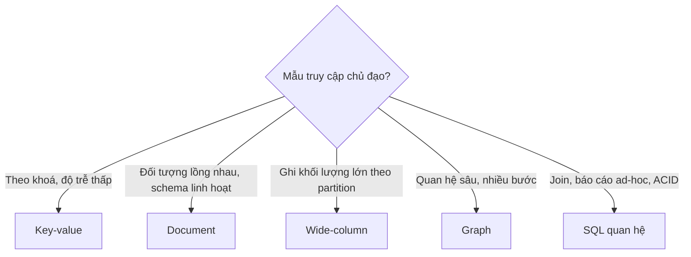

## 1. Core Concept

NoSQL gồm bốn họ chính — **key-value**, **document**, **wide-column** và **graph** — mỗi họ **tối ưu một mẫu truy cập** và đổi lại bằng **linh hoạt truy vấn** (ít join, ít ràng buộc). Nguyên tắc thiết kế đảo ngược so với SQL: **SQL bắt đầu từ dữ liệu (chuẩn hoá) rồi truy vấn tuỳ ý; NoSQL bắt đầu từ danh sách truy vấn (access pattern) rồi thiết kế dữ liệu (denormalize) để mỗi truy vấn chạm đúng một phân vùng**. Chọn NoSQL vì "hợp thời" mà không biết access pattern là sai lầm phổ biến.

**Mental model:** SQL như **kho dữ liệu có hệ thống ngăn kéo chuẩn hoá**, tìm theo bất kỳ cách nào nhưng phải đi qua nhiều ngăn. NoSQL như **in sẵn từng loại báo cáo theo đúng cách bạn sẽ đọc**: đọc cực nhanh nhưng nếu cần một kiểu báo cáo chưa in thì rất khó, và cập nhật phải sửa ở nhiều bản in.

## 2. How It Works

**Bốn mô hình**
- **Key-value** (Redis, DynamoDB): get/put theo khoá, độ trễ thấp, scale ngang. **Document** (MongoDB, Cosmos): JSON lồng nhau, schema linh hoạt, truy vấn theo trường. **Wide-column** (Cassandra, Bigtable): **partition key + clustering key**, ghi rất nhanh (LSM), truy vấn trong một partition. **Graph** (Neo4j, Neptune): đỉnh và cạnh, **duyệt quan hệ nhiều bước** hiệu quả.

**Thiết kế theo access pattern**
- Liệt kê truy vấn → thiết kế **khoá** → **denormalize/nhân bản** dữ liệu để mỗi truy vấn chỉ đọc **một partition/document**. **DynamoDB single-table design** đặt nhiều loại thực thể chung bảng với khoá phức hợp (`PK = CUSTOMER#42`, `SK = ORDER#2026-11-21`) để một `Query` lấy cả khách và đơn.

**Document: embed vs reference**
- **Embed** dữ liệu **hay đọc cùng nhau** (đơn hàng + các dòng) → một lần đọc; **reference** khi dữ liệu **lớn, dùng chung hoặc thay đổi độc lập**. Cẩn thận mảng **tăng vô hạn** trong document (giới hạn kích thước, ghi chậm).

**Nhất quán và scale**
- Đa số **eventual consistency**, chỉnh được bằng **quorum** (`R + W > N`, xem bài CAP). **Sharding theo partition key**; **hot partition** là rủi ro chính — chọn khoá **cardinality cao, phân phối đều**. **Giao dịch** thường giới hạn trong một partition/document.

**Wide-column: partition và clustering key**
- **Partition key** quyết định **node nào** giữ dữ liệu; **clustering key** sắp xếp **trong** partition và cho phép truy vấn khoảng trong partition. Truy vấn **không có partition key** là scatter-gather, rất đắt.

**Khi nào chọn**
- Mẫu truy cập **rõ ràng, theo khoá**, cần **scale ngang và độ trễ dự đoán được**; ngược lại cần **join, báo cáo ad-hoc, ràng buộc toàn vẹn, giao dịch nhiều thực thể** thì **SQL** tốt hơn.

```javascript
// MongoDB: embed dòng hàng trong đơn → một lần đọc
db.orders.insertOne({ _id: "o-1", customerId: 42,
  items: [{ sku: "A1", qty: 2 }, { sku: "B7", qty: 1 }], total: 250000 });
db.orders.find({ customerId: 42 }).sort({ _id: -1 }).limit(20);   // truy vấn theo access pattern
```

## 3. Visual Diagram



## 4. Rules of Thumb & Trade-offs

| Tình huống / Nhu cầu | Chọn gì |
| --- | --- |
| Truy cập theo khoá, scale lớn | Key-value / Wide-column |
| Đối tượng lồng nhau, schema thay đổi | Document |
| Quan hệ sâu (bạn của bạn bè, gian lận) | Graph |
| Join, báo cáo ad-hoc, ràng buộc toàn vẹn | SQL |
| Truy vấn khoảng trong một khoá | Wide-column (clustering key) |
| Chưa rõ mẫu truy cập | Bắt đầu với SQL |

- **Được gì:** scale ngang và độ trễ dự đoán được. **Mất gì:** truy vấn ad-hoc, join, ràng buộc và giao dịch bị giới hạn; denormalize nghĩa là **cập nhật nhiều nơi**.

## 5. Must Remember / Production Pitfalls

- **Cần join/báo cáo phức tạp mới nhận ra chọn sai → chọn NoSQL khi chưa biết access pattern → liệt kê truy vấn trước, cân nhắc SQL**.
- **Throttle dù tổng dung lượng còn dư → hot partition do khoá lệch → khoá cardinality cao, thêm hậu tố/tách khoá nóng**.
- **Document phình vượt giới hạn → embed mảng tăng vô hạn → tách thành collection riêng (reference)**.
- **Dữ liệu denormalize lệch nhau → cập nhật chỉ một nơi → chiến lược cập nhật đồng bộ (hoặc chấp nhận eventual) và CDC**.
- **"Không schema" nghĩa là không cần quản lý → ứng dụng vẫn phải quản lý phiên bản dữ liệu → schema versioning, validation ở tầng ứng dụng**.
- Interview trap: "khi nào chọn NoSQL?" → **mẫu truy cập rõ, cần scale ngang/độ trễ dự đoán được hơn là truy vấn linh hoạt**; "thiết kế NoSQL bắt đầu từ đâu?" → **từ danh sách truy vấn (access pattern)**; "partition key tốt?" → **cardinality cao, phân phối đều, có trong truy vấn**.

## 6. Search Hooks

- `document vs key-value vs wide-column vs graph` — bốn mô hình NoSQL.
- `DynamoDB single table design` — thiết kế theo access pattern.
- `Cassandra partition key clustering key` — mô hình wide-column.
- `MongoDB embed vs reference` — chọn cách mô hình tài liệu.
- `eventual consistency quorum` — nhất quán và quorum.
