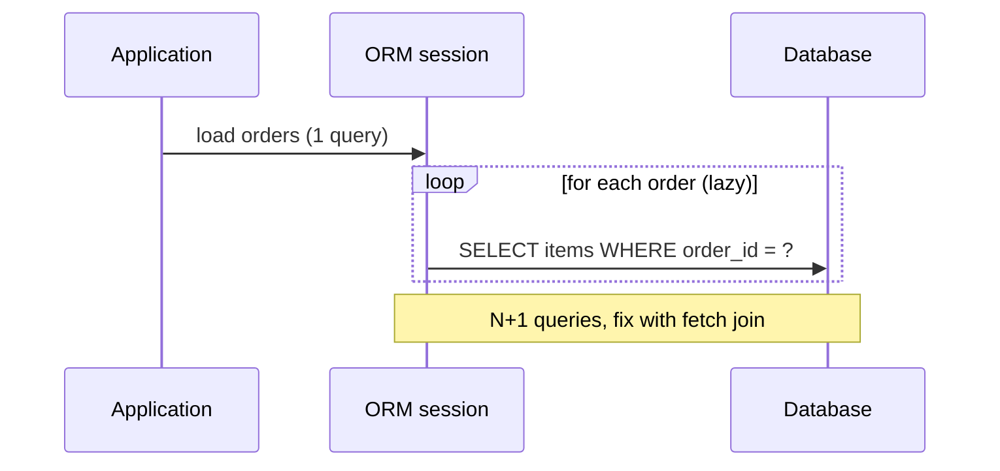

## 1. Core Concept

**ORM** (Hibernate/JPA, SQLAlchemy, Entity Framework, Prisma, ActiveRecord) ánh xạ bảng quan hệ sang đối tượng để viết code nhanh hơn. Nhưng nó **che giấu SQL thực sự được sinh ra**, nên bẫy hiệu năng và tính đúng đắn nằm ở những chỗ bạn không nhìn thấy: **N+1**, **lazy loading**, **ranh giới transaction**, **persistence context**. Mental model: *ORM là công cụ tiện lợi, không phải lý do để ngừng nghĩ về SQL — luôn biết câu lệnh nào đang chạy.*

## 2. How It Works

- **Unit of Work / persistence context**: ORM theo dõi các entity đã nạp, phát hiện thay đổi (**dirty checking**) và **flush** thành `INSERT/UPDATE` khi commit; một entity ở cùng context là cùng một đối tượng (**identity map**).
- **Lazy vs eager loading**: quan hệ lazy chỉ nạp khi truy cập (nhiều truy vấn nhỏ → **N+1**); eager nạp ngay (có thể kéo quá nhiều). Giải pháp: **fetch join / `JOIN FETCH` / `selectinload` / `include`**, hoặc **projection (DTO)** chỉ lấy cột cần.
- **Transaction boundary**: đặt ở **tầng use case/service**, không phải mỗi lần gọi repository; một request = một transaction ngắn.
- **Optimistic locking**: cột `@Version`; cập nhật thất bại khi version đổi → chống **lost update**.
- **Batch**: **batch insert/update** (`saveAll`, `bulk_create`, `executeBatch`) thay vì từng dòng; với khối lớn dùng bulk/COPY.
- **Migration**: quản lý schema bằng công cụ có phiên bản (Flyway, Liquibase, Alembic), không để ORM tự `auto-update` trên production.
- **Khi nào bỏ ORM**: báo cáo phức tạp, bulk lớn, truy vấn tối ưu tay → SQL thuần/query builder (jOOQ, SQLAlchemy Core).

## 3. Visual Diagram

## 4. Rules of Thumb & Trade-offs

- **Bật log SQL ở dev/test** và đặt **ngưỡng cảnh báo số query mỗi request**; viết test khẳng định số truy vấn.
- Đọc: **projection/DTO + join có chủ đích**; ghi: **aggregate qua repository** trong transaction.
- Dùng **ORM cho CRUD**, **SQL thuần cho báo cáo/bulk**.
- Trade-off: **năng suất lập trình** vs **kiểm soát và hiệu năng** (ORM tiện nhưng dễ sinh truy vấn kém).

## 5. Must Remember / Production Pitfalls

- **N+1** là lỗi ORM số một; xuất hiện khi dữ liệu lớn lên, không lộ ở dev với 5 bản ghi.
- **`LazyInitializationException`/truy cập lazy ngoài session** → thiết kế DTO rõ ràng thay vì mở session rộng khắp ("open session in view") che lấp N+1.
- **Transaction quá rộng** (bao cả gọi HTTP ngoài) giữ kết nối DB lâu → cạn pool.
- **Nạp cả bảng vào bộ nhớ** để lọc ở ứng dụng thay vì lọc ở SQL.
- **`auto-ddl`/tự cập nhật schema** trên production gây mất dữ liệu; dùng migration có review.
- **Mã sinh bởi AI** hay quên `JOIN FETCH` và lặp truy vấn trong vòng lặp; luôn đếm số query.
- Interview trap: "ORM có chậm không?" → ORM **không chậm tự thân**; chậm do **cách dùng** (N+1, nạp thừa, transaction dài).

## 6. Search Hooks

- `N+1 select problem lazy loading` — bẫy hiệu năng phổ biến nhất của ORM.
- `JPA fetch join entity graph` — nạp quan hệ có chủ đích.
- `DTO projection vs entity` — chỉ lấy cột cần cho truy vấn đọc.
- `Unit of Work identity map dirty checking` — cách ORM theo dõi thay đổi.
- `optimistic locking @Version` — chống lost update ở tầng ORM.
- `Flyway Liquibase database migrations` — quản lý thay đổi schema có phiên bản.
