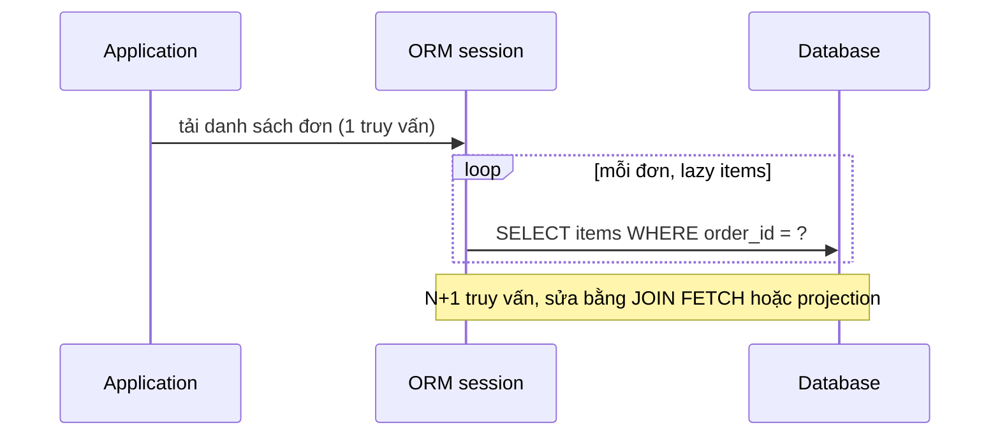

## 1. Core Concept

**ORM** (Hibernate/JPA, SQLAlchemy, Entity Framework, Prisma, ActiveRecord) ánh xạ bảng quan hệ sang đối tượng để viết code nhanh hơn. Cái giá là nó **che giấu câu SQL thực sự được sinh ra**, nên các lỗi hiệu năng và tính đúng đắn nằm ở chỗ bạn **không nhìn thấy**: **N+1**, **lazy loading**, **ranh giới transaction**, **persistence context**. ORM không chậm tự thân — nó chậm khi bị dùng như thể SQL không tồn tại.

**Mental model:** ORM như **người phiên dịch**: tiện, nhưng nếu bạn nói "đưa tôi từng cuốn sách của mỗi tác giả" nó sẽ **chạy ra thư viện 101 lần** thay vì một lần. Bạn không cần bỏ người phiên dịch, chỉ cần **luôn biết nó đã nói gì** (bật log SQL) và biết lúc nào nên tự nói tiếng gốc (SQL thuần).

## 2. How It Works

**Unit of Work / persistence context → ORM theo dõi thay đổi**
- ORM giữ các entity đã nạp trong **persistence context** (**identity map**: cùng id → cùng một object), phát hiện thay đổi bằng **dirty checking** và **flush** thành `INSERT/UPDATE` khi commit hoặc **trước một truy vấn** (flush mode). Hệ quả: sửa object là **tự ghi DB** ở thời điểm bạn không để ý.

**Lazy vs eager loading → Nguồn của N+1**
- **Lazy**: quan hệ chỉ nạp khi truy cập → một truy vấn lấy danh sách rồi **N truy vấn** cho từng phần tử (**N+1**; 100 đơn = **101 truy vấn**, mỗi cái thêm ~1 ms RTT). **Eager** nạp ngay nhưng có thể kéo quá nhiều dữ liệu. Giải pháp có chủ đích: **`JOIN FETCH`/entity graph** (JPA), **`selectinload`/`joinedload`** (SQLAlchemy), **`include`** (Prisma/EF), hoặc **projection**.

**Projection/DTO → Chỉ lấy cột cần**
- Với truy vấn **đọc**, đừng nạp cả đồ thị entity: dùng **DTO/projection** lấy vài cột, giảm bộ nhớ và dữ liệu truyền, tránh dirty checking thừa.

**Ranh giới transaction → Ngắn và đúng chỗ**
- Đặt transaction ở **tầng use case/service**, một request = một transaction **ngắn**. **Không** bao cả lời gọi HTTP bên ngoài trong transaction (giữ kết nối DB lâu → **cạn connection pool**).

**Optimistic locking**
- Cột **`@Version`**: `UPDATE ... WHERE id = ? AND version = ?`; nếu 0 hàng bị ảnh hưởng thì ném lỗi → **chống lost update** mà không giữ khoá.

**Ghi hàng loạt**
- **Batch insert/update** (`saveAll` với `hibernate.jdbc.batch_size`, `bulk_create`, `executeBatch`) thay vì từng dòng; khối rất lớn dùng **bulk/COPY**. Cẩn thận: chiến lược sinh khoá `IDENTITY` có thể **tắt batch** trong Hibernate.

**Migration**
- Quản lý schema bằng công cụ có **phiên bản** (**Flyway, Liquibase, Alembic**); **không** để ORM tự `auto-ddl/update` schema trên production.

**Khi nào bỏ ORM**
- Báo cáo phức tạp, bulk lớn, truy vấn tối ưu tay → **SQL thuần/query builder** (jOOQ, SQLAlchemy Core) — dùng ORM cho CRUD, SQL cho phần còn lại.

```java
// N+1: 1 truy vấn đơn + N truy vấn items
List<Order> orders = repo.findAll();
orders.forEach(o -> o.getItems().size());                 // lazy → N truy vấn

// Sửa: nạp quan hệ có chủ đích
@Query("select o from Order o join fetch o.items where o.customerId = :c")
List<Order> findWithItems(@Param("c") long customerId);
```

## 3. Visual Diagram



## 4. Rules of Thumb & Trade-offs

| Tình huống / Nhu cầu | Chọn gì |
| --- | --- |
| CRUD thông thường | ORM |
| Danh sách kèm quan hệ | `JOIN FETCH` / selectinload / include |
| Truy vấn đọc chỉ cần vài cột | DTO/projection |
| Báo cáo, bulk lớn | SQL thuần / query builder |
| Chống lost update | `@Version` (optimistic locking) |
| Ghi nhiều dòng | Batch insert/update, COPY |
| Thay đổi schema production | Flyway/Liquibase/Alembic |

- **Được gì:** năng suất lập trình cao. **Mất gì:** kiểm soát SQL và hiệu năng thấp hơn; dễ sinh truy vấn kém nếu không giám sát.

## 5. Must Remember / Production Pitfalls

- **Trang chậm khi dữ liệu lớn lên → N+1 không lộ với 5 bản ghi ở dev → bật log SQL, test khẳng định số truy vấn mỗi request, JOIN FETCH/projection**.
- **`LazyInitializationException` rồi "sửa" bằng mở session xuyên suốt (open-session-in-view) → che giấu N+1 → thiết kế DTO rõ ràng, nạp có chủ đích trong service**.
- **Cạn connection pool → transaction bao cả lời gọi HTTP/xử lý chậm → transaction chỉ chứa thao tác DB**.
- **Nạp cả bảng vào bộ nhớ để lọc ở ứng dụng → OOM/chậm → lọc ở SQL, phân trang keyset**.
- **Thứ tự INSERT/UPDATE khác dự kiến hoặc ghi bất ngờ → flush tự động → hiểu flush mode, tránh sửa entity không cần**.
- **Mất dữ liệu khi deploy → `auto-ddl` thay đổi schema production → migration có phiên bản và review**.
- **Mã sinh bởi AI hay lặp truy vấn trong vòng lặp và quên JOIN FETCH → luôn đếm số query**.
- Interview trap: "ORM có chậm không?" → **không tự thân; chậm do N+1, nạp thừa, transaction dài**; "N+1 là gì?" → **1 truy vấn danh sách + N truy vấn con do lazy loading**; "khi nào bỏ ORM?" → **báo cáo/bulk phức tạp, cần SQL tối ưu tay**.

## 6. Search Hooks

- `N+1 select problem lazy loading` — bẫy hiệu năng phổ biến nhất của ORM.
- `JPA fetch join entity graph` — nạp quan hệ có chủ đích.
- `DTO projection vs entity` — chỉ lấy cột cần cho truy vấn đọc.
- `Unit of Work identity map dirty checking` — cách ORM theo dõi thay đổi.
- `optimistic locking @Version` — chống lost update ở tầng ORM.
- `Flyway Liquibase database migrations` — quản lý thay đổi schema có phiên bản.
