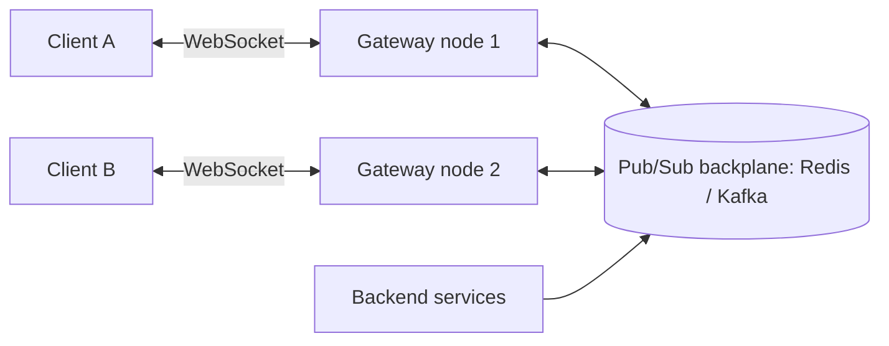

## 1. Core Concept

HTTP chuẩn là **client hỏi, server trả lời**. Với dữ liệu thời gian thực (chat, giá cổ phiếu, thông báo, cộng tác), server cần **chủ động đẩy** xuống client. Ba cách chính: **polling/long polling**, **Server-Sent Events (SSE)** (một chiều server → client qua HTTP) và **WebSocket** (hai chiều, kết nối bền). Mental model: *càng cần "thời gian thực + hai chiều", bạn càng phải trả bằng kết nối bền, trạng thái trên server và độ phức tạp khi scale.*

## 2. How It Works

- **Short polling**: client gọi lặp lại mỗi N giây — đơn giản nhưng tốn request và có độ trễ ≤ N.
- **Long polling**: server **giữ request mở** đến khi có dữ liệu hoặc timeout rồi client gọi lại — độ trễ thấp hơn, dùng được qua mọi proxy, vẫn tốn kết nối.
- **SSE**: một request HTTP dài, server stream sự kiện dạng `text/event-stream`; trình duyệt tự **reconnect** và gửi `Last-Event-ID`; **một chiều**, chạy trên HTTP thường (qua proxy/CDN dễ, hợp HTTP/2).
- **WebSocket**: nâng cấp kết nối HTTP (`Upgrade: websocket`) thành kênh **hai chiều full-duplex**; độ trễ thấp, overhead nhỏ mỗi tin nhắn; cần **heartbeat (ping/pong)**, tự quản lý **reconnect** và **nhận lại tin nhỡ**.
- **Scale ngang**: kết nối bền gắn với **một node**; để gửi tin tới người dùng bất kỳ cần **pub/sub backplane** (Redis Pub/Sub, Kafka, NATS) hoặc **registry** `user → node`; load balancer cần hỗ trợ **WebSocket** và **sticky/L7**.
- **Giới hạn**: mỗi kết nối tốn file descriptor và bộ nhớ (hàng chục nghìn kết nối/node với mô hình I/O async); chống **thundering herd** khi nhiều client reconnect cùng lúc.

## 3. Visual Diagram

## 4. Rules of Thumb & Trade-offs

| Nhu cầu | Chọn |
| --- | --- |
| Server đẩy cập nhật một chiều (thông báo, feed, tiến độ) | **SSE** |
| Hai chiều độ trễ thấp (chat, game, cộng tác) | **WebSocket** |
| Cập nhật hiếm, đơn giản, tương thích tối đa | **Polling / long polling** |

- Bắt đầu với thứ **đơn giản nhất đủ dùng** (SSE hoặc polling) trước khi dùng WebSocket.
- **Ứng dụng phải chịu được mất kết nối**: reconnect với backoff + jitter, và đồng bộ lại trạng thái (theo cursor/sequence).
- Trade-off: **độ trễ thấp và hai chiều** vs **trạng thái kết nối, scale và vận hành phức tạp**.

## 5. Must Remember / Production Pitfalls

- **Proxy/LB timeout** cắt kết nối rảnh (thường 60 giây) → gửi **heartbeat** định kỳ.
- **Reconnect storm**: sau deploy/sự cố, cả triệu client kết nối lại cùng lúc làm sập server → jitter + giới hạn tốc độ chấp nhận kết nối.
- **Mất tin nhắn khi reconnect** nếu không có cơ chế **sequence number/ack/replay**; WebSocket **không đảm bảo giao nhận** qua các lần kết nối.
- **Gửi mọi sự kiện cho mọi client**: lọc theo đăng ký (topic/room) ở server.
- **Backpressure**: client chậm làm hàng đợi gửi phình bộ nhớ → giới hạn và ngắt client chậm.
- **Kiểm tra quyền chỉ lúc bắt tay**, không kiểm tra theo kênh → rò rỉ dữ liệu giữa người dùng.
- Interview trap: "SSE hay WebSocket?" → **SSE** cho đẩy một chiều (rẻ, tự reconnect), **WebSocket** khi thực sự cần hai chiều.

## 6. Search Hooks

- `WebSocket vs Server-Sent Events` — chọn giữa kênh hai chiều và đẩy một chiều.
- `long polling vs short polling` — hai cách "giả" thời gian thực qua HTTP.
- `WebSocket scaling pub/sub backplane` — scale kết nối bền qua nhiều node.
- `WebSocket heartbeat reconnect backoff` — giữ và khôi phục kết nối bền.
- `reconnect storm thundering herd` — kết nối lại ồ ạt gây quá tải.
- `gRPC streaming WebTransport` — các lựa chọn streaming khác.
