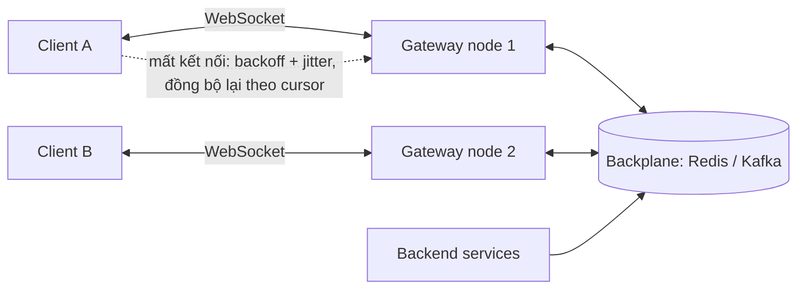

## 1. Core Concept

HTTP chuẩn là **client hỏi, server trả lời**. Với dữ liệu thời gian thực (chat, giá cổ phiếu, thông báo, cộng tác), server cần **chủ động đẩy** dữ liệu xuống client. Có bốn cách: **short polling**, **long polling**, **Server-Sent Events (SSE)** (một chiều, qua HTTP) và **WebSocket** (hai chiều, kết nối bền). Càng cần "thời gian thực + hai chiều", bạn càng phải trả bằng **kết nối bền, trạng thái ở server và độ phức tạp khi scale**.

**Mental model:** polling là **gọi điện hỏi liên tục "có tin mới chưa?"**; long polling là **gọi và giữ máy chờ đến khi có tin**; SSE là **đài phát thanh một chiều** (bạn nghe, không nói lại); WebSocket là **đường dây điện thoại mở suốt** hai bên cùng nói — tiện nhưng **giữ máy tốn tài nguyên** và nếu mất tín hiệu thì phải gọi lại và **hỏi xem mình lỡ những gì**.

## 2. How It Works

**Bốn kỹ thuật**
- **Short polling**: client gọi lặp lại mỗi N giây — đơn giản, tốn request, độ trễ tới N giây. **Long polling**: server **giữ request mở** đến khi có dữ liệu hoặc timeout rồi client gọi lại — độ trễ thấp hơn, chạy qua mọi proxy, vẫn tốn kết nối.
- **SSE**: một request HTTP dài, server stream `text/event-stream`; trình duyệt **tự reconnect** và gửi **`Last-Event-ID`** để tiếp tục; **một chiều** server → client; chạy trên HTTP thường (proxy/CDN dễ, hợp HTTP/2).
- **WebSocket**: nâng cấp HTTP (`Upgrade: websocket`) thành kênh **hai chiều full-duplex**, overhead nhỏ mỗi tin nhắn; **bạn tự lo** heartbeat, reconnect và nhận lại tin nhỡ.

**Scale ngang → Backplane**
- Kết nối bền **gắn với một node**. Để gửi tin tới người dùng đang nối vào **node khác**, dùng **pub/sub backplane** (Redis Pub/Sub, Kafka, NATS) hoặc **registry user → node**; load balancer phải hỗ trợ WebSocket (L7, timeout phù hợp).

**Heartbeat và reconnect**
- Proxy/LB cắt kết nối **rảnh** (thường ~60 giây) → gửi **ping/pong** định kỳ. Mất kết nối → **reconnect với exponential backoff + jitter**, rồi **đồng bộ lại trạng thái** bằng **cursor/sequence number** (WebSocket **không bảo đảm giao nhận qua nhiều kết nối**).

**Reconnect storm**
- Sau deploy/sự cố, **hàng triệu client kết nối lại cùng lúc** làm sập server vừa hồi phục → **jitter** phía client, **giới hạn tốc độ chấp nhận kết nối**, **drain dần** khi deploy.

**Backpressure và giới hạn**
- Client chậm làm hàng đợi gửi phình bộ nhớ → **giới hạn hàng đợi, ngắt client chậm**. Mỗi kết nối tốn **file descriptor và bộ nhớ** (hàng chục nghìn kết nối/node với mô hình I/O async).

**Bảo mật**
- Xác thực khi bắt tay (token ngắn hạn), kiểm tra **`Origin`**, rate limit tin nhắn, **kiểm tra quyền theo từng kênh/phòng** (không chỉ lúc bắt tay).

**Lựa chọn khác**
- **gRPC streaming**, **WebTransport**, và **push notification** cho mobile khi app không chạy.

```javascript
// SSE phía client: tự reconnect, tiếp tục từ Last-Event-ID
const es = new EventSource("/stream/notifications");
es.onmessage = (e) => render(JSON.parse(e.data));
// WebSocket cần tự làm reconnect + heartbeat
```

## 3. Visual Diagram



## 4. Rules of Thumb & Trade-offs

| Tình huống / Nhu cầu | Chọn gì |
| --- | --- |
| Server đẩy cập nhật một chiều (thông báo, feed, tiến độ) | SSE |
| Hai chiều độ trễ thấp (chat, game, cộng tác) | WebSocket |
| Cập nhật hiếm, tương thích tối đa | Polling / long polling |
| Gửi tin qua nhiều node | Pub/sub backplane |
| Mobile khi app đóng | Push notification |
| Streaming giữa service | gRPC streaming |

- **Được gì:** độ trễ thấp, đẩy chủ động. **Mất gì:** kết nối bền, trạng thái ở server, scale và vận hành phức tạp; **bắt đầu bằng thứ đơn giản nhất đủ dùng** (SSE hoặc polling) trước khi dùng WebSocket.

## 5. Must Remember / Production Pitfalls

- **Kết nối rảnh bị đứt sau ~60 giây → proxy/LB timeout → heartbeat ping/pong**.
- **Sau deploy cả triệu client kết nối lại làm sập server → reconnect storm → jitter, giới hạn tốc độ chấp nhận, drain dần**.
- **Mất tin khi reconnect → không có sequence/ack/replay → số thứ tự/cursor và đồng bộ lại sau khi nối**.
- **Gửi mọi sự kiện cho mọi client → lãng phí băng thông → đăng ký theo topic/room, lọc ở server**.
- **Hàng đợi gửi phình khi client chậm → thiếu backpressure → giới hạn hàng đợi, ngắt client chậm**.
- **Kiểm tra quyền chỉ lúc bắt tay → lộ dữ liệu giữa người dùng → kiểm tra quyền theo từng kênh/phòng**.
- Interview trap: "SSE hay WebSocket?" → **SSE cho đẩy một chiều (rẻ, tự reconnect), WebSocket khi thật sự cần hai chiều**; "scale WebSocket nhiều node?" → **pub/sub backplane**; "reconnect storm?" → **client kết nối lại đồng loạt, chống bằng jitter và giới hạn chấp nhận**.

## 6. Search Hooks

- `WebSocket vs Server-Sent Events` — chọn giữa kênh hai chiều và đẩy một chiều.
- `long polling vs short polling` — hai cách giả thời gian thực qua HTTP.
- `WebSocket scaling pub/sub backplane` — scale kết nối bền qua nhiều node.
- `WebSocket heartbeat reconnect backoff` — giữ và khôi phục kết nối bền.
- `reconnect storm thundering herd` — kết nối lại ồ ạt gây quá tải.
- `gRPC streaming WebTransport` — các lựa chọn streaming khác.
