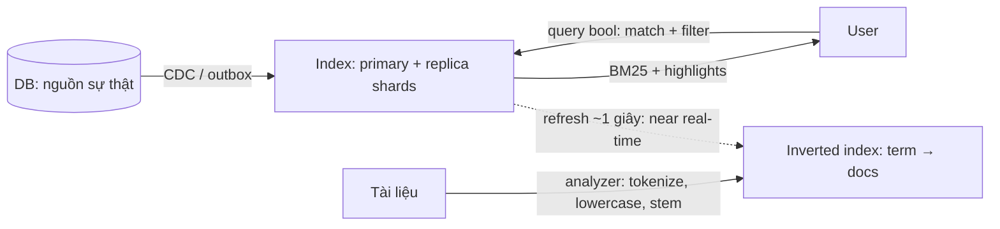

## 1. Core Concept

**Elasticsearch/OpenSearch** là search engine phân tán dựa trên **inverted index (chỉ mục ngược)**: **tìm văn bản theo từ khoá, xếp hạng theo độ liên quan, lọc và tổng hợp** rất nhanh trên hàng trăm triệu tài liệu. Nó dùng cho **tìm kiếm văn bản, log và phân tích** — **không phải** cơ sở dữ liệu giao dịch chính. Hiểu analyzer, shard và "near real-time" giúp bạn tránh các lỗi phổ biến (mapping, shard, đồng bộ dữ liệu).

**Mental model:** inverted index như **mục lục cuối sách** nhưng theo từ: với mỗi **từ**, ghi **danh sách trang (tài liệu)** có từ đó. Tìm "redis cache" = lấy hai danh sách rồi giao nhau và chấm điểm, thay vì đọc từng trang. Chỉ mục này là **bản dẫn xuất** từ cuốn sách gốc (DB) và có thể **lệch** nếu bạn không đồng bộ cẩn thận.

## 2. How It Works

**Inverted index và analyzer**
- Văn bản đi qua **analyzer**: **tokenizer** (tách từ) + **filter** (lowercase, stemming `running → run`, bỏ stop word) thành các **term**; mỗi term trỏ tới danh sách **document**. **Cùng analyzer** phải áp cho cả lúc lập chỉ mục và lúc tìm.

**Index, shard, replica**
- **Index** chia thành **primary shard** (phân tán qua node) mỗi cái có **replica** (chịu lỗi + scale đọc). Ghi vào **segment bất biến**; **refresh (~1 giây)** mới làm tài liệu **tìm thấy được** → **near real-time**, không phải real-time tức thì. **Số primary shard không đổi được** sau khi tạo (phải **reindex/split**).

**Truy vấn**
- **`match`** (full-text, có phân tích, có điểm), **`term`** (khớp nguyên văn, dùng cho trường `keyword`), **`bool`** (`must`/`should`/`filter`/`must_not`), **`range`**. Điều kiện trong **`filter`** **không tính điểm** và được **cache** → rẻ hơn `must`.

**Xếp hạng → BM25**
- **BM25** (cải tiến của TF-IDF): từ **hiếm** quan trọng hơn, tần suất từ trong tài liệu có **bão hoà**, tài liệu **dài** bị chuẩn hoá. Tăng trọng số trường bằng `boost` (title > body).

**Mapping → `text` vs `keyword`**
- **`text`**: được phân tích, để tìm full-text. **`keyword`**: nguyên văn, để **lọc, sắp xếp, tổng hợp**. Khai báo mapping **tường minh** thay vì **dynamic mapping** (tránh **mapping explosion** khi có hàng nghìn trường lạ).

**Aggregations, vector và vận hành**
- **Aggregations** (nhóm, thống kê, histogram) cho facet/dashboards. **Hybrid search**: **kNN vector + BM25**. Log/time-series dùng **index theo thời gian + ILM** (hot–warm–cold–delete) và snapshot.

**Đồng bộ với DB nguồn**
- **DB là nguồn sự thật**; ES là **chỉ mục dẫn xuất**, đồng bộ qua **CDC/outbox** hoặc job reindex, có cơ chế **đối soát**.

```json
GET /products/_search
{ "query": { "bool": {
    "must":   [ { "match": { "title": "bàn phím cơ" } } ],
    "filter": [ { "term": { "in_stock": true } }, { "range": { "price": { "lte": 2000000 } } } ] } },
  "sort": [ "_score", { "price": "asc" } ] }
```

## 3. Visual Diagram



## 4. Rules of Thumb & Trade-offs

| Tình huống / Nhu cầu | Chọn gì |
| --- | --- |
| Tìm kiếm full-text, xếp hạng theo liên quan | Elasticsearch/OpenSearch |
| Truy vấn khớp chính xác theo ID/enum | SQL/DB hoặc trường `keyword` + `filter` |
| Điều kiện không cần chấm điểm | `filter` (được cache) |
| Phân trang sâu | `search_after` (không dùng `from` lớn) |
| Log theo thời gian | Index theo ngày + ILM |
| Tìm ngữ nghĩa + từ khoá | Hybrid (kNN + BM25) |

- **Được gì:** tìm kiếm mạnh, gần real-time, aggregation nhanh. **Mất gì:** tốn tài nguyên, **nhất quán cuối cùng** với DB, phải vận hành shard/mapping; không thay thế DB giao dịch.

## 5. Must Remember / Production Pitfalls

- **Vừa ghi xong chưa tìm thấy → near real-time, chưa refresh → chấp nhận độ trễ ~1 giây hoặc `refresh=wait_for` cho trường hợp cần**.
- **Cluster chậm, quá tải bộ nhớ → quá nhiều shard nhỏ → thiết kế số shard theo kích cỡ (hàng chục GB mỗi shard), gộp index**.
- **Cần đổi số primary shard mới biết không đổi được → reindex/split tốn kém → ước lượng kích thước từ đầu**.
- **Bùng nổ số trường (mapping explosion) → dynamic mapping không kiểm soát → mapping tường minh, giới hạn số trường**.
- **Dùng ES làm DB chính → mất dữ liệu/không giao dịch → DB là nguồn sự thật, ES là chỉ mục dẫn xuất kèm đối soát**.
- **Phân trang sâu với `from + size` lớn → tốn bộ nhớ/CPU → `search_after`**.
- Interview trap: "vì sao ghi xong chưa tìm thấy?" → **chưa refresh (near real-time)**; "`text` vs `keyword`?" → **text để full-text (phân tích), keyword để lọc/sắp xếp/aggregation**; "ES có thay DB không?" → **không, là chỉ mục dẫn xuất**.

## 6. Search Hooks

- `inverted index analyzer` — cơ chế của search engine.
- `Elasticsearch BM25 relevance` — xếp hạng theo độ liên quan.
- `Elasticsearch shards replicas sizing` — thiết kế shard.
- `Elasticsearch search_after deep pagination` — phân trang sâu.
- `Elasticsearch mapping text vs keyword` — kiểu trường.
