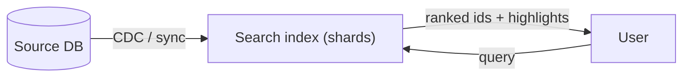

## 1. Core Concept

**Elasticsearch/OpenSearch** là search engine phân tán dựa trên **inverted index**: tìm theo từ khoá, xếp hạng theo độ liên quan, lọc và tổng hợp rất nhanh. Dùng cho tìm kiếm văn bản, log và analytics; **không phải** database giao dịch chính. Mental model: *như mục lục cuối sách — từ → danh sách tài liệu chứa từ đó.*

## 2. How It Works

- **Inverted index**: văn bản qua **analyzer** (tokenizer + filter như lowercase, stemming, stop words) thành term; mỗi term trỏ tới các document.
- **Cấu trúc**: **index** chia thành **shard** (primary + replica) phân bổ trên node; ghi vào segment bất biến, **refresh** (~1 giây) mới tìm thấy (near real-time).
- **Query**: `match` (full-text, có phân tích), `term` (khớp chính xác, trường keyword), `bool` (must/should/filter), `range`; **filter** không tính điểm và được cache.
- **Xếp hạng**: **BM25** (TF-IDF cải tiến); tăng trọng số trường (`boost`).
- **Aggregations**: nhóm/thống kê (facet, histogram).
- **Mapping**: `text` (phân tích) vs `keyword` (nguyên văn, sort/aggregate); khai báo rõ thay vì dynamic mapping.
- **Vector/hybrid search**: kNN kết hợp BM25.
- **Vận hành**: ILM (vòng đời index theo thời gian cho log), snapshot.

## 3. Visual Diagram

## 4. Rules of Thumb & Trade-offs

- Giữ **DB là nguồn sự thật**, ES là chỉ mục dẫn xuất (đồng bộ qua CDC/outbox).
- Dùng `filter` cho điều kiện không cần xếp hạng.
- Trade-off: **tìm kiếm mạnh, gần real-time** vs **tốn tài nguyên, nhất quán cuối cùng, vận hành shard**.

## 5. Must Remember / Production Pitfalls

- **Quá nhiều shard nhỏ** làm cluster chậm; số shard primary **không đổi được** sau khi tạo (cần reindex/split).
- **Mapping explosion** do dynamic field không kiểm soát.
- Dùng ES làm DB chính → mất dữ liệu/không giao dịch.
- Deep pagination (`from+size` lớn) tốn tài nguyên; dùng `search_after`.
- Đồng bộ DB → ES lệch khi lỗi; cần cơ chế đối soát.
- Interview trap: "Vì sao mới ghi chưa tìm thấy?" → chưa **refresh**, near real-time.

## 6. Search Hooks

- `inverted index analyzer` — cơ chế của search engine.
- `Elasticsearch BM25 relevance` — xếp hạng theo độ liên quan.
- `Elasticsearch shards replicas sizing` — thiết kế shard.
- `Elasticsearch search_after deep pagination` — phân trang sâu.
- `Elasticsearch mapping text vs keyword` — kiểu trường.
