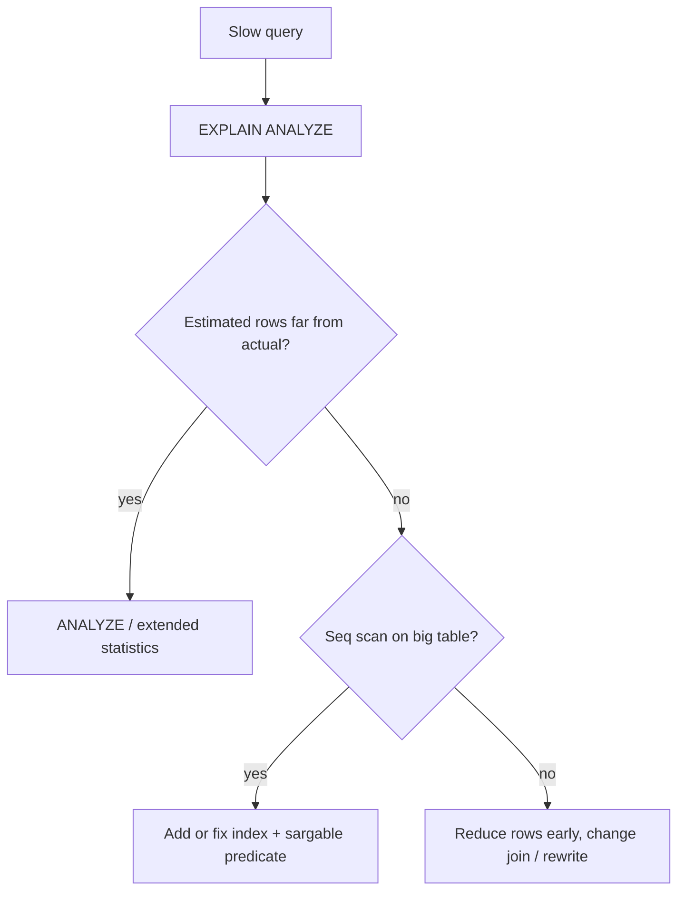

## 1. Core Concept

SQL là ngôn ngữ **khai báo**: bạn nói **cần gì**, **query planner** quyết định **làm thế nào** (thứ tự join, dùng index nào). Tối ưu nâng cao là hiểu cách planner suy nghĩ để viết truy vấn **cho phép nó chọn kế hoạch tốt**, và nhận ra khi nào nó chọn sai. Mental model: *planner dựa vào **thống kê** và **chi phí ước lượng** — nếu ước lượng số hàng sai, kế hoạch sai, và truy vấn chậm hàng nghìn lần.*

## 2. How It Works

- **Đọc kế hoạch**: `EXPLAIN (ANALYZE, BUFFERS)` so sánh **số hàng ước lượng vs thực tế**; lệch lớn = **thống kê cũ** (`ANALYZE`) hoặc cột tương quan.
- **Quét**: **Seq Scan** (toàn bảng), **Index Scan**, **Index-Only Scan** (index chứa đủ cột), **Bitmap Scan**. Index không luôn thắng seq scan khi truy vấn lấy **phần lớn hàng**.
- **Thuật toán join**: **Nested Loop** (hợp ít hàng bên ngoài + index bên trong), **Hash Join** (bảng lớn, điều kiện `=`), **Merge Join** (hai bên đã sắp xếp). Thứ tự join quyết định lượng dữ liệu trung gian.
- **Sargable predicate**: điều kiện mà index dùng được — `WHERE created_at >= '2026-01-01'`; **không sargable**: `WHERE date(created_at) = ...`, `WHERE lower(email) = ...` (cần functional index), `LIKE '%x'`, ép kiểu ngầm.
- **Phân trang**: **keyset** (`WHERE (created_at, id) < (:c, :i) ORDER BY created_at DESC, id DESC LIMIT 20`) thay cho `OFFSET` lớn.
- **Window function** (`ROW_NUMBER`, `LAG`, `SUM() OVER`) thay cho self-join/subquery tương quan để tính top-N-theo-nhóm, running total.
- **Giảm dữ liệu sớm**: lọc trước khi join, chỉ chọn cột cần (tránh `SELECT *`), `EXISTS` thay `IN` với tập lớn tương quan.

```sql
-- Top-3 đơn mới nhất mỗi khách: window function thay vì N truy vấn
SELECT * FROM (
  SELECT o.*, ROW_NUMBER() OVER (PARTITION BY customer_id ORDER BY created_at DESC) rn
  FROM orders o WHERE created_at >= now() - interval '30 days'
) t WHERE rn <= 3;
```

## 3. Visual Diagram



## 4. Rules of Thumb & Trade-offs

- **Đo, đừng đoán**: luôn xem kế hoạch thật trên dữ liệu có kích cỡ production.
- **Index phục vụ truy vấn thực sự chạy**; mỗi index làm chậm ghi — gỡ index không dùng.
- **Denormalize hoặc materialized view** khi một truy vấn đọc tổng hợp đắt chạy rất thường xuyên.
- Trade-off: **truy vấn nhanh** (index, denormalize) vs **chi phí ghi, dung lượng và độ phức tạp đồng bộ**.

## 5. Must Remember / Production Pitfalls

- **Hàm bọc cột** trong `WHERE` làm mất index; viết lại thành khoảng so sánh trên cột gốc.
- **`OFFSET` lớn** quét và bỏ hàng nghìn dòng; kết quả cũng lệch khi dữ liệu thay đổi.
- **`NOT IN` với NULL** cho kết quả rỗng bất ngờ; dùng `NOT EXISTS`.
- **N+1 từ ORM** và **`SELECT *`** đọc cột lớn không cần.
- **Kế hoạch tốt hôm qua, tệ hôm nay**: tham số khác (parameter sniffing), thống kê đổi, dữ liệu lệch — theo dõi truy vấn chậm bằng `pg_stat_statements`/slow log.
- **Join trên cột khác kiểu** ép chuyển kiểu và bỏ index.
- Interview trap: "Có index mà truy vấn vẫn seq scan, vì sao?" → **selectivity thấp**, hàm bọc cột, thống kê cũ, hoặc kiểu dữ liệu không khớp.

## 6. Search Hooks

- `EXPLAIN ANALYZE reading query plans` — đọc kế hoạch thực thi và so sánh ước lượng với thực tế.
- `nested loop vs hash join vs merge join` — ba thuật toán join và khi nào dùng.
- `sargable queries` — điều kiện cho phép dùng index.
- `keyset pagination vs OFFSET` — phân trang nhanh và ổn định.
- `window functions ROW_NUMBER LAG` — tính toán theo nhóm không cần self-join.
- `pg_stat_statements slow query log` — tìm truy vấn tốn nhiều thời gian nhất.
