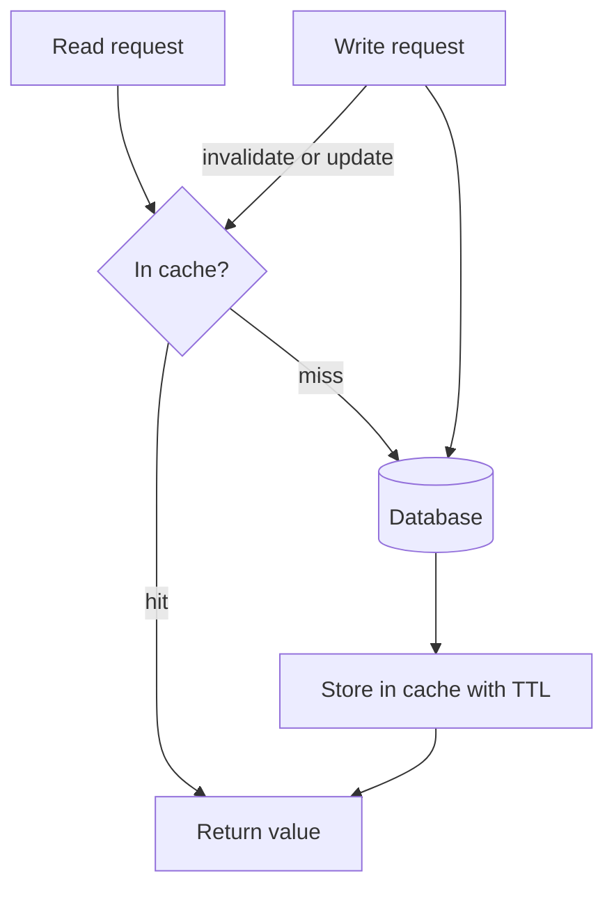

## 1. Core Concept

**Cache** lưu bản sao dữ liệu đắt-để-lấy ở nơi nhanh hơn (RAM, gần người dùng) để giảm **latency** và tải backend. Bài toán thật sự không phải "lưu" mà là **khi nào dữ liệu trong cache còn đúng** — hay **cache invalidation**. Mental model: *cache là một **lời đánh cược** rằng dữ liệu chưa đổi; bạn chọn mức rủi ro dữ liệu cũ đổi lấy tốc độ.*

## 2. How It Works

- **Các tầng cache**: browser → **CDN** → API gateway → **application cache** (local như Caffeine, hoặc phân tán như **Redis/Memcached**) → buffer pool của DB.
- **Chiến lược đọc/ghi**:
  - **Cache-aside (lazy loading)**: app đọc cache → miss thì đọc DB rồi ghi vào cache. Phổ biến nhất, app kiểm soát.
  - **Read-through**: cache tự nạp từ DB khi miss.
  - **Write-through**: ghi đồng thời cache và DB → nhất quán hơn, ghi chậm hơn.
  - **Write-behind (write-back)**: ghi cache trước, DB ghi bất đồng bộ → nhanh nhưng **có thể mất dữ liệu**.
  - **Refresh-ahead**: làm mới trước khi hết hạn cho key nóng.
- **Eviction** khi đầy: **LRU** (ít dùng gần đây nhất), **LFU** (ít dùng nhất), FIFO, **TTL** (hết hạn theo thời gian).
- **Invalidation**: theo **TTL**, **xoá/cập nhật tường minh** khi ghi, hoặc theo **sự kiện** (CDC) — phổ biến là kết hợp TTL làm lưới an toàn.
- **Chỉ số**: **hit ratio** (hit/(hit+miss)); thấp hơn ~80–90% thường cho thấy cache chưa đáng giá hoặc thiết kế key sai.

## 3. Visual Diagram

## 4. Rules of Thumb & Trade-offs

- Mặc định **cache-aside + TTL + xoá key khi ghi**; chỉ phức tạp hơn khi có lý do đo được.
- Cache dữ liệu **đọc nhiều, ít đổi, tính toán đắt**; **không** cache thứ cần tính nhất quán tuyệt đối (số dư thời gian thực).
- Đặt **TTL theo độ chấp nhận stale** của nghiệp vụ, thêm **jitter** để key không hết hạn cùng lúc.
- Trade-off: **Latency/Throughput vs Freshness/Consistency** (và thêm độ phức tạp vận hành).

## 5. Must Remember / Production Pitfalls

- **Race của cache-aside**: A đọc DB (giá trị cũ) → B ghi DB và xoá cache → A ghi giá trị cũ vào cache → **cache cũ đến khi hết TTL**. Giảm bằng TTL ngắn, xoá-sau-ghi, hoặc versioning.
- **Cache stampede** (hot key hết hạn, nghìn request cùng đập DB), **penetration** (key không tồn tại luôn miss → **cache negative result/Bloom filter**), **avalanche** (nhiều key hết hạn cùng lúc → TTL jitter).
- **Hot key** làm nóng một node Redis → local cache hoặc nhân bản key.
- **Không coi cache là nguồn sự thật**: mất cache phải còn chạy được (kể cả khi chậm); hệ thống không chịu nổi **cache lạnh** là rủi ro.
- Value quá lớn, key không giới hạn → tốn RAM và chậm.
- Interview trap: "Cập nhật DB rồi cập nhật cache hay xoá cache?" → thường **xoá** (tránh ghi đè sai thứ tự), ghi lại ở lần đọc kế tiếp.

## 6. Search Hooks

- `cache-aside vs write-through vs write-behind` — các chiến lược đọc/ghi cache.
- `cache invalidation strategies` — TTL, xoá tường minh, theo sự kiện.
- `LRU LFU eviction policy` — chính sách loại bỏ khi cache đầy.
- `cache penetration avalanche stampede` — ba kiểu sự cố cache cổ điển.
- `cache hit ratio` — thước đo hiệu quả cache.
- `CDN caching Cache-Control` — cache ở rìa và qua header HTTP.
