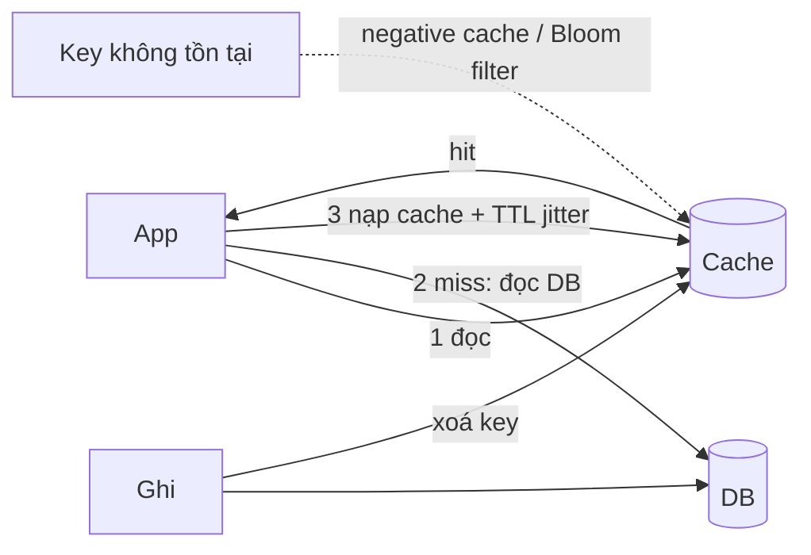

## 1. Core Concept

**Cache** là bộ nhớ nhanh đặt trước nguồn dữ liệu chậm/đắt (database, API) để **giảm độ trễ và tải** cho nguồn đó. Độ khó không nằm ở việc "thêm Redis" mà ở **chiến lược**: khi nào đọc/ghi cache, khi nào **vô hiệu hoá (invalidate)**, xoá gì khi đầy và xử lý các sự cố đặc trưng (stampede, penetration, avalanche). Câu nói nổi tiếng: *"chỉ có hai việc khó trong khoa học máy tính: cache invalidation và đặt tên"*.

**Mental model:** cache là **kệ đồ dùng hay xài ngay cạnh bàn làm việc**: lấy cực nhanh so với chạy xuống kho (DB). Nhưng đồ trên kệ có thể **đã cũ** khi kho đã đổi, kệ nhỏ nên phải có luật dọn đồ (eviction), và nếu cả nhóm cùng chạy xuống kho khi kệ trống thì kho kẹt cứng.

## 2. How It Works

**Chiến lược đọc/ghi**
- **Cache-aside (lazy loading)**: ứng dụng tự đọc cache; **miss** thì đọc DB rồi **nạp cache** kèm TTL. Phổ biến nhất, dễ cài; lần đầu chậm, có thể cũ.
- **Read-through**: cache layer tự nạp từ DB khi miss (ứng dụng chỉ nói chuyện với cache).
- **Write-through**: ghi **cả DB và cache đồng bộ** → cache luôn mới, ghi chậm hơn.
- **Write-behind (write-back)**: ghi cache trước, **ghi DB bất đồng bộ sau** → ghi nhanh, nhưng **mất dữ liệu nếu cache chết trước khi flush**.
- **Write-around**: ghi thẳng DB, bỏ qua cache (tránh làm bẩn cache bằng dữ liệu ít đọc).

**Vô hiệu hoá (invalidation)**
- **TTL** (đơn giản, chấp nhận cũ trong thời hạn), **xoá/cập nhật key khi ghi** (chính xác hơn nhưng dễ sót), **sự kiện/CDC** (xoá cache khi DB đổi, kể cả từ service khác), **key có phiên bản** (`user:42:v7`). **TTL luôn nên có như lưới an toàn** dù đã invalidate chủ động.
- **Race kinh điển** ở cache-aside khi ghi: thứ tự nên là **ghi DB rồi xoá cache** (không "cập nhật cache"); vẫn có race hiếm (đọc cũ ghi đè cache mới), giảm bằng TTL ngắn hoặc xoá lần hai trễ.

**Eviction → Khi cache đầy**
- **LRU** (bỏ cái lâu không dùng nhất), **LFU** (bỏ cái ít dùng nhất; hợp phân phối lệch), **TTL/FIFO/random**. Redis: `maxmemory-policy` như `allkeys-lru`, `volatile-ttl`; **TinyLFU** (Caffeine) tốt cho hit ratio.

**Sự cố đặc trưng**
- **Cache penetration**: truy vấn **key không tồn tại** liên tục chọc xuyên cache xuống DB → **negative caching** (cache cả kết quả "không có" với TTL ngắn) hoặc **Bloom filter**.
- **Cache avalanche**: **nhiều key hết hạn cùng lúc** (cùng TTL) hoặc cache sập → DB quá tải → **TTL ngẫu nhiên (jitter)**, nhiều tầng cache, giới hạn tốc độ xuống DB.
- **Cache stampede**: một **key nóng hết hạn**, hàng nghìn request cùng miss → single-flight, lock, làm mới sớm (xem bài Redis Cache Stampede).

**Hit ratio → Thước đo giá trị**
- **Hit ratio = hits/(hits + misses)**; độ trễ trung bình = `h·t_cache + (1−h)·t_db`. Ví dụ `h = 95%`, cache 1 ms, DB 50 ms → `0,95·1 + 0,05·50 = 3,45 ms` (so với 50 ms không có cache); nếu `h` giảm còn 80% thì thành `10,8 ms`.

**Nhiều tầng**
- **L1 (trong tiến trình)** + **L2 (Redis)** + **CDN**; tăng tốc nhưng thêm vấn đề nhất quán giữa các tầng.

```python
def get_user(uid):
    v = redis.get(f"u:{uid}")
    if v is not None:
        return None if v == "NULL" else json.loads(v)          # negative cache
    row = db.fetch(uid)
    redis.setex(f"u:{uid}", 300 + random.randint(0, 60),       # TTL + jitter
                json.dumps(row) if row else "NULL")
    return row

def update_user(uid, data):
    db.update(uid, data)           # ghi DB trước
    redis.delete(f"u:{uid}")       # rồi xoá cache
```

## 3. Visual Diagram



## 4. Rules of Thumb & Trade-offs

| Tình huống / Nhu cầu | Chọn gì |
| --- | --- |
| Đọc nhiều, chấp nhận hơi cũ | Cache-aside + TTL |
| Cần cache luôn mới sau ghi | Write-through |
| Ghi rất nhiều, chấp nhận rủi ro mất | Write-behind |
| Dữ liệu ghi nhiều, ít đọc lại | Write-around |
| Truy vấn key không tồn tại liên tục | Negative caching / Bloom filter |
| Mass expiry | TTL jitter |
| Phân phối truy cập lệch mạnh | LFU/TinyLFU |

- **Được gì:** độ trễ và tải DB giảm mạnh. **Mất gì:** dữ liệu có thể cũ, độ phức tạp invalidation, tốn bộ nhớ, thêm điểm lỗi; **cache chỉ là bản sao, DB mới là nguồn sự thật**.

## 5. Must Remember / Production Pitfalls

- **Người dùng thấy dữ liệu cũ → ghi DB mà không xoá/cập nhật cache → xoá key khi ghi hoặc CDC, kèm TTL an toàn**.
- **DB bị đập bởi truy vấn key không tồn tại → penetration → negative cache hoặc Bloom filter, validate đầu vào**.
- **Cùng lúc hàng loạt key hết hạn làm DB sập → avalanche (cùng TTL) → TTL ngẫu nhiên, khởi động ấm (warm up), nhiều tầng**.
- **Mất dữ liệu khi cache chết (write-behind) → chưa flush → chỉ dùng cho dữ liệu chấp nhận mất, hoặc có log/hàng đợi bền**.
- **Cập nhật cache thay vì xoá gây ghi đè thứ tự sai (race) → hai ghi đồng thời → ghi DB rồi xoá cache, TTL ngắn**.
- Interview trap: "cache-aside hay write-through?" → **cache-aside đọc lazy, write-through ghi đồng bộ cả hai**; "penetration, avalanche, stampede khác gì?" → **key không tồn tại / nhiều key hết hạn cùng lúc / một key nóng hết hạn**; "tính độ trễ trung bình?" → **h·t_cache + (1−h)·t_db**.

## 6. Search Hooks

- `cache-aside write-through write-behind` — các chiến lược đọc/ghi cache.
- `cache invalidation strategies` — TTL, xoá khi ghi, CDC, key có phiên bản.
- `LRU LFU eviction policy` — luật dọn cache khi đầy.
- `cache penetration avalanche` — hai sự cố đặc trưng của cache.
- `cache hit ratio` — đo hiệu quả của cache.
- `cache stampede` — nhiều request cùng nạp lại khi key nóng hết hạn.
