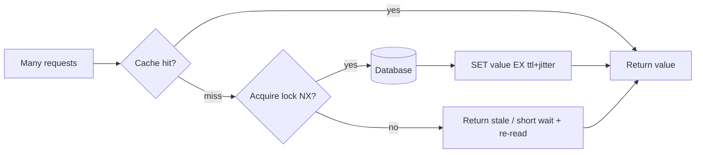

## 1. Core Concept

**Cache Stampede** (Thundering Herd, Dog-piling) xảy ra khi một **hot key** hết hạn hoặc bị xoá, và hàng nghìn request cùng **cache miss** đồng loạt recompute giá trị từ Database. DB bị dội tải đột biến, latency tăng, có thể sập và kéo theo toàn hệ thống. Mental model: *chỉ cho phép một người đi lấy dữ liệu, những người còn lại chờ hoặc dùng tạm bản cũ.*

## 2. How It Works

- Cache-aside chuẩn: `GET key` → miss → query DB → `SET key value EX ttl`. Không có gì ngăn N request làm việc đó **cùng lúc**.
- Ba nhóm kỹ thuật chống stampede:
  - **Locking / Single Flight**: chỉ request giữ lock (`SET lock:key token NX PX 5000`) được rebuild; request khác chờ ngắn rồi đọc lại cache, hoặc trả **stale value**.
  - **Probabilistic Early Expiration (XFetch)**: mỗi request tự quyết định refresh sớm với xác suất tăng dần khi gần hết TTL, nên refresh rải rác thay vì dồn vào một thời điểm.
  - **Background refresh / Stale-while-revalidate**: lưu `value + softExpireAt` với TTL thật dài hơn; hết soft TTL thì trả bản cũ và refresh bất đồng bộ.
- **TTL Jitter** (`ttl + random(0..10%)`) chống **mass expiration** khi nhiều key được nạp cùng lúc (warm-up, deploy).

```python
def xfetch(key, ttl, beta=1.0):
    value, delta, expiry = cache.get_with_meta(key)  # delta = recompute time (s)
    if value is None or time.time() - delta * beta * math.log(random.random()) >= expiry:
        start = time.time()
        value = load_from_db(key)
        delta = time.time() - start
        cache.set_with_meta(key, value, delta, ttl)
    return value
```

## 3. Visual Diagram



## 4. Rules of Thumb & Trade-offs

- **Dùng locking** khi recompute đắt (query nặng, gọi 3rd-party) và chấp nhận vài request chờ thêm vài chục ms.
- **Dùng XFetch / stale-while-revalidate** cho hot key read-heavy cần latency ổn định; đổi lại dữ liệu có thể *stale* thêm một khoảng ngắn.
- **Request Coalescing in-process** rẻ nhất nhưng chỉ gộp trong một instance: 100 pod vẫn có thể tạo 100 query.
- **Không cần** khi key lạnh, recompute rẻ, hoặc DB dư sức chịu tải burst.
- **Trade-off cốt lõi**: *Freshness vs. Availability/Latency* — càng chống stampede mạnh, càng chấp nhận serve dữ liệu cũ.

## 5. Must Remember / Production Pitfalls

- **Lock phải có TTL và token**: thiếu `PX` → holder crash là deadlock; xoá lock phải so token (Lua `GET == token then DEL`) để không xoá lock của người khác.
- **Chờ lock bằng spin loop** không backoff sẽ biến stampede DB thành stampede Redis.
- **Cache negative result** (key không tồn tại) với TTL ngắn, nếu không sẽ bị **Cache Penetration**.
- **Hot key** một shard: dù chống stampede, một key vẫn có thể làm nóng một Redis node — cân nhắc local cache (L1) hoặc key replication.
- **Interview trap**: "Tăng TTL là xong" → chỉ dời thời điểm stampede; "Không bao giờ expire" → dữ liệu stale vô hạn và tốn memory.

## 6. Search Hooks

- `Cache Stampede` — nhiều request cùng miss và dội vào DB.
- `Thundering Herd Problem` — tên gọi khác của hiện tượng đồng loạt đánh thức/gọi backend.
- `XFetch probabilistic early recomputation` — thuật toán refresh sớm theo xác suất (VLDB 2015).
- `Redis SET NX PX distributed lock` — khoá phân tán đơn giản để chỉ một tiến trình rebuild.
- `singleflight Go` — gộp request trùng key trong một process.
- `stale-while-revalidate cache` — trả bản cũ trong khi làm mới ở background.
- `Cache Penetration vs Cache Avalanche` — phân biệt các failure mode khác của cache.
