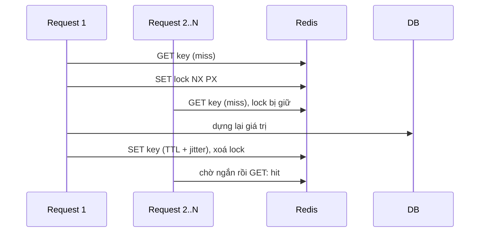

## 1. Core Concept

**Cache stampede** (còn gọi **thundering herd / dogpile**) xảy ra khi **một key nóng hết hạn** và **hàng nghìn request cùng lúc thấy cache miss**, tất cả cùng chạy xuống DB để dựng lại giá trị — làm DB quá tải ngay đúng lúc nó phải làm việc nặng nhất, có thể kéo sập cả hệ thống. Cache vốn để bảo vệ DB lại trở thành khoảnh khắc nguy hiểm nhất.

**Mental model:** như **một cửa hàng hết món bán chạy**: nếu mỗi khách đều tự chạy vào bếp đòi nấu lại, bếp sẽ kẹt cứng. Cách đúng là **chỉ một người** vào bếp nấu, những người khác **đứng chờ hoặc nhận tạm món cũ**, và người quản lý **chuẩn bị món trước khi hết**.

## 2. How It Works

**Khi nào xảy ra**
- **Key rất nóng hết hạn** (TTL kết thúc), **khởi động nguội** (cache rỗng), hoặc **nhiều key cùng TTL** hết hạn một lúc. Ví dụ: sản phẩm hot nhận **5.000 request/giây**, truy vấn dựng lại mất **200 ms** → trong 200 ms có tới **~1.000 request** cùng miss và đập DB.

**Giải pháp 1 → Request coalescing (single-flight)**
- Trong một tiến trình, **gộp các request cùng key** thành một lần tải duy nhất, các request còn lại **chờ kết quả đó** (Go `singleflight`, `Promise` dùng chung, lock theo key).

**Giải pháp 2 → Distributed lock (`SET NX PX`)**
- Giữa nhiều instance: request đầu tiên lấy khoá bằng **`SET lock:key token NX PX 5000`**; ai lấy được thì dựng lại và ghi cache; người khác **chờ ngắn rồi đọc lại cache** hoặc **trả bản cũ**. Lưu ý: khoá cần **TTL** (phòng crash), giá trị là **token duy nhất**, và **chỉ xoá khoá khi token khớp** (Lua compare-and-delete) để không xoá nhầm khoá của người khác.

**Giải pháp 3 → TTL jitter**
- Thêm **số ngẫu nhiên** vào TTL (ví dụ 300 ± 60 giây) để các key **không hết hạn đồng loạt**.

**Giải pháp 4 → Probabilistic early expiration (XFetch)**
- Mỗi request có **xác suất nhỏ làm mới sớm** trước khi hết hạn thật; xác suất **tăng dần khi gần hết hạn** và theo thời gian dựng lại: `làm mới nếu now − Δ·β·ln(rand) ≥ expiry`. Kết quả: một request làm mới **trước** khi key hết hạn nên **không có thời điểm miss tập thể**.

**Giải pháp 5 → Stale-while-revalidate / soft TTL**
- Lưu **hai hạn**: **soft TTL** (hết thì làm mới ở nền) và **hard TTL** (hết mới xoá). Trong khi làm mới, **trả giá trị cũ** cho request khác — người dùng không bị chờ.

**Phòng thủ phụ**
- **Làm nóng (pre-warm)** key quan trọng khi khởi động, **làm mới ở nền theo lịch**, **giới hạn đồng thời xuống DB** (semaphore/circuit breaker), **negative caching** cho key không tồn tại.

```python
def get_product(pid):
    key = f"p:{pid}"
    v = redis.get(key)
    if v: return json.loads(v)
    token = uuid4().hex
    if redis.set(f"lock:{key}", token, nx=True, px=5000):        # chỉ một người dựng lại
        try:
            row = db.query("SELECT * FROM products WHERE id=%s", pid)
            redis.set(key, json.dumps(row), ex=300 + random.randint(0, 60))  # TTL + jitter
            return row
        finally:
            if redis.get(f"lock:{key}") == token.encode():       # chỉ xoá khoá của mình (nên dùng Lua)
                redis.delete(f"lock:{key}")
    time.sleep(0.05); return get_product(pid)                    # người khác chờ rồi đọc lại
```

## 3. Visual Diagram



## 4. Rules of Thumb & Trade-offs

| Tình huống / Nhu cầu | Chọn gì |
| --- | --- |
| Một tiến trình, nhiều request cùng key | Single-flight / coalescing |
| Nhiều instance | Distributed lock (NX PX) hoặc stale-while-revalidate |
| Nhiều key hết hạn cùng lúc | TTL jitter |
| Tránh miss tập thể hoàn toàn | XFetch / soft TTL |
| Chấp nhận dữ liệu cũ ngắn hạn | Stale-while-revalidate |
| Khởi động nguội | Pre-warm |
| Bảo vệ DB lần cuối | Giới hạn đồng thời / circuit breaker |

- **Được gì:** DB không bị đập khi key nóng hết hạn. **Mất gì:** thêm độ phức tạp (khoá, quản lý TTL), có thể phục vụ dữ liệu hơi cũ, lock có thể thành điểm nghẽn nếu cài sai.

## 5. Must Remember / Production Pitfalls

- **DB sập đúng lúc key nóng hết hạn → mọi request cùng dựng lại → single-flight/lock + làm mới sớm**.
- **Khoá hết hạn trước khi dựng lại xong → hai người cùng dựng → TTL khoá vừa đủ dài, token, cân nhắc gia hạn**.
- **Xoá nhầm khoá của người khác → release không kiểm tra token → Lua compare-and-delete**.
- **Mọi key hết hạn cùng giờ → đặt cùng TTL khi nạp hàng loạt → thêm jitter**.
- **Người dùng chờ lâu khi key đang dựng lại → chờ khoá không có giới hạn → chờ ngắn rồi trả bản cũ (stale) hoặc lỗi nhanh**.
- Interview trap: "chống stampede bằng cách nào?" → **single-flight/lock, TTL jitter, làm mới sớm (XFetch), stale-while-revalidate**; "vì sao lock cần token?" → **tránh xoá nhầm khoá của người khác**; "stampede khác penetration?" → **key tồn tại bị hết hạn vs key không tồn tại**.

## 6. Search Hooks

- `cache stampede thundering herd` — nhiều request cùng dựng lại khi key hết hạn.
- `probabilistic early expiration XFetch` — làm mới sớm theo xác suất.
- `Redis distributed lock SET NX PX` — khoá phân tán bằng Redis.
- `single flight request coalescing` — gộp request cùng key.
- `TTL jitter` — tránh hết hạn đồng loạt.
