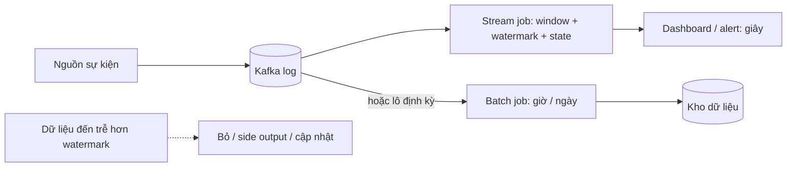

## 1. Core Concept

**Batch processing** xử lý **tập dữ liệu hữu hạn (bounded)** theo lô định kỳ (mỗi đêm, mỗi giờ); **stream processing** xử lý **dòng dữ liệu vô hạn (unbounded)** liên tục ngay khi sự kiện tới. Chọn giữa hai kiểu là đánh đổi **độ trễ ↔ độ phức tạp/chi phí**: batch đơn giản, rẻ, dễ sửa và chạy lại; stream cho kết quả trong **giây** nhưng phải đối mặt với **dữ liệu đến trễ, trạng thái, nhất quán**.

**Mental model:** batch như **gom thư cả ngày rồi đọc một lần vào chiều** (hiệu quả, nhưng biết tin chậm); stream như **nhận và xử lý từng cuộc gọi ngay khi chuông reo** (phản hồi nhanh, nhưng phải xử lý cuộc gọi đến **sai thứ tự** và **lỡ cuộc gọi khi đang bận**).

## 2. How It Works

**Bounded vs unbounded**
- Batch biết **điểm kết thúc** của dữ liệu nên có thể sắp xếp/join toàn bộ, **chạy lại** dễ dàng khi sai. Stream **không bao giờ kết thúc**, nên mọi phép tính phải dựa trên **cửa sổ (window)** và **trạng thái**.

**Event time vs processing time**
- **Event time**: lúc sự kiện **thực sự xảy ra** (ghi trong dữ liệu). **Processing time**: lúc hệ thống **nhận/xử lý**. Hai thời điểm **lệch nhau** do mạng, thiết bị offline, retry (một cú click lúc 10:00 có thể tới lúc 10:07). Tính theo processing time cho kết quả sai; cần **event time**.

**Window và watermark**
- **Window**: **tumbling** (khung cố định không chồng, 5 phút), **sliding** (trượt, chồng lấn), **session** (theo khoảng nghỉ của người dùng). **Watermark**: ước lượng "đến thời điểm này, **dữ liệu có event time ≤ W đã hầu như đến đủ**" → khi watermark vượt **cuối cửa sổ**, cửa sổ được **đóng và phát kết quả**. Dữ liệu **đến muộn hơn watermark** là **late data**: bỏ, đưa **side output**, hoặc **cập nhật lại** kết quả (allowed lateness). Đánh đổi: **watermark trễ** → chính xác hơn nhưng **độ trễ cao**; **sớm** → nhanh nhưng bỏ lỡ nhiều dữ liệu.

**Lambda vs Kappa**
- **Lambda**: hai đường — **batch layer** (chính xác, chậm) + **speed layer** (nhanh, xấp xỉ) rồi gộp; nhược điểm: **viết logic hai lần**, khó đồng bộ. **Kappa**: **một pipeline stream** duy nhất, **tính lại bằng cách replay log** (Kafka giữ dài). Đơn giản hơn nhưng cần log bền, replay hiệu quả.

**Micro-batch vs true streaming**
- **Micro-batch** (Spark Structured Streaming): gom thành **lô nhỏ** (vài giây) rồi xử lý — **throughput cao**, dễ, độ trễ ≥ vài trăm ms–giây. **True streaming** (Flink): xử lý **từng sự kiện** — độ trễ thấp mili-giây, mô hình state mạnh. Chọn theo **SLA độ trễ** thật sự cần.

**Exactly-once**
- Trong stream, "exactly-once" nghĩa là **ảnh hưởng lên trạng thái và đầu ra như thể mỗi sự kiện chỉ được xử lý một lần**, đạt bằng **checkpoint + sink idempotent/transactional**, không phải "không bao giờ xử lý hai lần" ở tầng vật lý.

```sql
-- Flink SQL: cửa sổ 5 phút theo EVENT TIME, chịu trễ 1 phút (watermark)
SELECT window_start, COUNT(*) AS orders
FROM TABLE(TUMBLE(TABLE orders, DESCRIPTOR(event_time), INTERVAL '5' MINUTES))
GROUP BY window_start, window_end;
-- WATERMARK FOR event_time AS event_time - INTERVAL '1' MINUTE
```

## 3. Visual Diagram



## 4. Rules of Thumb & Trade-offs

| Tình huống / Nhu cầu | Chọn gì |
| --- | --- |
| Báo cáo hằng ngày/giờ, chấp nhận trễ | Batch |
| Phát hiện gian lận, cảnh báo trong giây | Stream |
| Chỉ cần gần real-time (vài giây), dùng lại Spark | Micro-batch |
| Độ trễ mili-giây, trạng thái phức tạp | Flink (true streaming) |
| Một codebase, replay từ log | Kappa |
| Dữ liệu đến trễ, sai thứ tự | Event time + watermark |

- **Được gì:** stream cho kết quả tức thì; batch đơn giản, rẻ, dễ debug/chạy lại. **Mất gì:** stream phức tạp hơn nhiều (trạng thái, late data, vận hành 24/7); batch có độ trễ cao.

## 5. Must Remember / Production Pitfalls

- **Số liệu theo giờ sai khi mạng chậm → tính theo processing time → dùng event time + watermark**.
- **Cửa sổ không bao giờ đóng/phát kết quả → watermark kẹt (nguồn idle/partition không có dữ liệu) → cấu hình idle source, watermark theo từng partition**.
- **Mất dữ liệu đến trễ âm thầm → watermark quá chặt → allowed lateness, side output đếm dữ liệu trễ**.
- **Logic batch và stream lệch nhau (Lambda) → duy trì hai codebase → cân nhắc Kappa/engine hợp nhất**.
- **Dùng stream khi batch hằng giờ là đủ → phức tạp và chi phí vận hành vô ích → chọn theo SLA độ trễ thực sự cần**.
- Interview trap: "event time vs processing time?" → **event time là lúc xảy ra, processing time là lúc xử lý**; "watermark làm gì?" → **ước lượng tiến độ event time để biết khi nào đóng cửa sổ**; "exactly-once thực tế là gì?" → **checkpoint + sink idempotent/transactional**.

## 6. Search Hooks

- `batch vs stream processing` — hai mô hình xử lý dữ liệu.
- `event time vs processing time` — thời điểm xảy ra và thời điểm xử lý.
- `watermarks windowing streaming` — cửa sổ và watermark.
- `lambda vs kappa architecture` — hai kiến trúc kết hợp batch và stream.
- `Spark Structured Streaming micro-batch` — streaming theo lô nhỏ.
- `exactly-once stream processing` — ngữ nghĩa chính xác một lần trong stream.
