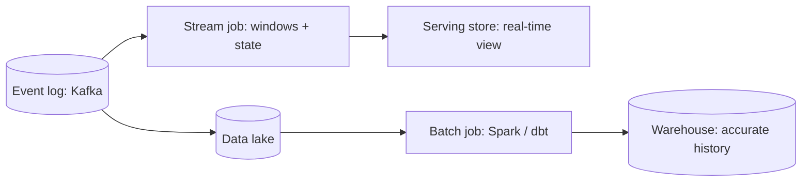

## 1. Core Concept

**Batch processing** xử lý tập dữ liệu **hữu hạn (bounded)** theo lô định kỳ — thông lượng cao, độ trễ phút đến giờ. **Stream processing** xử lý dữ liệu **vô hạn (unbounded)** liên tục khi nó đến — độ trễ mili-giây đến giây. Câu hỏi thiết kế chính là **"dữ liệu cần mới tới mức nào"** chứ không phải công cụ nào hợp thời. Mental model: *batch là "chụp ảnh rồi tính", stream là "xem phim và tính từng khung hình" — và khung hình có thể đến muộn, sai thứ tự.*

## 2. How It Works

- **Batch**: đọc dữ liệu lưu trữ (S3, warehouse), biến đổi, ghi kết quả; công cụ **Spark, dbt, MapReduce**; chạy theo lịch (Airflow). Dễ **tái xử lý (backfill)** vì dữ liệu nguồn bất biến.
- **Stream**: nguồn là log (Kafka) → **Flink, Kafka Streams, Spark Structured Streaming** xử lý liên tục có **trạng thái (state)** và **checkpoint** để phục hồi.
- **Thời gian**: **event time** (lúc sự kiện thực sự xảy ra) khác **processing time** (lúc hệ thống thấy nó) — dữ liệu đến **muộn và lộn xộn**.
- **Windowing**: **tumbling** (cửa sổ cố định, không chồng), **sliding** (chồng lấn), **session** (theo khoảng nghỉ của người dùng).
- **Watermark**: ước lượng "đã thấy hết sự kiện đến thời điểm T" để biết khi nào **đóng cửa sổ**; dữ liệu đến sau watermark là **late data** (bỏ, hoặc xử lý riêng/ cập nhật lại).
- **Ngữ nghĩa**: at-least-once + sink **idempotent**, hoặc **exactly-once** qua checkpoint + transaction trong phạm vi framework.
- **Kiến trúc**: **Lambda** (song song một đường batch chính xác và một đường stream nhanh, hợp nhất ở serving — nhân đôi logic) vs **Kappa** (chỉ stream, tái xử lý bằng cách replay log).

## 3. Visual Diagram

## 4. Rules of Thumb & Trade-offs

- Báo cáo ngày/tuần, ML training, backfill → **batch** (rẻ, đơn giản). Cảnh báo gian lận, dashboard thời gian thực, personalisation → **stream**.
- **Đừng stream nếu batch đủ**: stream tốn vận hành (state, checkpoint, watermark) hơn nhiều.
- **Micro-batch** (Spark Structured Streaming) là điểm giữa: độ trễ vài giây, mô hình đơn giản.
- Trade-off: **Latency vs. Correctness/Completeness vs. Cost/Complexity**.

## 5. Must Remember / Production Pitfalls

- **Dùng processing time** thay vì event time làm số liệu sai khi có trễ/replay → luôn tính theo event time cho nghiệp vụ.
- **Bỏ qua late data**: cửa sổ đóng quá sớm mất sự kiện; đóng quá muộn tăng độ trễ và bộ nhớ → chọn **allowed lateness** theo thực tế.
- **State phình không kiểm soát** (key mới liên tục) làm job sập → TTL cho state.
- **Data skew/hot key**: một partition xử lý quá nhiều → chia key (salting).
- **Sink không idempotent** + at-least-once → ghi trùng; dùng upsert theo khoá.
- **Backfill** của stream phức tạp hơn batch; Lambda nhân đôi mã nguồn nên dễ lệch kết quả giữa hai đường.
- Interview trap: "Exactly-once trong stream là thật?" → chỉ **trong phạm vi framework + sink hỗ trợ transaction/idempotent**; end-to-end vẫn cần idempotency.

## 6. Search Hooks

- `batch vs stream processing` — xử lý dữ liệu hữu hạn và vô hạn.
- `event time vs processing time` — hai khái niệm thời gian trong stream.
- `watermarks windowing late data Flink` — đóng cửa sổ và xử lý dữ liệu đến muộn.
- `Lambda architecture vs Kappa architecture` — hai kiến trúc kết hợp batch và stream.
- `Spark Structured Streaming micro-batch` — mô hình xử lý stream theo lô nhỏ.
- `stream processing exactly-once semantics` — ngữ nghĩa exactly-once và giới hạn thực tế.
