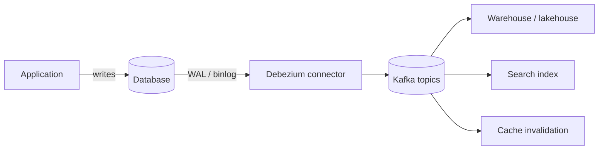

## 1. Core Concept

**Change Data Capture (CDC)** theo dõi và phát ra **mọi thay đổi** (insert/update/delete) của database dưới dạng **dòng sự kiện**, bằng cách đọc **transaction log** của chính DB (PostgreSQL **WAL**, MySQL **binlog**). Nó giải quyết việc đồng bộ dữ liệu sang warehouse, search index, cache hay service khác **mà không truy vấn bảng liên tục và không sửa code ứng dụng**. Mental model: *log của DB vốn đã là bản ghi trung thực mọi thay đổi theo đúng thứ tự — CDC chỉ "nghe" nó.*

## 2. How It Works

- **Các cách bắt thay đổi**: **log-based** (đọc WAL/binlog — độ trễ thấp, đầy đủ, thấy cả delete, ít tải lên DB), **query-based** (poll cột `updated_at` — đơn giản nhưng bỏ sót delete và tạo tải), **trigger-based** (trigger ghi bảng audit — tăng tải ghi).
- **Debezium + Kafka Connect**: connector đọc log của DB, phát mỗi thay đổi thành **một message** vào topic Kafka (một topic mỗi bảng), với **key = primary key**, nội dung gồm **`before`/`after`**, loại thao tác (`c`reate/`u`pdate/`d`elete), vị trí log (**LSN/offset**) và thời điểm.
- **Quy trình**: **snapshot ban đầu** (đọc trạng thái hiện tại của bảng) → chuyển sang **streaming** theo log từ đúng vị trí đã snapshot, nhờ vậy không mất thay đổi nào.
- **PostgreSQL logical decoding**: dùng **replication slot** giữ lại WAL cho tới khi consumer xác nhận đã đọc.
- **Thứ tự**: đảm bảo **theo từng primary key** (cùng key vào cùng partition).
- **Delete**: phát event `d` kèm **tombstone** (value null) để **log compaction** của Kafka xoá key.
- **Ứng dụng**: nạp **warehouse/lakehouse** gần thời gian thực, cập nhật **search index/cache**, **transactional outbox** (đọc bảng outbox qua CDC), đồng bộ giữa các microservice, kiểm toán.

## 3. Visual Diagram

## 4. Rules of Thumb & Trade-offs

- Cần đồng bộ **gần thời gian thực**, thấy **delete**, không muốn tăng tải DB → **log-based CDC**; bảng nhỏ, độ trễ phút chấp nhận được → **query-based** đơn giản hơn.
- CDC phơi bày **mô hình dữ liệu nội bộ** của DB; với tích hợp nghiệp vụ nên dùng **outbox** để phát event có hợp đồng rõ ràng.
- Trade-off: **Độ trễ thấp và đầy đủ** đổi lấy **phụ thuộc vào cấu hình/quyền hạn của DB và độ phức tạp vận hành**.

## 5. Must Remember / Production Pitfalls

- **Replication slot không được tiêu thụ** (connector chết) → **WAL tích tụ làm đầy đĩa** của PostgreSQL: giám sát lag slot và cảnh báo.
- **Giao hàng at-least-once** → sink phải **idempotent** (upsert theo khoá).
- **Thay đổi schema** (đổi tên/xoá cột) có thể làm vỡ consumer: dùng schema registry và chiến lược tương thích.
- **Transaction lớn** tạo đợt event khổng lồ và tăng độ trễ.
- **PII trong event** thay đổi: kiểm soát cột nhạy cảm (che/loại bỏ) trước khi vào Kafka.
- Interview trap: "Vì sao CDC log-based tốt hơn polling `updated_at`?" → không bỏ sót **delete**, không bỏ lỡ thay đổi giữa hai lần poll, ít tải DB và có thứ tự commit.

## 6. Search Hooks

- `Change Data Capture log-based` — bắt thay đổi qua transaction log.
- `Debezium Kafka Connect` — công cụ CDC phổ biến phát thay đổi vào Kafka.
- `PostgreSQL logical decoding replication slot` — cơ chế đọc WAL và rủi ro đầy đĩa.
- `outbox pattern CDC` — kết hợp outbox và CDC để phát event tin cậy.
- `initial snapshot streaming CDC` — giai đoạn snapshot rồi chuyển sang streaming.
- `tombstone log compaction delete` — cách thể hiện delete trong Kafka.
