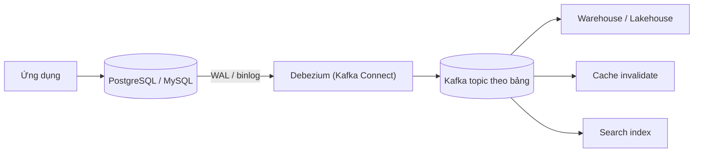

## 1. Core Concept

**Change Data Capture (CDC)** bắt **mọi thay đổi (insert/update/delete)** của database và phát thành **dòng sự kiện**, nhờ đọc **transaction log** (WAL/binlog) thay vì truy vấn bảng. CDC giải quyết việc **đồng bộ dữ liệu gần real-time** sang kho/cache/search mà **không tải thêm lên DB nguồn** và **không bỏ sót xoá**.

**Mental model:** CDC như **người ghi biên bản đứng cạnh sổ cái của ngân hàng**: mỗi dòng ghi vào sổ cái (log), biên bản được sao lại và chuyển đi, **không cần hỏi lại từng tài khoản**. Polling thì giống hỏi từng tài khoản định kỳ "có gì mới?" — chậm và bỏ sót.

## 2. How It Works

**Log-based vs query-based**
- **Query-based** (polling `updated_at`): đơn giản, nhưng **không bắt được xoá cứng**, bỏ sót thay đổi giữa hai lần poll, **tải thêm lên DB**. **Log-based** (Debezium đọc **WAL** của PostgreSQL / **binlog** của MySQL): bắt **đầy đủ insert/update/delete theo thứ tự commit**, **độ trễ thấp**, tải nhỏ.

**Debezium + Kafka Connect**
- **Debezium** là source connector chạy trên **Kafka Connect**: đọc log, phát mỗi thay đổi thành event lên **topic Kafka** (thường mỗi bảng một topic, **key = primary key** để giữ thứ tự theo hàng). Event có `before`, `after`, `op` (c/u/d), `source` (vị trí log, ts).

**Snapshot và streaming**
- Khởi động lần đầu: **initial snapshot** (đọc toàn bộ bảng) rồi chuyển sang **streaming** từ vị trí log đã ghi. Connector lưu **offset** (LSN/binlog position) để **tiếp tục sau restart**.

**Replication slot (PostgreSQL)**
- Postgres giữ **WAL** cho tới khi connector xác nhận đã đọc (replication slot). Nếu connector **chết lâu**, WAL **không được dọn → đầy đĩa nguồn**. Phải **giám sát slot lag** và dọn slot bỏ hoang.

**Schema evolution**
- Đổi cột ở nguồn làm đổi cấu trúc event. Dùng **Schema Registry** (Avro/Protobuf) với quy tắc tương thích để consumer không vỡ.

**Ứng dụng**
- Đồng bộ sang **data warehouse/lakehouse**, **invalidate cache**, cập nhật **search index**, **Outbox pattern** (đọc bảng outbox bằng CDC thay vì dual-write), xây **materialized view**.

**Ngữ nghĩa giao hàng**
- Thường **at-least-once** → consumer phải **idempotent** (upsert theo key, so sánh vị trí log).

```json
{
  "name": "orders-cdc",
  "config": {
    "connector.class": "io.debezium.connector.postgresql.PostgresConnector",
    "table.include.list": "public.orders",
    "plugin.name": "pgoutput",
    "slot.name": "orders_slot",
    "snapshot.mode": "initial"
  }
}
```

## 3. Visual Diagram



## 4. Rules of Thumb & Trade-offs

| Tình huống / Nhu cầu | Chọn gì |
| --- | --- |
| Cần bắt cả xoá và thứ tự commit | Log-based CDC |
| Bảng nhỏ, chấp nhận trễ, không quyền đọc log | Polling theo `updated_at` |
| Tránh dual-write DB + broker | Outbox + CDC |
| Đổi schema thường xuyên | Schema Registry + tương thích |
| Đồng bộ sang kho phân tích | CDC → Kafka → lakehouse (upsert/MERGE) |

- **Được gì:** gần real-time, đầy đủ thay đổi, ít tải lên nguồn. **Mất gì:** vận hành connector/Kafka, quản lý slot và schema, at-least-once nên cần idempotent consumer.

## 5. Must Remember / Production Pitfalls

- **Đĩa DB nguồn đầy → replication slot không được tiêu thụ → giám sát lag slot, cảnh báo, dọn slot bỏ hoang**.
- **Dữ liệu thiếu bản ghi bị xoá → dùng polling `updated_at` → CDC log-based**.
- **Trùng bản ghi ở đích → at-least-once → upsert/MERGE theo primary key và vị trí log**.
- **Consumer vỡ sau khi đổi cột → không có schema evolution → Schema Registry, thay đổi tương thích**.
- **Không có khoá chính → không xác định hàng khi update/delete → luôn có primary key, `REPLICA IDENTITY` phù hợp**.
- **Snapshot ban đầu khoá/tải nặng bảng lớn → cấu hình snapshot incremental, chạy giờ thấp điểm**.
- Interview trap: "polling vs CDC?" → **polling bỏ sót xoá và tải DB, CDC đọc log đầy đủ**; "CDC giải quyết dual-write thế nào?" → **Outbox + CDC đọc bảng outbox**; "rủi ro replication slot?" → **WAL phình đầy đĩa nếu connector dừng**.

## 6. Search Hooks

- `Change Data Capture CDC` — bắt thay đổi từ log của database.
- `Debezium Kafka Connect` — connector CDC phổ biến.
- `PostgreSQL logical replication slot WAL` — cơ chế log nguồn và rủi ro.
- `Debezium initial snapshot` — nạp toàn bộ trước rồi stream.
- `Schema Registry Avro compatibility` — tiến hoá schema an toàn.
- `transactional outbox CDC` — thay dual-write bằng outbox + CDC.
