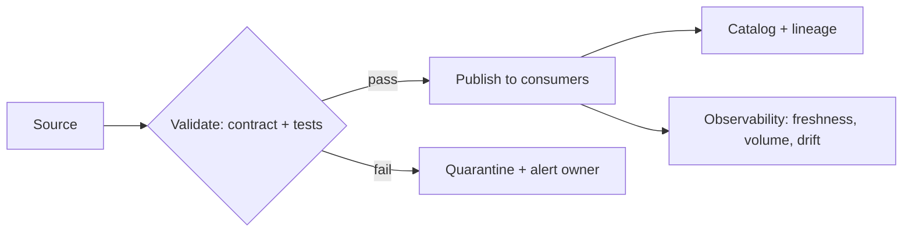

## 1. Core Concept

Pipeline chạy xanh không có nghĩa dữ liệu **đúng**. **Data quality** là mức độ dữ liệu **đáng tin để ra quyết định**; **data governance** là tập luật, vai trò và công cụ để dữ liệu **có chủ sở hữu, truy vết được, bảo mật và tuân thủ**. Mental model: *dữ liệu là một sản phẩm có hợp đồng — người tạo chịu trách nhiệm chất lượng tại nguồn, người dùng được bảo đảm bằng kiểm thử và cảnh báo tự động.*

## 2. How It Works

- **Chiều chất lượng**: **completeness** (đủ), **accuracy** (đúng), **consistency** (nhất quán giữa hệ thống), **timeliness/freshness** (kịp thời), **uniqueness** (không trùng), **validity** (đúng định dạng/khoảng giá trị).
- **Kiểm thử dữ liệu**: **schema** (cột/kiểu), `not_null`, `unique`, `accepted_values`, **referential integrity**, **freshness** (dữ liệu mới nhất không quá N giờ), **volume anomaly** (số dòng đổi bất thường), **distribution drift** (phân bố giá trị lệch). Công cụ: **dbt tests**, **Great Expectations**, **Soda**.
- **Chặn và cách ly**: bản ghi vi phạm đi vào **quarantine/dead-letter** thay vì làm hỏng toàn bộ; quyết định **fail fast** (dừng pipeline) hay **warn** theo mức nghiêm trọng.
- **Data contract**: thoả thuận giữa **producer** và **consumer** về schema, ngữ nghĩa, SLA; thay đổi phá vỡ phải được thông báo/kiểm tra trong CI.
- **Governance**: **ownership** (ai chịu trách nhiệm từng dataset), **catalog** (tìm và hiểu dữ liệu), **lineage** (dữ liệu đi từ đâu tới đâu, để đánh giá tác động), **phân loại dữ liệu**.
- **Bảo mật & tuân thủ**: **masking/tokenization** PII, **column/row-level security**, **retention** theo chính sách, hỗ trợ **quyền xoá (GDPR)**, audit truy cập.
- **Data observability**: giám sát liên tục freshness, volume, schema và phân bố để **phát hiện sự cố trước người dùng**.

## 3. Visual Diagram

## 4. Rules of Thumb & Trade-offs

- **Kiểm tra càng gần nguồn càng tốt**; sửa ở hạ nguồn chỉ che vấn đề và lặp lại ở mọi consumer.
- Bắt đầu với vài kiểm thử **giá trị cao** (khoá duy nhất, not null, freshness, tổng khớp nguồn) trên dataset quan trọng, rồi mở rộng.
- Trade-off: **kiểm tra chặt (fail fast)** bảo vệ chất lượng nhưng có thể **làm chậm/ngừng** giao hàng; **cảnh báo mềm** giữ dòng chảy nhưng rủi ro dữ liệu xấu lọt qua.

## 5. Must Remember / Production Pitfalls

- **Chỉ kiểm tra ở cuối** (dashboard) thì lỗi đã lan khắp nơi; người dùng là người phát hiện đầu tiên.
- **Alert fatigue**: quá nhiều kiểm thử nhiễu khiến cảnh báo thật bị bỏ qua.
- **Thay đổi schema âm thầm** ở nguồn là nguyên nhân phổ biến nhất làm vỡ pipeline và số liệu.
- **Không có owner** → sự cố không ai xử lý; tài liệu và catalog lỗi thời.
- **PII lan khắp** các bảng/bản sao làm không thể đáp ứng yêu cầu xoá.
- Interview trap: "Pipeline thành công nhưng số liệu sai — bạn kiểm tra gì?" → **freshness, volume, schema, trùng lặp, đối chiếu tổng với nguồn, thay đổi ở upstream**.

## 6. Search Hooks

- `data quality dimensions completeness accuracy timeliness` — các chiều đánh giá chất lượng dữ liệu.
- `dbt tests Great Expectations Soda` — công cụ kiểm thử dữ liệu.
- `data contracts producer consumer` — hợp đồng dữ liệu giữa bên tạo và bên dùng.
- `data lineage data catalog` — truy vết nguồn gốc và tìm hiểu dữ liệu.
- `data observability freshness volume drift` — giám sát liên tục sức khoẻ dữ liệu.
- `PII masking GDPR right to erasure` — bảo vệ dữ liệu cá nhân và quyền xoá.
