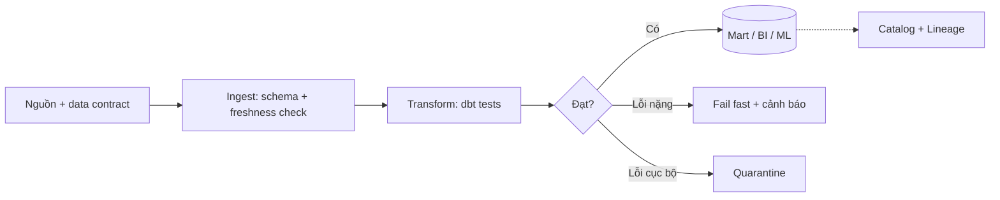

## 1. Core Concept

**Data quality** đảm bảo dữ liệu **đúng, đủ, mới, nhất quán** trước khi người dùng ra quyết định; **data governance** quy định **ai sở hữu, ai được truy cập, dữ liệu đi đâu** (lineage, catalog, PII, tuân thủ). Hai thứ này giải quyết vấn đề "**số liệu sai mà không ai biết**" — lỗi dữ liệu thường **âm thầm** và đắt hơn lỗi code vì lan sang báo cáo, ML và quyết định kinh doanh.

**Mental model:** pipeline dữ liệu như **nhà máy nước**: quality checks là **trạm kiểm tra chất lượng nước** ở mỗi công đoạn; governance là **sổ đăng ký đường ống + quy định ai được mở van**. Không có trạm kiểm tra, nước bẩn chảy đến tận vòi mới có người phát hiện.

## 2. How It Works

**Các chiều chất lượng**
- **Completeness** (không thiếu), **Validity** (đúng định dạng/miền giá trị), **Uniqueness** (không trùng khoá), **Freshness/Timeliness** (đủ mới), **Consistency** (nhất quán giữa hệ thống), **Accuracy** (khớp thực tế).

**Kiểm tra theo lớp**
- **Schema checks** (kiểu, cột bắt buộc), **constraint checks** (not null, unique, giá trị cho phép, khoá ngoại), **volume/anomaly** (số dòng bất thường), **freshness** (dữ liệu mới nhất không quá N giờ), **reconciliation** (tổng khớp với nguồn). Công cụ: **dbt tests**, **Great Expectations**, **Soda**, Deequ.

**Shift-left và Data Contract**
- **Shift-left**: kiểm tra **sớm** (tại nguồn/ingest) thay vì cuối chuỗi. **Data contract**: thoả thuận bằng văn bản giữa **producer và consumer** về schema, ngữ nghĩa, SLA, chủ sở hữu; thay đổi phá vỡ phải qua review → ngăn nguồn đổi cột làm hỏng downstream.

**Lineage và Catalog**
- **Lineage**: bảng/cột này **đến từ đâu, đi đâu** → đánh giá **tác động** khi đổi/sửa và **truy nguyên** số liệu sai. **Data catalog** (DataHub, Amundsen, Glue/Unity Catalog): tìm dữ liệu, mô tả, owner, mức độ tin cậy.

**PII và bảo mật**
- Phân loại **PII**, **mask/hash/tokenize**, **column-level security**, **row-level security**, **mã hoá**, **audit log**, **retention/xoá theo yêu cầu** (GDPR "right to be forgotten"). Nguyên tắc **least privilege** và **ownership** rõ ràng.

**Xử lý khi kiểm tra thất bại**
- **Fail fast** (dừng pipeline để không lan dữ liệu xấu) cho lỗi nghiêm trọng; **quarantine** (đưa bản ghi lỗi sang bảng riêng) cho lỗi cục bộ; **cảnh báo** cho lỗi nhẹ. Phân mức **severity**.

```yaml
# dbt schema tests: kiểm tra ngay trong pipeline transform
models:
  - name: orders
    columns:
      - name: order_id
        tests: [unique, not_null]
      - name: status
        tests:
          - accepted_values: {values: [placed, paid, shipped, cancelled]}
      - name: customer_id
        tests:
          - relationships: {to: ref('customers'), field: customer_id}
```

## 3. Visual Diagram



## 4. Rules of Thumb & Trade-offs

| Tình huống / Nhu cầu | Chọn gì |
| --- | --- |
| Ngăn nguồn đổi schema phá downstream | Data contract |
| Bắt lỗi sớm | Shift-left checks tại ingest |
| Lỗi nghiêm trọng làm báo cáo sai | Fail fast |
| Vài bản ghi hỏng | Quarantine |
| Biết tác động khi đổi bảng | Lineage |
| Dữ liệu nhạy cảm | Mask/hash/tokenize + RLS/CLS |

- **Được gì:** tin cậy số liệu, phát hiện sớm, tuân thủ. **Mất gì:** thêm chi phí xây/duy trì kiểm tra, quá nhiều cảnh báo gây "alert fatigue", cần văn hoá ownership.

## 5. Must Remember / Production Pitfalls

- **Báo cáo sai âm thầm → không có kiểm tra → test unique/not_null/freshness ngay trong pipeline**.
- **Downstream vỡ khi nguồn đổi cột → không có hợp đồng → data contract và review thay đổi phá vỡ**.
- **Không biết ai chịu trách nhiệm khi lỗi → thiếu ownership → gán owner trong catalog**.
- **Quá nhiều cảnh báo bị bỏ qua → không phân severity → phân mức, chỉ page lỗi nghiêm trọng**.
- **Rò rỉ PII ở bảng phân tích → không mask → phân loại PII, mask/CLS, audit**.
- **Dữ liệu cũ nhưng pipeline "xanh" → chỉ kiểm tra thành công job, không kiểm tra freshness → freshness SLA**.
- Interview trap: "data quality gồm những chiều nào?" → **completeness, validity, uniqueness, freshness, consistency, accuracy**; "data contract là gì?" → **thoả thuận schema/SLA producer–consumer**; "lineage dùng làm gì?" → **đánh giá tác động và truy nguyên lỗi**.

## 6. Search Hooks

- `data quality dimensions` — các chiều chất lượng dữ liệu.
- `data contracts` — thoả thuận schema và SLA giữa producer và consumer.
- `Great Expectations dbt tests` — công cụ kiểm tra chất lượng trong pipeline.
- `data lineage catalog` — nguồn gốc dữ liệu và danh mục.
- `PII masking tokenization` — bảo vệ dữ liệu cá nhân.
- `data observability freshness volume` — giám sát độ mới và khối lượng.
