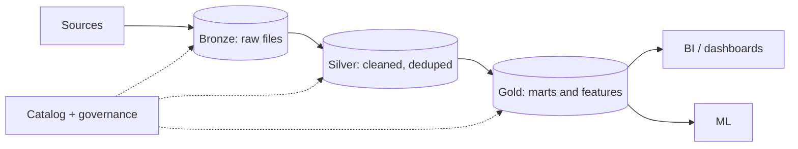

## 1. Core Concept

Ba kiến trúc lưu trữ phân tích: **data lake** (file thô trên object storage, rẻ và linh hoạt nhưng dễ thành "data swamp"), **data warehouse** (lưu có cấu trúc, cột, truy vấn SQL rất nhanh, chi phí cao hơn) và **lakehouse** (lake + **table format** mở như **Delta Lake / Apache Iceberg / Hudi** thêm ACID, schema, time travel). Mental model: *lakehouse = giữ dữ liệu ở định dạng mở trên object storage rẻ, nhưng "khoác" lên nó lớp quản lý giống bảng của warehouse.*

## 2. How It Works

- **Data lake**: lưu file (Parquet, ORC, JSON, CSV) trên **S3/ADLS/GCS**, **schema-on-read**; tách **lưu trữ và tính toán** (Spark, Trino, Athena).
- **Data warehouse**: **schema-on-write**, lưu **columnar** với nén và **MPP** (Snowflake, BigQuery, Redshift); quản lý hộ metadata, tối ưu, quyền truy cập.
- **Parquet**: định dạng **cột** có nén và thống kê min/max theo khối → **predicate pushdown** (bỏ qua khối không khớp) và **column pruning** (chỉ đọc cột cần).
- **Table format (Iceberg/Delta/Hudi)**: lớp **metadata** trên file giúp **ACID transaction**, **schema evolution**, **time travel** (đọc theo phiên bản), **MERGE/UPDATE/DELETE**, và nhiều engine cùng đọc một bảng.
- **Phân vùng (partitioning)**: chia file theo cột (thường ngày) để truy vấn chỉ quét phân vùng liên quan; **compaction** gộp file nhỏ.
- **Medallion architecture**: **Bronze** (thô, bất biến) → **Silver** (làm sạch, chuẩn hoá, khử trùng) → **Gold** (mô hình hoá cho báo cáo/ML).
- **Catalog** (Glue, Unity Catalog, Hive Metastore) quản lý định nghĩa bảng, quyền, lineage.

## 3. Visual Diagram

## 4. Rules of Thumb & Trade-offs

| Cần | Chọn |
| --- | --- |
| Dữ liệu đa dạng, ML, chi phí lưu trữ thấp, nhiều engine | **Lakehouse / lake + table format** |
| BI/SQL nhanh, ít vận hành, đội phân tích mạnh SQL | **Warehouse** |
| Lưu thô để tái xử lý | **Bronze trên object storage** |

- Dùng **định dạng mở** (Parquet + Iceberg/Delta) để tránh khoá nhà cung cấp.
- **Phân vùng theo ngày** cho dữ liệu sự kiện; chọn **file size** hợp lý (khoảng 128 MB–1 GB).
- Trade-off: **linh hoạt và chi phí lưu trữ thấp** (lake) vs **hiệu năng/quản trị sẵn có** (warehouse); lakehouse hội tụ cả hai nhưng đòi hỏi kỹ năng vận hành.

## 5. Must Remember / Production Pitfalls

- **Small files problem**: hàng triệu file nhỏ làm truy vấn và metadata chậm → compaction định kỳ.
- **Over-partitioning** (phân vùng theo cột cardinality cao như `user_id`) tạo vô số thư mục/file nhỏ.
- **Data swamp**: lake không có catalog, ownership, chất lượng → không ai tin dữ liệu.
- **Ghi đồng thời** vào cùng bảng cần cơ chế commit của table format; ghi trực tiếp file gây hỏng/bất nhất.
- **Schema drift** ở nguồn làm vỡ pipeline hạ nguồn nếu không kiểm soát.
- **Chi phí truy vấn** (BigQuery theo dữ liệu quét, warehouse theo thời gian compute) tăng vọt nếu quét toàn bảng; dùng partition/cluster.
- Interview trap: "Parquet khác Iceberg/Delta thế nào?" → Parquet là **định dạng file cột**; Iceberg/Delta là **lớp table/metadata** trên các file Parquet.

## 6. Search Hooks

- `data lake vs data warehouse vs lakehouse` — ba kiến trúc lưu trữ phân tích.
- `Apache Iceberg Delta Lake Hudi table format` — lớp bảng ACID trên object storage.
- `Parquet columnar predicate pushdown` — cách định dạng cột tăng tốc truy vấn.
- `medallion architecture bronze silver gold` — các tầng làm sạch dữ liệu.
- `small files problem compaction` — vấn đề và cách xử lý file nhỏ.
- `separation of storage and compute` — tách lưu trữ và tính toán để scale độc lập.
