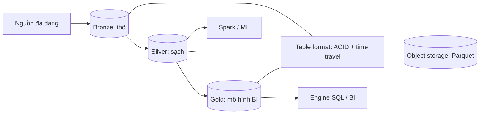

## 1. Core Concept

Ba kiến trúc lưu dữ liệu phân tích: **data warehouse** (dữ liệu **có cấu trúc**, schema-on-write, truy vấn SQL nhanh, ACID — nhưng đắt và khó lưu dữ liệu phi cấu trúc), **data lake** (lưu **mọi định dạng** trên **object storage rẻ**, schema-on-read — nhưng dễ thành "đầm lầy" và thiếu ACID), và **lakehouse** (lake + **open table format** như Iceberg/Delta/Hudi cho ACID, schema evolution, time travel — **một bản dữ liệu** phục vụ cả BI lẫn ML). Điểm then chốt: **tách lưu trữ khỏi tính toán**.

**Mental model:** warehouse là **thư viện được biên mục gọn gàng** (tìm nhanh, nhưng chỉ nhận sách đúng khuôn); lake là **nhà kho khổng lồ ném mọi thứ vào** (rẻ, nhận tất cả, nhưng khó tìm nếu không có sổ đăng ký); lakehouse là **nhà kho có hệ thống biên mục (table format) phủ lên**, vừa rẻ vừa tìm nhanh.

## 2. How It Works

**Warehouse vs Lake vs Lakehouse**
- **Warehouse**: schema-on-write, lưu dạng cột nội bộ, hiệu năng BI tốt, quản trị mạnh; chi phí cao theo dung lượng cũ. **Lake**: file (Parquet/JSON/ảnh…) trên S3/ADLS/GCS, **rẻ**, linh hoạt, nhưng **không giao dịch**, schema lộn xộn, ghi đồng thời hỏng. **Lakehouse**: lake + **table format** → **ACID, upsert/delete, time travel**, engine SQL/Spark/Trino cùng đọc.

**Parquet → Cột, thống kê, pushdown**
- **Parquet**: định dạng **cột** nén tốt, chia **row group**, mỗi cột có **thống kê min/max**. Engine dùng **column pruning** (chỉ đọc cột cần) và **predicate pushdown** (bỏ qua row group/file không thoả điều kiện) → quét ít dữ liệu hơn nhiều. **Partition** theo cột hay lọc (`dt`) để bỏ qua cả thư mục.

**Small files problem**
- Quá nhiều **file nhỏ** (do streaming/ghi thường xuyên) → **mở/liệt kê file tốn** hơn đọc dữ liệu, truy vấn chậm, metadata phình. Cách xử lý: **compaction** gộp thành file **~128–512 MB**, điều chỉnh tần suất commit.

**Medallion architecture**
- **Bronze** (thô, nguyên trạng), **Silver** (làm sạch, khử trùng, chuẩn hoá), **Gold** (mô hình phục vụ nghiệp vụ/BI). Mỗi lớp **kiểm soát chất lượng** tăng dần và có thể **tái tạo** từ lớp dưới.

**Tách lưu trữ và tính toán**
- Dữ liệu ở **object storage** (rẻ, bền), compute là **cluster/warehouse co giãn độc lập** (Snowflake, BigQuery, Redshift RA3, Databricks). **Nhiều engine** có thể cùng đọc một dữ liệu; trả tiền compute theo dùng; đổi lại cần **quản trị catalog** (Glue, Unity Catalog) và phí truyền dữ liệu.

**Chọn kiến trúc**
- Chủ yếu **BI trên dữ liệu có cấu trúc** → warehouse. **Dữ liệu đa dạng + ML + BI** → lakehouse. Lake thô không có table format chỉ nên là **vùng đệm**.

```sql
-- Predicate pushdown + partition pruning trên bảng Parquet/Iceberg
SELECT country, SUM(amount)
FROM lake.sales            -- partition theo dt, Parquet
WHERE dt BETWEEN DATE '2026-11-01' AND DATE '2026-11-07'   -- chỉ quét 7 partition
GROUP BY country;
```

## 3. Visual Diagram



## 4. Rules of Thumb & Trade-offs

| Tình huống / Nhu cầu | Chọn gì |
| --- | --- |
| BI trên dữ liệu có cấu trúc, ít vận hành | Data warehouse |
| Dữ liệu đa dạng, ML + BI trên một bản | Lakehouse |
| Lưu rẻ mọi thứ, chưa rõ dùng | Lake (có catalog) |
| Truy vấn chỉ vài cột/vài ngày | Parquet + partition + pushdown |
| Nhiều file nhỏ làm chậm | Compaction |
| Mô hình tinh luyện dần | Medallion |

- **Được gì:** chi phí lưu trữ thấp, một bản dữ liệu cho nhiều engine, co giãn độc lập. **Mất gì:** lakehouse/lake cần quản trị catalog, bảo trì (compaction, snapshot), hiệu năng BI có thể kém warehouse chuyên dụng.

## 5. Must Remember / Production Pitfalls

- **Lake thành đầm lầy, không ai biết dữ liệu gì → không catalog/schema/owner → catalog, convention đặt tên, ownership, table format**.
- **Truy vấn chậm dần → quá nhiều file nhỏ → compaction định kỳ, kích thước file mục tiêu**.
- **Quét toàn bộ dù lọc theo ngày → không partition/ sai kiểu → partition theo cột lọc, tận dụng predicate pushdown**.
- **Ghi đồng thời làm dữ liệu hỏng trên lake thô → thiếu ACID → table format (Iceberg/Delta/Hudi)**.
- **Hoá đơn compute bất ngờ → engine tách rời nhưng không giới hạn → quota, auto-suspend, theo dõi chi phí theo truy vấn**.
- Interview trap: "warehouse vs lake vs lakehouse?" → **có cấu trúc+ACID / mọi định dạng rẻ / lake + table format cho ACID**; "vì sao Parquet nhanh?" → **cột, nén, thống kê min/max cho pushdown**; "small files problem?" → **nhiều file nhỏ → overhead mở/liệt kê, giải bằng compaction**.

## 6. Search Hooks

- `data lake vs warehouse vs lakehouse` — ba kiến trúc lưu dữ liệu phân tích.
- `Apache Iceberg Delta Lake Hudi` — table format cho lakehouse.
- `Parquet columnar predicate pushdown` — vì sao Parquet quét ít dữ liệu.
- `medallion architecture bronze silver gold` — các lớp dữ liệu tinh luyện.
- `small files problem compaction` — gộp file nhỏ.
- `separation of storage and compute` — tách lưu trữ và tính toán.
