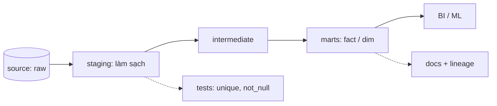

## 1. Core Concept

**dbt** (data build tool) là công cụ **biến đổi dữ liệu bằng SQL trong kho** theo tinh thần **ELT**, đem **thực hành phần mềm** (version control, test, tài liệu, CI/CD) vào **analytics engineering**. Bạn viết các **model** (câu lệnh `SELECT`), dbt dựng **DAG phụ thuộc** bằng `ref()`, biên dịch và **materialize** thành bảng/view trong kho.

**Mental model:** dbt như **bộ Makefile cho SQL**: mỗi model là một bước, `ref()` khai báo phụ thuộc, dbt tự quyết **thứ tự chạy**, chạy **test** và sinh **tài liệu + lineage**. Bạn chỉ viết "dữ liệu cuối trông thế nào", không viết `CREATE TABLE`/`INSERT`.

## 2. How It Works

**Model và ref/source**
- Model là file `.sql` chứa `SELECT`. `{{ ref('stg_orders') }}` tạo **phụ thuộc** và tự trỏ đúng schema theo môi trường; `{{ source('raw','orders') }}` khai báo **bảng nguồn** (kiểm tra freshness).

**Layering**
- **staging** (làm sạch, đổi tên, ép kiểu 1–1 với nguồn) → **intermediate** (logic ghép) → **marts** (bảng fact/dimension phục vụ BI). Giữ staging mỏng, logic nghiệp vụ ở marts.

**Materialization**
- **view** (không lưu, luôn mới), **table** (lưu, build lại toàn bộ), **incremental** (chỉ xử lý dòng mới/đổi → tiết kiệm với bảng lớn), **ephemeral** (CTE, không tạo đối tượng). Chọn theo kích thước và tần suất đọc.

**Incremental model**
- Dùng `is_incremental()` để lọc dữ liệu mới và `unique_key` để **merge/upsert**. Cẩn thận **dữ liệu đến muộn** → dùng **lookback window** và định kỳ `--full-refresh`.

**Tests**
- **Generic tests**: `unique`, `not_null`, `accepted_values`, `relationships`. **Singular tests**: SQL tuỳ biến trả về dòng sai. Chạy bằng `dbt test` hoặc `dbt build` (run + test theo DAG).

**Snapshots (SCD Type 2)**
- `snapshot` ghi **lịch sử thay đổi** của bảng nguồn (thêm `dbt_valid_from/to`), phục vụ SCD Type 2.

**Tài liệu, macros, CI**
- `dbt docs` sinh **catalog + lineage**; **Jinja macros** tái sử dụng logic; **CI** chạy `dbt build --select state:modified+` chỉ trên model đổi và downstream (slim CI), dùng **dev/prod target**.

```sql
-- models/marts/fct_orders.sql
{{ config(materialized='incremental', unique_key='order_id') }}
SELECT o.order_id, o.customer_id, o.amount, o.updated_at
FROM {{ ref('stg_orders') }} o

WHERE o.updated_at > (SELECT max(updated_at) - interval '3 hours' FROM {{ this }})  -- lookback

```

## 3. Visual Diagram



## 4. Rules of Thumb & Trade-offs

| Tình huống / Nhu cầu | Chọn gì |
| --- | --- |
| Model nhỏ/ít đọc | `view` |
| Truy vấn thường xuyên, build nhanh | `table` |
| Bảng lớn, chỉ có dữ liệu mới thêm | `incremental` |
| Lưu lịch sử thay đổi | `snapshot` |
| Kiểm tra chất lượng trong pipeline | dbt tests |
| CI nhanh | Slim CI `state:modified+` |

- **Được gì:** SQL có version, test, lineage tự động, cộng tác nhóm. **Mất gì:** chỉ lo transform (cần công cụ nạp), incremental dễ sai nếu không xử lý dữ liệu trễ, phụ thuộc năng lực kho.

## 5. Must Remember / Production Pitfalls

- **Incremental bỏ sót cập nhật muộn → lọc chặt theo `updated_at` → lookback window + full-refresh định kỳ**.
- **Dữ liệu trùng sau lần chạy lại → thiếu `unique_key` → khai báo `unique_key` để merge**.
- **Thay đổi làm vỡ downstream không biết → thiếu test/contract → tests + model contracts + CI**.
- **Logic nghiệp vụ rải rác ở staging → khó tái dùng → staging mỏng, logic ở marts**.
- **Build chậm → mọi model là `table` → dùng `view`/`incremental` hợp lý**.
- **Số liệu khác nhau giữa dev và prod → không tách target → profiles dev/prod, CI**.
- Interview trap: "dbt làm E, T hay L?" → **chỉ T (trong kho)**; "ref() để làm gì?" → **tạo phụ thuộc và DAG**; "incremental rủi ro?" → **dữ liệu đến muộn/update**.

## 6. Search Hooks

- `dbt models ref source` — model SQL và phụ thuộc.
- `dbt incremental models` — xử lý chỉ phần dữ liệu mới.
- `dbt tests generic singular` — kiểm tra chất lượng.
- `dbt snapshots SCD type 2` — lưu lịch sử thay đổi.
- `dbt materializations view table incremental` — các kiểu materialize.
- `analytics engineering` — thực hành phần mềm cho phân tích dữ liệu.
