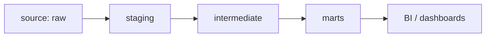

## 1. Core Concept

**dbt** (data build tool) cho phép phân tích viên/kỹ sư biến đổi dữ liệu **trong warehouse bằng SQL** như phần mềm: model là file `SELECT`, có version, test, tài liệu và lineage. Đó là chữ **T** trong **ELT**. Mental model: *dbt không di chuyển dữ liệu — nó biên dịch SQL và chạy trong warehouse theo đồ thị phụ thuộc.*

## 2. How It Works

- **Model**: file `.sql` chứa `SELECT`; `{{ ref('other_model') }}` tạo **DAG phụ thuộc**, `{{ source('raw','orders') }}` trỏ dữ liệu gốc.
- **Materialization**: `view`, `table`, **`incremental`** (chỉ xử lý dòng mới), `ephemeral`.
- **Test**: generic (`unique`, `not_null`, `accepted_values`, `relationships`) và singular (SQL tuỳ ý); **freshness** cho source.
- **Tài liệu và lineage** tự sinh từ code (`dbt docs`).
- **Phân lớp** thường dùng: **staging** (làm sạch 1-1 nguồn) → **intermediate** → **marts** (bảng phục vụ BI).
- **Snapshot** (SCD2), **seeds** (CSV nhỏ), **macros** (Jinja tái sử dụng).
- **Môi trường**: dev/prod target, CI chạy `dbt build` với state-based selection.

```sql
-- models/marts/fct_orders.sql
select o.id, o.customer_id, sum(i.amount) as revenue
from {{ ref('stg_orders') }} o
join {{ ref('stg_items') }} i on i.order_id = o.id
group by 1, 2
```

## 3. Visual Diagram



## 4. Rules of Thumb & Trade-offs

- Một model = một khái niệm rõ; đặt tên theo lớp (`stg_`, `int_`, `fct_`, `dim_`).
- **Test ở staging** để lỗi dừng sớm.
- Trade-off: **SQL-first đơn giản, kiểm thử được** vs **không hợp biến đổi phức tạp cần code (khi đó dùng Spark)**.

## 5. Must Remember / Production Pitfalls

- **Incremental** sai khoá/điều kiện gây trùng hoặc thiếu dòng; cần `unique_key` và xử lý dữ liệu đến trễ.
- Model `view` xếp chồng nhiều tầng làm truy vấn chậm.
- Bỏ qua test → số liệu sai lan tới dashboard.
- Logic nghiệp vụ nằm rải rác ở BI thay vì mart.
- Chi phí warehouse tăng khi chạy full-refresh bảng lớn.
- Interview trap: "dbt có phải công cụ ETL không?" → chỉ làm **transform** trong warehouse (ELT).

## 6. Search Hooks

- `dbt incremental models` — xử lý chỉ dữ liệu mới.
- `dbt tests ref source` — kiểm thử và phụ thuộc.
- `analytics engineering staging marts` — phân lớp mô hình dữ liệu.
- `slowly changing dimension snapshot` — lưu lịch sử thay đổi chiều.
- `ELT vs ETL` — thứ tự biến đổi và nạp.
