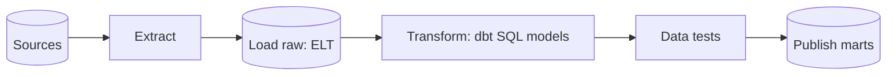

## 1. Core Concept

**ETL/ELT pipeline** đưa dữ liệu từ nguồn (DB, API, file) về nơi phân tích; **orchestration** lập lịch, sắp thứ tự phụ thuộc, retry và giám sát các bước đó (**Apache Airflow, Dagster, Prefect**). Chất lượng pipeline không nằm ở việc "chạy được một lần" mà ở việc **chạy lại bao nhiêu lần cũng cho cùng kết quả**. Mental model: *pipeline là một DAG các bước nhỏ, mỗi bước **idempotent** và gắn với một **khoảng dữ liệu** xác định — nhờ đó retry và backfill an toàn.*

## 2. How It Works

- **ETL** (Extract–Transform–Load): biến đổi **trước** khi nạp vào đích. **ELT**: nạp dữ liệu thô vào warehouse/lakehouse **rồi** biến đổi bằng SQL (**dbt**) tận dụng sức mạnh tính toán của warehouse — là xu hướng hiện đại.
- **Orchestrator**: định nghĩa **DAG** (đồ thị có hướng không chu trình) gồm **task** và **dependency**; **scheduler** chạy theo lịch hoặc sự kiện; **executor/worker** thực thi; hỗ trợ **retry, timeout, SLA, alert, backfill** (chạy lại cho các khoảng quá khứ).
- **Airflow**: `DAG`, `Operator`, `Sensor` (chờ điều kiện), `XCom` (truyền **dữ liệu nhỏ** giữa task), `catchup`/backfill, `data interval` (khoảng dữ liệu mà một lần chạy phụ trách).
- **Tải dữ liệu**: **full load** (đơn giản, tốn kém) vs **incremental** (theo watermark `updated_at`, hoặc **CDC**); nạp vào **partition** theo ngày để ghi đè an toàn.
- **Idempotent task**: cùng input → cùng output, chạy lại không nhân đôi. Cách làm: **ghi đè partition**, `MERGE/UPSERT` theo khoá, ghi vào bảng tạm rồi **hoán đổi** nguyên tử.
- **Xác định theo logical date**: dùng **khoảng dữ liệu của lần chạy** (`{{ data_interval_start }}`) chứ **không** `now()`.

```python
@dag(schedule="@daily", start_date=datetime(2026, 1, 1), catchup=True)
def daily_orders():
    @task
    def load(ds=None):  # ds = ngày logic của lần chạy
        run_sql("DELETE FROM raw.orders WHERE order_date = %(d)s", d=ds)   # ghi đè partition -> idempotent
        run_sql("INSERT INTO raw.orders SELECT * FROM src.orders WHERE order_date = %(d)s", d=ds)
    load()
```

## 3. Visual Diagram



## 4. Rules of Thumb & Trade-offs

- Mặc định **ELT**: nạp thô, giữ lịch sử, biến đổi bằng SQL trong warehouse; ETL khi phải lọc/ẩn dữ liệu nhạy cảm **trước khi** nạp.
- Mỗi task **nhỏ, một việc, idempotent**; để orchestrator **điều phối**, còn việc nặng chạy ở warehouse/Spark, không trong worker Airflow.
- **Incremental + partition** cho bảng lớn; full refresh định kỳ để sửa lệch.
- Trade-off: **đơn giản/đúng** (full refresh) vs **chi phí/độ trễ** (incremental phức tạp hơn).

## 5. Must Remember / Production Pitfalls

- **Task không idempotent** (`INSERT` thẳng) → retry hoặc backfill **nhân đôi dữ liệu**.
- Dùng **`datetime.now()`** trong task → backfill ra kết quả sai vì không gắn với khoảng dữ liệu.
- **XCom truyền dữ liệu lớn** làm sập metadata DB; chỉ truyền tham chiếu (đường dẫn, ID).
- **Xử lý nặng khi parse DAG** (gọi DB/API ở top-level file) làm scheduler chậm.
- **Dữ liệu đến muộn** (late-arriving) khiến lô ngày hôm trước thiếu: cần cửa sổ tải lại hoặc xử lý theo event time.
- **Múi giờ/DST** gây lỗi lịch; dùng UTC.
- Thiếu **alert/SLA** → pipeline hỏng mà không ai biết cho tới khi báo cáo sai.
- Interview trap: "Làm sao backfill an toàn?" → task idempotent + gắn **data interval**, ghi đè partition.

## 6. Search Hooks

- `ETL vs ELT` — biến đổi trước hay sau khi nạp vào đích.
- `Apache Airflow DAG data interval backfill` — khái niệm lập lịch và chạy lại của Airflow.
- `idempotent data pipelines` — thiết kế pipeline chạy lại không nhân đôi dữ liệu.
- `dbt models tests incremental` — biến đổi bằng SQL, kiểm thử và nạp tăng dần.
- `incremental load watermark` — chỉ tải phần dữ liệu thay đổi.
- `Dagster vs Airflow` — so sánh hai công cụ orchestration.
