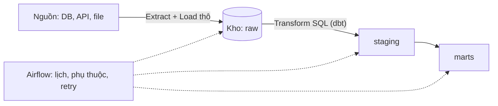

## 1. Core Concept

**ETL** (Extract–Transform–Load) biến đổi dữ liệu **trước khi nạp** vào kho; **ELT** nạp dữ liệu **thô** vào kho trước rồi **biến đổi bên trong kho** (tận dụng sức mạnh và chi phí rẻ của kho hiện đại, thường kèm **dbt**). **Orchestration** (Airflow, Dagster, Prefect) **lên lịch, phụ thuộc, retry và giám sát** các bước đó. Điều quan trọng nhất của một pipeline dữ liệu tốt là **idempotent**: chạy lại bao nhiêu lần cũng ra cùng kết quả.

**Mental model:** pipeline như **dây chuyền sản xuất đêm**: orchestrator là **quản đốc** biết trạm nào chạy trước, trạm nào chờ, trạm nào hỏng thì thử lại. Nếu mỗi ca chạy lại mà **sản phẩm bị nhân đôi**, dây chuyền đó không đáng tin; muốn tin được thì **mỗi ca ghi đè đúng phần việc của mình** thay vì chất thêm.

## 2. How It Works

**ETL vs ELT**
- **ETL**: transform ở **máy riêng** trước khi nạp — phù hợp kho cũ/giới hạn, dữ liệu nhạy cảm cần làm sạch trước. **ELT**: **nạp thô** (lưu bản gốc để chạy lại), transform bằng **SQL trong kho** (scale theo kho, dbt quản lý model/test). Xu hướng hiện đại là ELT.

**Airflow cơ bản**
- **DAG** (đồ thị có hướng không chu trình) gồm **task** (operator) và phụ thuộc; **scheduler** kích hoạt theo lịch; **executor** chạy task; **XCom** truyền dữ liệu **nhỏ** giữa task; **sensor** chờ điều kiện (nên dùng **deferrable** để không chiếm slot).

**Data interval và backfill**
- Mỗi lần chạy gắn với một **data interval** `[start, end)`; run cho interval đó được kích hoạt **sau khi interval kết thúc** (run "ngày 21" chạy vào đầu ngày 22 và xử lý dữ liệu ngày 21). **Không dùng `now()` trong task** — dùng `data_interval_start/end` để kết quả **tất định**. **Catchup/backfill** chạy lại các interval quá khứ.

**Pipeline idempotent**
- Chạy hai lần → cùng kết quả. Cách làm: **ghi đè theo partition** (`INSERT OVERWRITE`/xoá-rồi-chèn theo interval), **`MERGE` upsert theo khoá**, tránh `INSERT` nối đuôi không điều kiện, tên file/bảng tạm theo interval. Nhờ đó **retry và backfill an toàn**.

**Incremental load với watermark**
- Chỉ nạp **bản ghi mới/đổi** kể từ lần trước: `WHERE updated_at > :last_watermark`. Cẩn thận: **không bắt được xoá cứng**, **cập nhật muộn** (updated_at đến sau watermark) → dùng **lookback window** (nạp lại N giờ gần nhất) hoặc **CDC**; **full refresh** định kỳ để đối soát.

**Công cụ**
- **Airflow** (trưởng thành, nhiều tích hợp, task-centric), **Dagster** (**asset-centric**: mô hình hoá bảng/dataset, lineage, kiểm thử tốt), **Prefect** (Python-native, linh hoạt). **dbt** lo phần transform SQL có test.

```python
@dag(schedule="@daily", start_date=datetime(2026, 1, 1), catchup=True, max_active_runs=1)
def sales_pipeline():
    @task(retries=3, retry_delay=timedelta(minutes=5))
    def load_partition(data_interval_start=None, data_interval_end=None):
        # idempotent: xoá rồi chèn đúng interval này
        run_sql("DELETE FROM sales WHERE ts >= %s AND ts < %s", data_interval_start, data_interval_end)
        run_sql("INSERT INTO sales SELECT * FROM staging WHERE ts >= %s AND ts < %s",
                data_interval_start, data_interval_end)
    load_partition()
sales_pipeline()
```

## 3. Visual Diagram



## 4. Rules of Thumb & Trade-offs

| Tình huống / Nhu cầu | Chọn gì |
| --- | --- |
| Kho hiện đại (Snowflake/BigQuery/Redshift), muốn giữ dữ liệu thô | ELT |
| Cần làm sạch/ẩn PII trước khi vào kho | ETL (hoặc ELT với bước mask sớm) |
| Chạy lại/backfill an toàn | Pipeline idempotent (overwrite theo partition/MERGE) |
| Chỉ nạp phần mới | Incremental + watermark + lookback |
| Bắt cả xoá và thay đổi chính xác | CDC |
| Quản lý theo asset/lineage | Dagster |
| Hệ sinh thái tích hợp rộng, chuẩn ngành | Airflow |

- **Được gì:** lặp lại được, dễ debug, chạy lại an toàn. **Mất gì:** ELT tốn chi phí lưu trữ dữ liệu thô và tính toán trong kho; orchestrator thêm hạ tầng vận hành.

## 5. Must Remember / Production Pitfalls

- **Backfill/retry làm dữ liệu nhân đôi → task append không idempotent → overwrite theo partition hoặc MERGE**.
- **Kết quả khác nhau mỗi lần chạy lại → dùng `now()` trong task → dùng `data_interval_start/end`**.
- **Thiếu dữ liệu cập nhật muộn → watermark `updated_at` không bắt update trễ/xoá → lookback window, CDC, full refresh đối soát**.
- **Cạn slot, pipeline chậm → sensor chiếm worker khi chờ → deferrable sensor, timeout**.
- **Task nặng chạy trực tiếp trên worker Airflow → quá tải → đẩy tính toán sang Spark/kho, Airflow chỉ điều phối**.
- **Truyền dữ liệu lớn qua XCom → DB metadata phình → chỉ truyền tham chiếu (đường dẫn), lưu dữ liệu ở storage**.
- Interview trap: "ETL vs ELT?" → **ELT nạp thô rồi transform trong kho**; "idempotent pipeline?" → **chạy lại cho cùng kết quả (ghi đè theo partition/MERGE)**; "run ngày 21 chạy khi nào?" → **sau khi interval ngày 21 kết thúc**.

## 6. Search Hooks

- `ETL vs ELT` — thứ tự biến đổi và nạp.
- `Airflow DAG data interval backfill` — lịch chạy theo interval và chạy lại.
- `idempotent data pipelines` — pipeline chạy lại an toàn.
- `incremental load watermark` — chỉ nạp phần mới.
- `Airflow vs Dagster vs Prefect` — các orchestrator phổ biến.
- `dbt models tests` — transform SQL có kiểm thử.
