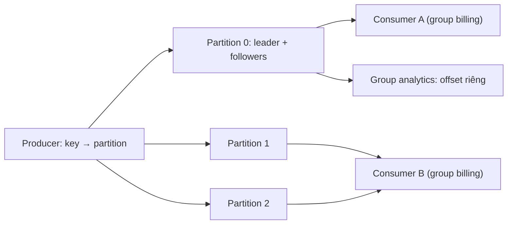

## 1. Core Concept

**Apache Kafka** là **log phân tán, bền, chia partition** dùng để truyền và lưu **dòng sự kiện** khối lượng lớn. Producer **ghi nối đuôi** vào topic, consumer **đọc theo offset của riêng mình** nên nhiều ứng dụng đọc độc lập, **replay** được. Kafka giải quyết **tách rời, chịu đột biến, thông lượng rất cao** (hàng trăm nghìn–triệu message/giây) — nhưng đòi bạn hiểu **partition, offset, replication, delivery guarantees**.

**Mental model:** Kafka là **cuốn nhật ký chung chia thành nhiều quyển (partition)**, chỉ ghi nối đuôi, giữ theo thời hạn. Mỗi người đọc có **thẻ đánh dấu riêng (offset)** và đọc theo tốc độ riêng; nhóm người đọc cùng nhiệm vụ (consumer group) **chia nhau mỗi quyển một người** để không đọc trùng.

## 2. How It Works

**Topic, partition, offset**
- Topic chia thành **partition**; mỗi partition là **log append-only có thứ tự**, mỗi bản ghi có **offset** tăng dần. **Thứ tự chỉ đảm bảo trong một partition**; **key** của message quyết định partition (cùng key → cùng partition). Dữ liệu **giữ theo retention** (thời gian/dung lượng), không xoá khi đọc.

**Consumer group**
- Trong một **group**, mỗi partition được **đúng một consumer** đọc ⇒ **độ song song tối đa = số partition**; nhiều group đọc độc lập (billing, analytics). **Offset** đã xử lý được commit; commit **sau khi xử lý** → **at-least-once**, **trước** → **at-most-once**. **Consumer lag** = vị trí cuối log − offset đã commit (chỉ số sức khoẻ quan trọng).

**Replication và độ bền**
- Mỗi partition có **replication factor (thường 3)**: một **leader** nhận ghi, các **follower** sao chép; **ISR** (in-sync replicas) là các replica theo kịp. **`acks`**: `0` (không chờ), `1` (leader ghi), **`all`** (chờ mọi ISR). **`min.insync.replicas=2`** cùng **RF=3, `acks=all`** → chịu mất **1 broker** mà **không mất message đã ack** (nếu ISR < 2 thì ghi bị từ chối — đổi khả dụng lấy độ bền). Tắt `unclean.leader.election`.

**Idempotent producer và transactions**
- **Idempotent producer** (`enable.idempotence=true`): broker dùng **producer id + sequence** để **khử trùng khi retry** trong một partition. **Transactions**: ghi **nguyên tử nhiều partition** và commit offset trong cùng giao dịch (mẫu **consume–transform–produce**), consumer `read_committed` chỉ thấy dữ liệu đã commit → **exactly-once trong phạm vi Kafka**.

**Log compaction**
- Thay vì xoá theo thời gian, **chỉ giữ bản ghi mới nhất cho mỗi key**; ghi **tombstone** (value null) để xoá key. Dùng cho **changelog/trạng thái** (bảng, cấu hình, CDC).

**Rebalance**
- Khi consumer vào/ra hoặc **xử lý quá chậm** (vượt `max.poll.interval.ms`/mất heartbeat `session.timeout.ms`), group **rebalance** và tạm dừng đọc. Giảm: **cooperative rebalancing**, **static membership**, xử lý ngắn gọn, tăng `max.poll.interval.ms`.

**KRaft**
- Kafka mới dùng **Raft nội bộ (KRaft)** quản lý metadata thay cho ZooKeeper → đơn giản vận hành, scale số partition tốt hơn.

**Chọn số partition**
- Quyết định **song song tối đa** và thông lượng; **tăng được, không giảm được**, và **tăng làm đổi ánh xạ key → partition** (phá thứ tự theo key). Ước lượng theo thông lượng mục tiêu/consumer.

```properties
# Producer bền: không mất message đã ack, không trùng khi retry
acks=all
enable.idempotence=true
retries=2147483647
delivery.timeout.ms=120000
# Topic: replication.factor=3, min.insync.replicas=2
```

## 3. Visual Diagram



## 4. Rules of Thumb & Trade-offs

| Tình huống / Nhu cầu | Chọn gì |
| --- | --- |
| Không mất message đã ack | RF=3, `acks=all`, `min.insync.replicas=2` |
| Không trùng khi retry | Idempotent producer |
| Ghi nguyên tử nhiều partition + offset | Transactions |
| Giữ trạng thái mới nhất theo key | Log compaction |
| Thứ tự theo thực thể | Key = id thực thể |
| Consumer chậm | Thêm consumer (≤ số partition), xử lý nhanh hơn |
| Xử lý không mất message | Commit offset sau khi xử lý + idempotent |

- **Được gì:** throughput lớn, bền, replay, nhiều consumer. **Mất gì:** độ phức tạp vận hành, thứ tự chỉ trong partition, `acks=all` tăng độ trễ, rebalance gây gián đoạn.

## 5. Must Remember / Production Pitfalls

- **Mất message sau khi broker chết → `acks=1` hoặc RF thấp → RF=3, `acks=all`, `min.insync.replicas=2`**.
- **Message trùng sau retry → producer không idempotent → `enable.idempotence=true`; consumer vẫn cần idempotent (at-least-once)**.
- **Thêm consumer không nhanh hơn → vượt số partition → tăng partition (cẩn thận ánh xạ key) hoặc song song trong consumer**.
- **Consumer lag tăng, rebalance liên tục → xử lý quá lâu vượt `max.poll.interval.ms` → xử lý nhẹ/bất đồng bộ, tăng timeout, cooperative rebalancing**.
- **Một partition quá nóng → key lệch (hot partition) → chọn key phân bố đều/thêm hậu tố**.
- **Tăng partition làm đảo thứ tự theo key → ánh xạ đổi → lên kế hoạch số partition từ đầu**.
- Interview trap: "thứ tự đảm bảo ở đâu?" → **trong một partition**; "exactly-once trong Kafka?" → **idempotent producer + transactions (trong Kafka), ngoài ra cần consumer idempotent**; "độ song song tối đa?" → **số partition**.

## 6. Search Hooks

- `Kafka partitions offsets consumer groups` — mô hình log, song song và đọc độc lập.
- `Kafka acks min.insync.replicas` — cấu hình độ bền khi ghi.
- `Kafka idempotent producer transactions` — chống trùng và exactly-once trong Kafka.
- `Kafka log compaction` — giữ bản ghi mới nhất theo key.
- `Kafka consumer lag rebalancing` — chỉ số lag và rebalance.
- `KRaft Kafka without ZooKeeper` — metadata bằng Raft nội bộ.
