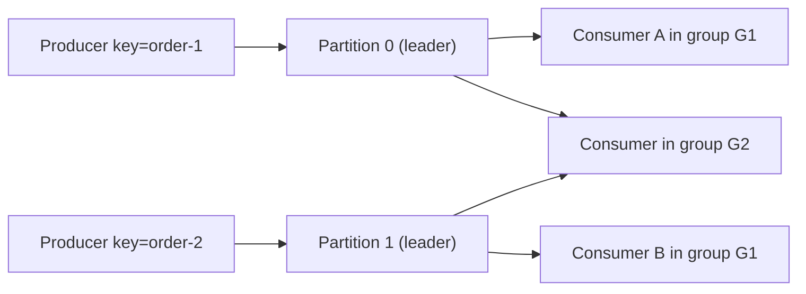

## 1. Core Concept

**Apache Kafka** là nền tảng **distributed commit log**: producer **append** sự kiện vào **topic** chia thành **partition**, broker lưu bền theo thời gian, nhiều consumer đọc độc lập theo **offset** của mình. Nó đạt throughput rất cao nhờ ghi/đọc **tuần tự** và dựa vào page cache của OS. Mental model: *Kafka là cuốn sổ cái chỉ-ghi-thêm có đánh số dòng (offset); ai muốn đọc thì tự nhớ mình đọc tới dòng nào.*

## 2. How It Works

- **Topic → partition → offset**: mỗi partition là log có thứ tự; **thứ tự chỉ được đảm bảo trong một partition**. Message có **key** → hash tới partition cố định → cùng key luôn cùng thứ tự.
- **Producer**: `acks=0/1/all` (không chờ / chờ leader / chờ toàn bộ **ISR**); **`enable.idempotence=true`** chống trùng khi retry; batching + nén để tăng throughput.
- **Replication**: mỗi partition có **leader** và **follower**; **ISR** (in-sync replicas) là các bản sao theo kịp; kết hợp `acks=all` + **`min.insync.replicas`** để đảm bảo độ bền. Từ Kafka 4.0, metadata dùng **KRaft** (không còn ZooKeeper).
- **Consumer group**: mỗi partition được gán cho **đúng một consumer trong group** → **độ song song tối đa = số partition**; group khác đọc độc lập. Thêm/bớt consumer gây **rebalance**.
- **Offset commit**: commit **sau khi xử lý** → at-least-once (có thể trùng); commit **trước** → at-most-once (có thể mất). **Exactly-once** trong Kafka dùng **transaction** (read-process-write).
- **Retention**: xoá theo **thời gian/dung lượng**, hoặc **log compaction** (giữ giá trị mới nhất mỗi key — dùng làm "bảng" changelog).
- **Hiệu năng**: ghi tuần tự, **zero-copy**, page cache, batching.

```properties
# Producer an toàn cho dữ liệu quan trọng
acks=all
enable.idempotence=true
retries=2147483647
delivery.timeout.ms=120000
compression.type=lz4
# Broker/topic: replication.factor=3, min.insync.replicas=2
```

## 3. Visual Diagram



## 4. Rules of Thumb & Trade-offs

- **Số partition** quyết định song song tối đa và khó giảm; chọn theo throughput mục tiêu và số consumer dự kiến, chừa dư địa tăng.
- Dữ liệu không được mất → `acks=all`, `replication.factor=3`, `min.insync.replicas=2`; chấp nhận độ trễ ghi cao hơn.
- Cần thứ tự theo thực thể → **key = id thực thể**; cần thứ tự toàn cục → một partition (đánh đổi throughput).
- Trade-off: **Throughput/Durability/Latency** (acks, batching) và **Ordering vs Parallelism**.

## 5. Must Remember / Production Pitfalls

- **Consumer lag** tăng liên tục = consumer chậm hơn producer → theo dõi và scale, kiểm tra xử lý chậm.
- **Hot partition** do key lệch (một khách hàng lớn) → một partition quá tải trong khi phần còn lại rảnh.
- **Rebalance storm**: consumer xử lý quá lâu (`max.poll.interval.ms`) bị coi là chết → rebalance liên tục; xử lý nặng nên tách khỏi poll loop.
- **Tăng số partition** làm đổi ánh xạ key → thứ tự theo key bị phá với dữ liệu mới.
- `acks=1` có thể **mất message** nếu leader chết trước khi follower sao chép; **unclean leader election** đánh đổi độ bền lấy sẵn sàng.
- Kích thước message mặc định tối đa ~**1 MB**: dữ liệu lớn nên lưu ngoài (S3) và gửi tham chiếu.
- Interview trap: "Kafka có exactly-once không?" → **trong phạm vi Kafka + transaction**; ghi ra hệ thống ngoài vẫn cần idempotent.

## 6. Search Hooks

- `Kafka partitions offsets consumer groups` — mô hình dữ liệu và cách consumer chia việc.
- `Kafka acks min.insync.replicas durability` — cấu hình độ bền khi ghi.
- `Kafka idempotent producer exactly-once transactions` — chống trùng và xử lý read-process-write.
- `Kafka log compaction` — giữ giá trị mới nhất mỗi key.
- `Kafka consumer lag rebalancing` — giám sát độ trễ và xử lý rebalance.
- `KRaft Kafka without ZooKeeper` — kiến trúc metadata mới của Kafka.
