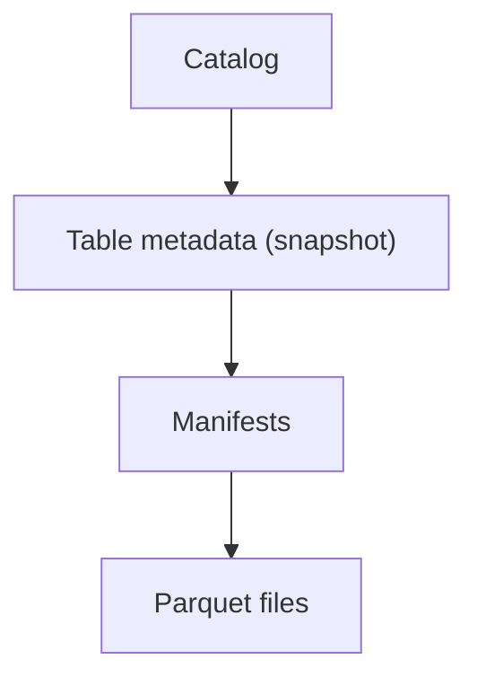

## 1. Core Concept

**Open table format** (Apache **Iceberg**, **Delta Lake**, **Apache Hudi**) thêm lớp metadata lên file Parquet trong object storage để có **giao dịch ACID, schema evolution, time travel** và hiệu quả truy vấn. Đây là nền của **lakehouse**. Mental model: *Parquet là các trang giấy; table format là sổ mục lục có phiên bản cho biết trang nào thuộc bảng ở mỗi thời điểm.*

## 2. How It Works

- **Vấn đề của data lake thô**: ghi đồng thời hỏng, không UPDATE/DELETE, liệt kê file chậm, schema lệch.
- **Metadata/transaction log**: Delta dùng `_delta_log`; Iceberg dùng **snapshot → manifest list → manifest → data files**; mỗi commit tạo snapshot mới (**atomic swap** con trỏ metadata).
- **Isolation**: optimistic concurrency, đọc thấy snapshot nhất quán.
- **Time travel**: truy vấn theo snapshot/timestamp; **rollback**.
- **Schema evolution**: thêm/đổi tên cột an toàn (Iceberg theo column id).
- **Partition**: Iceberg **hidden partitioning** và partition evolution.
- **Row-level change**: `MERGE INTO` (upsert), `DELETE`; **copy-on-write** vs **merge-on-read**.
- **Bảo trì**: **compaction** (gộp file nhỏ), expire snapshots, vacuum file mồ côi.
- **Engine**: Spark, Trino, Flink, Athena, Snowflake đọc cùng bảng.

## 3. Visual Diagram

## 4. Rules of Thumb & Trade-offs

- Dùng table format khi cần **upsert/CDC, time travel, nhiều engine** trên lake.
- Chọn theo hệ sinh thái: Delta (Databricks), Iceberg (đa engine), Hudi (upsert/streaming).
- Trade-off: **ACID và linh hoạt** vs **chi phí bảo trì (compaction, snapshot)**.

## 5. Must Remember / Production Pitfalls

- Không compaction → **small files** làm chậm.
- Không expire snapshot → metadata và dung lượng phình.
- Xoá file thủ công ngoài format làm hỏng bảng.
- Merge-on-read đọc chậm hơn nếu không compaction.
- Hai writer xung đột commit → retry.
- Interview trap: "Time travel hoạt động thế nào?" → giữ **snapshot cũ** của metadata trỏ tới file cũ.

## 6. Search Hooks

- `Apache Iceberg snapshots manifests` — cấu trúc metadata của Iceberg.
- `Delta Lake transaction log` — nhật ký giao dịch.
- `Iceberg vs Delta vs Hudi` — so sánh ba format.
- `copy-on-write vs merge-on-read` — hai chiến lược cập nhật.
- `table compaction small files` — gộp file nhỏ.
