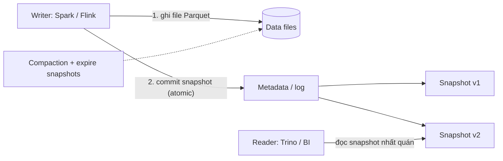

## 1. Core Concept

**Open table format** (**Apache Iceberg**, **Delta Lake**, **Apache Hudi**) là lớp **metadata** đặt trên file **Parquet** ở object storage, biến "đống file" thành **bảng có giao dịch ACID**: upsert/delete, **schema evolution**, **time travel**, đọc/ghi đồng thời an toàn. Nó giải quyết nhược điểm lớn nhất của data lake thô (không ACID, file nhỏ, schema hỗn loạn) và là nền tảng của **lakehouse**.

**Mental model:** table format như **sổ cái commit của Git đặt trên thư mục file**: dữ liệu thật là file bất biến; mỗi lần ghi tạo **commit mới (snapshot)** trỏ đến tập file hiện tại. Đọc luôn thấy **một snapshot nhất quán**, quay lại **snapshot cũ = time travel**.

## 2. How It Works

**Cấu trúc**
- **Data files** (Parquet, bất biến) + **metadata** (danh sách file, thống kê, schema, snapshot). **Iceberg**: metadata file → manifest list → manifests → data files. **Delta**: **transaction log** `_delta_log` (JSON + checkpoint Parquet). **Hudi**: **timeline** + index.

**ACID bằng optimistic concurrency**
- Writer ghi file mới, rồi **commit nguyên tử** bằng cách thêm một phiên bản metadata. Hai writer cùng lúc: **ai commit trước thắng**, người sau **kiểm tra xung đột** và retry/thất bại. Reader **không bị chặn**, đọc snapshot đã commit (**snapshot isolation**).

**Update/Delete: copy-on-write vs merge-on-read**
- **Copy-on-write (CoW)**: sửa dòng → **viết lại cả file** chứa dòng đó; đọc nhanh, ghi tốn. **Merge-on-read (MoR)**: ghi **delta/delete file nhỏ**, gộp khi đọc hoặc compaction; ghi nhanh, đọc chậm hơn đến khi compact. `MERGE INTO` cho **upsert** và **CDC**.

**Time travel và schema evolution**
- Truy vấn theo **snapshot/timestamp** (`VERSION AS OF`) để audit, rollback, tái lập kết quả. **Schema evolution**: thêm/đổi tên cột **không viết lại dữ liệu** (Iceberg theo **column id**, an toàn khi đổi tên). **Partition evolution** (Iceberg): đổi chiến lược partition không cần rewrite.

**Bảo trì**
- **Compaction** (gộp file nhỏ), **expire snapshots** (xoá snapshot cũ để giải phóng dung lượng), **remove orphan files**, **VACUUM** (Delta). Không bảo trì → metadata/file phình, truy vấn chậm.

**Chọn format**
- **Iceberg**: đa engine (Spark/Trino/Flink/Snowflake…), partition evolution, catalog mở. **Delta**: tích hợp sâu Databricks/Spark. **Hudi**: mạnh upsert/streaming gần real-time. Chọn theo **hệ sinh thái engine và catalog** đang dùng.

```sql
-- Upsert CDC vào bảng Iceberg/Delta bằng MERGE (ACID)
MERGE INTO lake.orders t
USING staging.orders_cdc s ON t.order_id = s.order_id
WHEN MATCHED AND s.op = 'd' THEN DELETE
WHEN MATCHED THEN UPDATE SET *
WHEN NOT MATCHED THEN INSERT *;

SELECT * FROM lake.orders VERSION AS OF 1234;   -- time travel
```

## 3. Visual Diagram



## 4. Rules of Thumb & Trade-offs

| Tình huống / Nhu cầu | Chọn gì |
| --- | --- |
| Nhiều engine cùng đọc, catalog mở | Iceberg |
| Hệ sinh thái Databricks/Spark | Delta Lake |
| Upsert tần suất cao, streaming | Hudi / MoR |
| Đọc nhiều, ghi ít | Copy-on-write |
| Ghi nhiều, chấp nhận đọc chậm hơn | Merge-on-read + compaction |
| Audit/rollback | Time travel |

- **Được gì:** ACID, upsert/delete, time travel, một bản dữ liệu cho nhiều engine. **Mất gì:** cần bảo trì (compaction, expire), CoW tốn ghi, MoR tốn đọc, khoá chặt vào catalog/engine tương thích.

## 5. Must Remember / Production Pitfalls

- **Truy vấn chậm dần, metadata phình → nhiều file nhỏ/snapshot → compaction, expire snapshots định kỳ**.
- **Dung lượng storage tăng mãi dù xoá dữ liệu → snapshot cũ giữ file → expire snapshots + remove orphan files**.
- **Hai job ghi cùng lúc thất bại → xung đột optimistic concurrency → retry, tách partition ghi**.
- **Đọc MoR chậm → nhiều delta chưa compact → compaction theo lịch**.
- **Time travel mất sau khi VACUUM → xoá file cũ → giữ retention đủ dài cho nhu cầu audit**.
- **Engine không đọc được bảng → catalog/phiên bản không tương thích → chọn catalog chuẩn (REST/Glue/Unity) và kiểm tra phiên bản**.
- Interview trap: "table format cung cấp gì trên lake?" → **ACID, time travel, schema evolution qua metadata**; "CoW vs MoR?" → **CoW đọc nhanh ghi tốn, MoR ghi nhanh đọc tốn**; "ACID thực hiện thế nào?" → **commit metadata nguyên tử + optimistic concurrency**.

## 6. Search Hooks

- `Apache Iceberg table format` — metadata snapshot cho bảng trên object storage.
- `Delta Lake transaction log` — nhật ký giao dịch của Delta.
- `Apache Hudi copy-on-write merge-on-read` — hai chiến lược cập nhật.
- `lakehouse time travel` — truy vấn phiên bản cũ.
- `Iceberg compaction expire snapshots` — bảo trì bảng.
- `optimistic concurrency control table formats` — xử lý ghi đồng thời.
