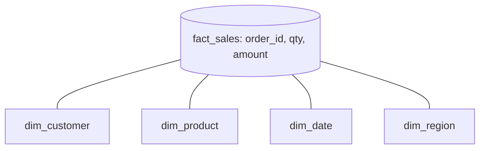

## 1. Core Concept

**OLTP** (Online Transaction Processing) phục vụ giao dịch ngắn, nhiều, theo từng hàng; **OLAP** (Online Analytical Processing) phục vụ truy vấn phân tích đọc **hàng triệu–tỷ hàng nhưng ít cột**. Hai workload đối lập nên cần **mô hình dữ liệu và engine khác nhau**. Mental model: *OLTP trả lời "chuyện gì đang xảy ra với đơn #42"; OLAP trả lời "doanh thu theo vùng theo tháng" — chạy truy vấn thứ hai trên DB của thứ nhất là cách làm sập production.*

## 2. How It Works

| | OLTP | OLAP |
| --- | --- | --- |
| Truy vấn | Điểm/ít hàng, ghi nhiều | Quét lớn, tổng hợp (`SUM/GROUP BY`) |
| Lưu trữ | **Row store** | **Column store** (nén tốt, đọc đúng cột cần) |
| Mô hình | **Chuẩn hoá (3NF)** giảm trùng lặp | **Phi chuẩn hoá** cho đọc nhanh |
| Ví dụ | PostgreSQL, MySQL | BigQuery, Snowflake, Redshift, ClickHouse |

- **Dimensional modeling (Kimball)**: **fact table** (sự kiện đo lường: số tiền, số lượng — dạng số, rất nhiều hàng) bao quanh bởi **dimension table** (ngữ cảnh: khách hàng, sản phẩm, thời gian, vùng) → **star schema**; **snowflake** là dimension chuẩn hoá thêm.
- **Grain** (độ mịn của fact): "một hàng = một dòng hoá đơn" — **phải định nghĩa rõ trước tiên**.
- **Surrogate key** cho dimension thay vì khoá nghiệp vụ.
- **SCD (Slowly Changing Dimension)**: **Type 1** ghi đè (mất lịch sử), **Type 2** thêm hàng mới kèm `valid_from/valid_to` (giữ lịch sử), Type 3 thêm cột giá trị cũ.
- **Column store** nén theo cột và dùng **vectorized execution**, rất nhanh với aggregation nhưng kém với cập nhật từng hàng.
- Dữ liệu từ OLTP sang OLAP qua **ETL/ELT** hoặc **CDC**.

## 3. Visual Diagram

## 4. Rules of Thumb & Trade-offs

- **Tách OLTP và OLAP**: dùng replica/warehouse riêng cho báo cáo, không chạy phân tích nặng trên DB giao dịch.
- Phân tích → **star schema** rõ ràng dễ truy vấn hơn mô hình chuẩn hoá; cần lịch sử thay đổi → **SCD Type 2**.
- Bắt đầu mô hình hoá từ **câu hỏi nghiệp vụ và grain**, không từ cấu trúc bảng nguồn.
- Trade-off: **phi chuẩn hoá** nhanh khi đọc nhưng **dữ liệu lặp và cập nhật khó**.

## 5. Must Remember / Production Pitfalls

- **Sai grain** (trộn hoá đơn và dòng hoá đơn trong cùng fact) làm tổng bị **nhân đôi** — lỗi số liệu phổ biến nhất.
- **Fact không cộng được** (tỷ lệ, số dư) không được `SUM` qua các chiều → lưu thành phần tử số/mẫu số.
- Ghi đè dimension (SCD 1) làm **báo cáo quá khứ đổi theo** — nếu cần đúng lịch sử, dùng Type 2.
- Row-store cho phân tích hoặc column-store cho OLTP đều **sai công cụ**.
- Quên **dimension thời gian** (date dim) khiến mọi truy vấn theo kỳ phải tự tính.
- Interview trap: "Vì sao warehouse hay phi chuẩn hoá?" → giảm `JOIN`, tối ưu **đọc/aggregation**; dữ liệu nạp theo lô nên rủi ro bất nhất khi ghi thấp.

## 6. Search Hooks

- `OLTP vs OLAP` — hai loại workload và hệ quả về thiết kế.
- `star schema fact and dimension tables` — mô hình dimensional cho phân tích.
- `slowly changing dimensions SCD type 2` — lưu lịch sử thay đổi của dimension.
- `columnar storage vs row storage` — lý do column store nhanh cho phân tích.
- `Kimball dimensional modeling grain` — quy trình mô hình hoá bắt đầu từ grain.
- `data warehouse surrogate keys` — khoá thay thế trong dimension.
