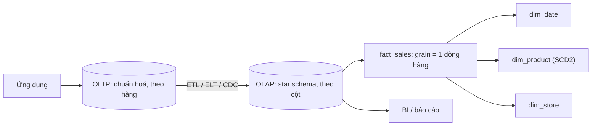

## 1. Core Concept

**OLTP** (xử lý giao dịch trực tuyến) phục vụ **ứng dụng**: hàng triệu **thao tác ngắn, theo từng bản ghi** (đặt hàng, đăng nhập) cần độ trễ mili-giây và tính ACID. **OLAP** (xử lý phân tích trực tuyến) phục vụ **phân tích**: **ít truy vấn nhưng quét và tổng hợp rất nhiều dữ liệu** (doanh thu theo tháng, theo khu vực). Hai tải này **mâu thuẫn về cách lưu và mô hình hoá dữ liệu**, nên cần hai hệ thống/hai mô hình khác nhau — OLTP **chuẩn hoá, lưu theo hàng**; OLAP **phi chuẩn hoá theo star schema, lưu theo cột**.

**Mental model:** OLTP như **quầy thu ngân**: phục vụ từng khách nhanh gọn, mỗi lần làm việc với **một hoá đơn**. OLAP như **phòng phân tích cuối tháng**: ngồi nhìn **hàng triệu hoá đơn cùng lúc** để tính tổng theo cửa hàng và sản phẩm. Hai việc này cần **bàn làm việc khác nhau**.

## 2. How It Works

**OLTP vs OLAP**
- **OLTP**: nhiều giao dịch ngắn, đọc/ghi vài hàng theo khoá, **chuẩn hoá (3NF)** để tránh trùng lặp, **index** cho tra cứu, ACID, dữ liệu **hiện tại**. **OLAP**: ít truy vấn nặng, quét hàng triệu–tỷ hàng nhưng **chỉ vài cột**, **phi chuẩn hoá**, dữ liệu **lịch sử**, chấp nhận tải theo lô/độ trễ.

**Columnar vs row storage**
- **Row store**: các cột của một hàng nằm cạnh nhau → tối ưu **đọc/ghi cả một hàng**. **Column store**: **mỗi cột lưu riêng** → truy vấn `SUM(amount)` chỉ **đọc cột cần**, **nén cực tốt** (giá trị giống nhau: run-length, dictionary → thường **5–10 lần**), xử lý theo **vector**. Ví dụ bảng 100 cột: truy vấn chỉ dùng 3 cột đọc **~3%** dữ liệu thay vì 100%.

**Star schema (Kimball)**
- **Fact table**: các **sự kiện/đo lường** (số lượng, doanh thu) theo một **grain** rõ ràng, chứa **khoá ngoại** tới dimension. **Dimension table**: thuộc tính **mô tả** (khách hàng, sản phẩm, ngày, cửa hàng). Truy vấn = join fact với vài dimension rồi `GROUP BY`. **Snowflake** chuẩn hoá thêm dimension (ít dùng hơn vì nhiều join).
- **Grain trước tiên**: quyết định "một hàng fact đại diện cho gì" (ví dụ **một dòng hàng của một đơn**) **trước khi** chọn dimension/measure; trộn nhiều grain trong một bảng là lỗi kinh điển. Loại fact: **transaction**, **periodic snapshot**, **accumulating snapshot**. Measure **additive** (cộng được) vs **semi-additive** (số dư: không cộng theo thời gian).

**Slowly Changing Dimensions (SCD)**
- Thuộc tính dimension **đổi theo thời gian** (khách chuyển thành phố). **Type 1**: ghi đè (mất lịch sử). **Type 2**: **thêm hàng mới** kèm `valid_from`, `valid_to`, `is_current` → **giữ lịch sử đúng thời điểm**, fact trỏ tới phiên bản đúng. **Type 3**: thêm cột "giá trị cũ" (lịch sử hạn chế).

**Surrogate key**
- Khoá **số nguyên vô nghĩa** do kho sinh ra, thay cho khoá nghiệp vụ (natural key): **ổn định** khi khoá nguồn đổi, **bắt buộc cho SCD Type 2** (một khách có nhiều hàng), join nhanh hơn chuỗi dài.

```sql
-- Doanh thu theo tháng và khu vực: chỉ đọc 3 cột fact, join 2 dimension
SELECT d.year_month, s.region, SUM(f.net_amount) AS revenue
FROM fact_sales f
JOIN dim_date d  ON d.date_key  = f.date_key
JOIN dim_store s ON s.store_key = f.store_key
WHERE d.year = 2026
GROUP BY d.year_month, s.region;
```

## 3. Visual Diagram



## 4. Rules of Thumb & Trade-offs

| Tình huống / Nhu cầu | Chọn gì |
| --- | --- |
| Giao dịch ngắn, đọc/ghi theo khoá | OLTP (row store, chuẩn hoá) |
| Quét và tổng hợp lượng lớn dữ liệu | OLAP (column store, star schema) |
| Cần lịch sử thay đổi thuộc tính | SCD Type 2 + surrogate key |
| Chỉ cần giá trị mới nhất | SCD Type 1 |
| Báo cáo trên cùng hệ thống giao dịch, tải nhỏ | Read replica; chưa cần kho riêng |
| Nhiều nguồn, nhiều đội phân tích | Kho/lakehouse với mô hình chiều |

- **Được gì:** truy vấn phân tích nhanh, mô hình dễ hiểu cho BI. **Mất gì:** phi chuẩn hoá nghĩa là **dữ liệu lặp lại** và phải đồng bộ từ OLTP (độ trễ), thêm hạ tầng ETL.

## 5. Must Remember / Production Pitfalls

- **Báo cáo nặng làm chậm ứng dụng → chạy truy vấn phân tích trên DB giao dịch → tách sang replica/kho OLAP**.
- **Số liệu fact không khớp → trộn nhiều grain trong một bảng → khai báo grain trước, mỗi fact một grain**.
- **Báo cáo lịch sử sai khi khách đổi thông tin → dimension SCD1 ghi đè → SCD Type 2 với surrogate key**.
- **Truy vấn kho chậm do join chuỗi dài → dùng khoá nghiệp vụ dạng chuỗi → surrogate key số nguyên**.
- **Cộng số dư theo thời gian ra kết quả vô nghĩa → measure semi-additive → dùng giá trị cuối kỳ/trung bình**.
- Interview trap: "OLTP vs OLAP?" → **OLTP giao dịch ngắn, row store, chuẩn hoá; OLAP quét/tổng hợp lớn, column store, star schema**; "SCD Type 2 là gì?" → **thêm hàng mới mỗi lần đổi, giữ lịch sử**; "vì sao column store nhanh cho phân tích?" → **chỉ đọc cột cần + nén tốt**.

## 6. Search Hooks

- `OLTP vs OLAP` — hai loại tải và hệ thống tương ứng.
- `star schema fact dimension tables` — mô hình chiều cho phân tích.
- `slowly changing dimensions SCD type 2` — giữ lịch sử thay đổi của chiều.
- `columnar vs row storage` — vì sao lưu theo cột nhanh cho phân tích.
- `Kimball dimensional modeling grain` — khai báo grain trước tiên.
- `surrogate keys` — khoá thay thế ổn định cho kho dữ liệu.
