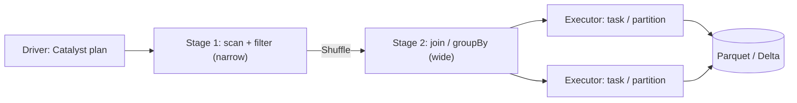

## 1. Core Concept

**Apache Spark** là engine xử lý dữ liệu **phân tán trong bộ nhớ** cho batch và streaming, mô hình hoá bằng **DataFrame/SQL**. Spark chia dữ liệu thành **partition** xử lý song song trên cluster và dựng **kế hoạch thực thi tối ưu (Catalyst)** — giải quyết bài toán xử lý hàng TB mà một máy không làm nổi. Hiệu năng quyết định bởi **shuffle, partition, skew**.

**Mental model:** Spark như **nhóm nhiều đầu bếp chia nhau nguyên liệu**: mỗi người xử lý **phần của mình (partition)**, nhưng khi cần **gộp theo nhóm (group/join)** thì phải **chuyển nguyên liệu qua lại giữa các bếp (shuffle)** — chậm nhất. Nếu một đầu bếp bị dồn quá nhiều (skew) cả nhóm phải đợi.

## 2. How It Works

**Driver, executor, job, stage, task**
- **Driver** lập kế hoạch; **executor** chạy **task** trên partition. Một **action** (count, write) kích hoạt **job**, chia thành **stage** tại ranh giới **shuffle**, mỗi stage gồm nhiều **task** (1 task/partition).

**Lazy evaluation và narrow vs wide**
- **Transformation** (filter, select) là **lazy**; chỉ **action** mới chạy. **Narrow** (filter/map): không cần dữ liệu từ partition khác. **Wide** (groupBy, join, repartition): **shuffle** dữ liệu qua mạng và đĩa → tốn kém.

**Catalyst và Tungsten**
- **Catalyst** tối ưu logic (predicate/projection pushdown, đổi thứ tự join) và chọn **kế hoạch vật lý**; **Tungsten** quản lý bộ nhớ/codegen. Ưu tiên **DataFrame/SQL** hơn RDD và hạn chế **Python UDF** (chậm, chặn tối ưu); dùng hàm built-in/Pandas UDF.

**Join strategy**
- **Broadcast hash join**: bảng nhỏ (< `spark.sql.autoBroadcastJoinThreshold`, mặc định ~10 MB) **gửi tới mọi executor** → **không shuffle** bảng lớn. **Sort-merge join**: cả hai lớn → shuffle + sort. Dùng hint `broadcast()` khi biết bảng nhỏ.

**Partition và `spark.sql.shuffle.partitions`**
- Mặc định **200** partition sau shuffle: quá ít → task lớn, spill; quá nhiều → overhead. Mục tiêu partition **~100–200 MB**. **AQE** (Adaptive Query Execution) tự gộp partition nhỏ, xử lý skew join, đổi chiến lược join lúc chạy.

**Data skew**
- Một vài key chiếm phần lớn dữ liệu → **một task chạy rất lâu** trong khi phần còn lại xong. Cách xử lý: **AQE skew join**, **salting** (thêm hậu tố ngẫu nhiên vào key), **broadcast**, lọc key nóng riêng.

**Cache/persist, coalesce vs repartition**
- `cache()` khi **tái sử dụng** DataFrame nhiều lần; nhớ `unpersist`. **`coalesce(n)`** giảm partition **không shuffle**; **`repartition(n)`** shuffle, cân bằng lại; ghi file: cẩn thận **small files**.

```python
orders = spark.read.parquet("s3://lake/orders")
dims   = spark.read.parquet("s3://lake/dim_product")
res = (orders.join(F.broadcast(dims), "product_id")      # bảng nhỏ -> không shuffle bảng lớn
             .where("order_date >= '2026-11-01'")
             .groupBy("category").agg(F.sum("amount").alias("rev")))
res.write.mode("overwrite").parquet("s3://lake/gold/rev_by_cat")
```

## 3. Visual Diagram



## 4. Rules of Thumb & Trade-offs

| Tình huống / Nhu cầu | Chọn gì |
| --- | --- |
| Join bảng lớn với bảng nhỏ | Broadcast join |
| Một vài key quá nóng | AQE skew / salting |
| Task spill ra đĩa, OOM | Tăng partition/memory, giảm dữ liệu per task |
| Tái sử dụng DataFrame nhiều lần | `cache()` / `persist()` |
| Giảm số file khi ghi | `coalesce` (không shuffle) |
| Logic tuỳ biến nặng | Pandas UDF, tránh Python UDF thường |

- **Được gì:** mở rộng ngang, API cấp cao, tối ưu tự động. **Mất gì:** shuffle tốn mạng/đĩa, tuning partition/memory, chi phí cluster, khó debug skew.

## 5. Must Remember / Production Pitfalls

- **Job chậm vì một task kéo dài → data skew → AQE skew join, salting, lọc key nóng**.
- **OOM/spill ra đĩa → partition quá lớn hoặc ít → tăng `shuffle.partitions`, bật AQE**.
- **Join bảng nhỏ vẫn shuffle → vượt ngưỡng/không hint → `broadcast()`**.
- **Nhiều file nhỏ khi ghi → quá nhiều partition → `coalesce`/compaction**.
- **Python UDF chậm → tuần tự hoá từng dòng, chặn tối ưu → hàm built-in/Pandas UDF**.
- **Cache tràn bộ nhớ → quên `unpersist` → chỉ cache khi tái dùng, giải phóng sau**.
- Interview trap: "narrow vs wide transformation?" → **wide gây shuffle**; "vì sao job có một task chậm?" → **data skew**; "broadcast join làm gì?" → **gửi bảng nhỏ tới mọi executor, tránh shuffle bảng lớn**.

## 6. Search Hooks

- `Spark shuffle partitions` — dịch chuyển dữ liệu giữa partition và cách tinh chỉnh.
- `Spark Catalyst optimizer` — tối ưu kế hoạch truy vấn.
- `Spark data skew salting` — xử lý key lệch.
- `Spark broadcast join` — join không shuffle cho bảng nhỏ.
- `Spark Adaptive Query Execution AQE` — tối ưu lúc chạy.
- `Spark cache persist` — lưu DataFrame tái sử dụng.
