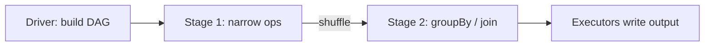

## 1. Core Concept

**Apache Spark** là engine xử lý dữ liệu phân tán trong bộ nhớ: bạn mô tả phép biến đổi trên **DataFrame**, Spark biến chúng thành kế hoạch và chạy song song trên nhiều executor. Mental model: *Spark = lập kế hoạch lười (lazy) rồi chia dữ liệu thành partition để xử lý song song; chi phí chính nằm ở shuffle.*

## 2. How It Works

- **Kiến trúc**: **driver** (điều phối) + **executor** (chạy task) trên cluster manager (YARN, Kubernetes, Databricks, EMR).
- **Transformation vs action**: `filter/select/join` là **lazy**; `count/collect/write` (action) mới kích hoạt chạy. Chuỗi biến đổi thành **DAG**, chia thành **stage** tại ranh giới shuffle.
- **Narrow vs wide**: narrow (map, filter) không di chuyển dữ liệu; **wide** (groupBy, join, repartition) gây **shuffle** qua mạng và đĩa.
- **Catalyst optimizer** tối ưu kế hoạch (predicate pushdown, chọn join); **Tungsten** quản lý bộ nhớ hiệu quả.
- **Join**: **broadcast hash join** khi một bảng nhỏ (gửi tới mọi executor), **sort-merge join** cho hai bảng lớn.
- **Partition**: số partition quyết định song song; `spark.sql.shuffle.partitions` mặc định 200.
- **Định dạng**: Parquet (columnar, nén, pushdown) thay vì CSV/JSON.
- **Structured Streaming**: xử lý stream với cùng API.

```python
df = spark.read.parquet("s3://lake/orders")
res = df.filter("dt >= '2026-01-01'").groupBy("country").sum("amount")
res.write.mode("overwrite").parquet("s3://lake/agg")
```

## 3. Visual Diagram



## 4. Rules of Thumb & Trade-offs

- **Lọc và chọn cột sớm**; dùng Parquet và **partition theo cột lọc**.
- Bảng nhỏ → **broadcast join**.
- Trade-off: **song song cao** vs **overhead shuffle/lập lịch**.

## 5. Must Remember / Production Pitfalls

- **Data skew**: một key chiếm phần lớn dữ liệu làm một task chạy rất lâu; dùng salting hoặc AQE.
- **Small files**: quá nhiều file nhỏ làm chậm đọc.
- `collect()` bản lớn về driver gây **OOM**.
- **UDF Python** chậm hơn hàm built-in.
- Quá ít partition → không tận dụng cluster; quá nhiều → overhead.
- Interview trap: "Vì sao job chậm dù cluster lớn?" → kiểm tra **shuffle và skew** trong Spark UI.

## 6. Search Hooks

- `Spark shuffle data skew` — shuffle và lệch dữ liệu.
- `Spark broadcast join vs sort merge join` — chọn thuật toán join.
- `Spark Catalyst optimizer` — tối ưu kế hoạch truy vấn.
- `Spark adaptive query execution AQE` — tự tối ưu lúc chạy.
- `Spark partitioning` — chia dữ liệu để song song hoá.
