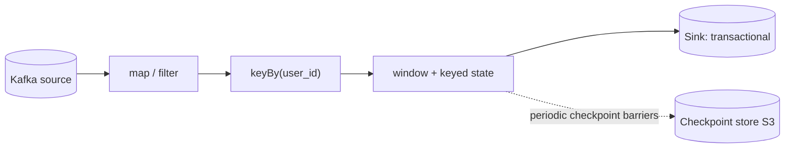

## 1. Core Concept

**Apache Flink** là engine **stateful stream processing**: xử lý dòng sự kiện vô hạn với **trạng thái** (đếm, join, cửa sổ) bền vững, độ trễ thấp và ngữ nghĩa **exactly-once** trong phạm vi framework. Nó là bước tiếp theo sau khi hiểu batch vs stream và Kafka: *cách thực sự tính toán trên stream mà không mất hay nhân đôi dữ liệu khi có lỗi.* Mental model: *một đồ thị toán tử chạy liên tục, mỗi toán tử giữ state riêng theo key, và hệ thống định kỳ **chụp ảnh nhất quán** toàn bộ để phục hồi.*

## 2. How It Works

- **Mô hình**: **source → toán tử (map/filter/keyBy/window/join) → sink**, chạy song song theo **parallelism**; `keyBy(key)` chia dữ liệu theo key để mỗi key được xử lý bởi đúng một instance (cùng **keyed state**).
- **State backend**: state trong bộ nhớ hoặc **RocksDB** (trên đĩa, hỗ trợ state rất lớn).
- **Event time & watermark**: xử lý theo thời gian xảy ra sự kiện; watermark báo "đã thấy hết dữ liệu đến T" để đóng **window** (tumbling, sliding, session); **allowed lateness** và **side output** cho dữ liệu muộn.
- **Checkpoint**: định kỳ chèn **barrier** vào dòng dữ liệu (thuật toán **Chandy–Lamport**) để chụp **snapshot nhất quán** của mọi state và **offset nguồn** vào lưu trữ bền (S3/HDFS). Lỗi → quay về checkpoint gần nhất và **phát lại** từ offset đó.
- **Exactly-once end-to-end**: checkpoint + **sink hỗ trợ transaction hoặc idempotent** (**two-phase commit sink**, ví dụ Kafka transaction), commit khi checkpoint hoàn tất.
- **Savepoint**: snapshot do người vận hành kích hoạt để **nâng cấp/đổi code/đổi parallelism** mà giữ state.
- **So sánh**: **Kafka Streams** (thư viện nhúng, gắn Kafka, đơn giản), **Spark Structured Streaming** (micro-batch, hệ sinh thái Spark), **Flink** (true streaming, state lớn, event time mạnh).

## 3. Visual Diagram

## 4. Rules of Thumb & Trade-offs

- Cần **độ trễ thấp + state lớn + event time chính xác** (gian lận, giám sát thời gian thực) → Flink; xử lý đơn giản gắn Kafka → Kafka Streams; đã có Spark và chấp nhận vài giây → Structured Streaming.
- Luôn đặt **`uid`** cho mỗi toán tử để có thể khôi phục state sau nâng cấp.
- Trade-off: **Exactly-once & độ trễ thấp** đổi lấy **độ phức tạp vận hành** (state, checkpoint, backpressure).

## 5. Must Remember / Production Pitfalls

- **State phình không kiểm soát** (key mới liên tục) → đặt **TTL** cho state, dọn key cũ.
- **Watermark kẹt** vì một partition nguồn **idle** → cửa sổ không bao giờ đóng; cấu hình **idleness**.
- **Data skew / hot key** làm một task quá tải trong khi các task khác rảnh.
- **Đổi hoặc bỏ `uid`/schema state** làm không khôi phục được savepoint.
- **Sink không idempotent** vẫn ghi trùng dù engine "exactly-once".
- Interview trap: "Flink exactly-once nghĩa là mỗi sự kiện chỉ xử lý một lần?" → **hiệu ứng lên state/sink như một lần**; sự kiện có thể được xử lý lại nội bộ sau khi phục hồi.

## 6. Search Hooks

- `Apache Flink checkpoints exactly-once` — cơ chế snapshot và đảm bảo exactly-once.
- `Chandy-Lamport snapshot barriers` — thuật toán chụp snapshot nhất quán trên dòng dữ liệu.
- `Flink watermarks idle sources` — đóng cửa sổ khi có nguồn không phát dữ liệu.
- `Flink state backend RocksDB` — lưu state lớn trên đĩa.
- `two-phase commit sink Kafka transactions` — sink transaction để đạt exactly-once.
- `Kafka Streams vs Flink vs Spark Structured Streaming` — chọn engine stream processing.
