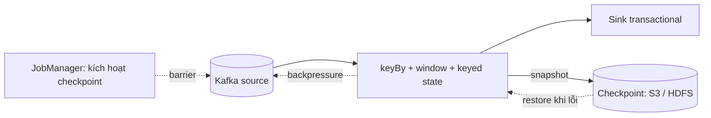

## 1. Core Concept

**Apache Flink** là engine **stream processing có trạng thái (stateful)**, xử lý **từng sự kiện** với độ trễ mili-giây và đảm bảo **exactly-once cho state** nhờ **checkpoint**. Nó giải quyết bài toán tính toán liên tục trên dòng dữ liệu vô hạn (đếm theo cửa sổ, join luồng, phát hiện gian lận) mà vẫn **phục hồi chính xác sau sự cố**.

**Mental model:** Flink như **dây chuyền có ghi chú trạng thái**: mỗi trạm nhớ thông tin (state) về những gì đã thấy, và định kỳ **chụp ảnh toàn bộ dây chuyền (checkpoint)**. Khi trạm hỏng, quay về **ảnh gần nhất** và phát lại sự kiện từ vị trí đã ghi trong ảnh, nên kết quả như chưa từng hỏng.

## 2. How It Works

**Dataflow và parallelism**
- Job là đồ thị **source → operator → sink**, chia thành nhiều **subtask song song**. `keyBy(key)` phân phối sự kiện cùng key tới **cùng subtask**, cho phép **keyed state** cục bộ.

**State và state backend**
- **Keyed state** (ValueState, MapState…) lưu theo key. **HashMap backend**: state trong heap, nhanh nhưng giới hạn RAM. **RocksDB backend**: state trên **đĩa cục bộ** (hàng trăm GB–TB), chậm hơn một chút, hỗ trợ **incremental checkpoint**.

**Checkpoint và barrier**
- Flink chèn **checkpoint barrier** vào dòng; khi operator nhận barrier, nó **snapshot state** lên storage bền (S3/HDFS), cùng **offset nguồn** (Kafka). Khi lỗi: **restore state + rewind source offset** → xử lý lại từ điểm chụp. Đây là **exactly-once cho state**; để **end-to-end exactly-once** cần sink **transactional/idempotent** (two-phase commit, Kafka transactions).
- **Savepoint** = checkpoint **thủ công, bền**, dùng để **nâng cấp job/đổi parallelism** rồi khởi động lại từ đúng trạng thái.

**Event time, window, watermark**
- Dùng **event time**; **watermark** báo tiến độ để đóng **window** (tumbling/sliding/session). `allowedLateness` + **side output** xử lý dữ liệu đến trễ.

**Backpressure**
- Khi sink/operator chậm, hệ thống **truyền áp lực ngược** làm nguồn đọc chậm lại (không mất dữ liệu). Dấu hiệu: buffer đầy, checkpoint kéo dài. Xử lý: tìm **operator nút cổ chai**, tăng parallelism, tối ưu I/O.

**Join và state TTL**
- Stream–stream join giữ state cả hai phía → **state phình vô hạn** nếu không có **state TTL**/interval join. Cấu hình TTL cho state không còn cần.

```java
env.enableCheckpointing(60_000);                 // chụp mỗi 60s
env.getCheckpointConfig().setCheckpointingMode(CheckpointingMode.EXACTLY_ONCE);
env.setStateBackend(new EmbeddedRocksDBStateBackend(true)); // incremental
stream.keyBy(Order::getUserId)
      .window(TumblingEventTimeWindows.of(Time.minutes(5)))
      .allowedLateness(Time.minutes(1))
      .sum("amount");
```

## 3. Visual Diagram



## 4. Rules of Thumb & Trade-offs

| Tình huống / Nhu cầu | Chọn gì |
| --- | --- |
| Độ trễ mili-giây, state phức tạp | Flink |
| State lớn (>GB) | RocksDB + incremental checkpoint |
| State nhỏ, cần tốc độ | HashMap backend |
| Nâng cấp job không mất state | Savepoint |
| End-to-end exactly-once | Sink transactional/idempotent |
| Gần real-time, đã dùng Spark | Spark Structured Streaming |

- **Được gì:** độ trễ thấp, state mạnh, phục hồi chính xác. **Mất gì:** vận hành phức tạp (state, checkpoint, watermark), chi phí hạ tầng 24/7, đường cong học.

## 5. Must Remember / Production Pitfalls

- **Checkpoint chậm/thất bại liên tục → backpressure hoặc state quá lớn → RocksDB incremental, giảm state, tăng parallelism**.
- **State phình vô hạn → join/keyed state không dọn → state TTL, interval join**.
- **Kết quả trùng ở sink dù Flink exactly-once → sink không transactional → two-phase commit/idempotent sink**.
- **Không nâng cấp được job → không có savepoint/uid operator → đặt `uid` cho operator, dùng savepoint**.
- **Cửa sổ không đóng → watermark kẹt do partition idle → cấu hình idleness**.
- **Hot key làm một subtask quá tải → key lệch → thêm salt/hai pha aggregate**.
- Interview trap: "exactly-once của Flink?" → **checkpoint (state) + sink transactional (end-to-end)**; "savepoint vs checkpoint?" → **savepoint thủ công để nâng cấp, checkpoint tự động để phục hồi**; "backpressure là gì?" → **áp lực ngược làm nguồn chậm lại, không mất dữ liệu**.

## 6. Search Hooks

- `Flink checkpointing exactly-once` — snapshot state để phục hồi chính xác.
- `Flink state backends RocksDB` — nơi lưu state và đánh đổi.
- `Flink savepoints` — snapshot thủ công để nâng cấp job.
- `Flink watermarks event time` — cửa sổ theo event time.
- `Flink backpressure` — cơ chế truyền áp lực ngược.
- `Flink state TTL` — dọn state không còn cần.
