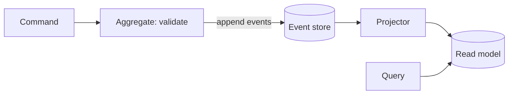

## 1. Core Concept

**CQRS (Command Query Responsibility Segregation)** tách mô hình **ghi (command)** khỏi mô hình **đọc (query)** vì hai bên có nhu cầu khác nhau (ghi cần bất biến nghiệp vụ, đọc cần nhanh và đúng hình dạng màn hình). **Event Sourcing** lưu **chuỗi sự kiện đã xảy ra** làm nguồn sự thật thay vì lưu trạng thái hiện tại; trạng thái = **gộp (fold) các sự kiện**. Hai thứ **độc lập** nhưng hay đi cùng. Mental model: *sổ cái kế toán — không sửa số dư, chỉ ghi thêm giao dịch; số dư là kết quả cộng dồn.*

## 2. How It Works

- **CQRS**: **command** (đổi trạng thái, có thể bị từ chối) đi qua **aggregate** kiểm tra bất biến; **query** đọc từ **read model** phi chuẩn hoá (SQL view, Elasticsearch, Redis…) tối ưu cho từng màn hình. Read model được cập nhật **bất đồng bộ** từ sự kiện nên **eventually consistent**.
- **Event Sourcing**: lưu mỗi thay đổi là một **event bất biến** (`AccountOpened`, `MoneyDeposited`) trong **event store**, theo **aggregate + số phiên bản**. Đọc trạng thái = phát lại event của aggregate; **snapshot** định kỳ để khỏi phát lại từ đầu.
- **Projection**: tiến trình đọc event và dựng/cập nhật read model; có thể **dựng lại từ đầu** bằng cách phát lại toàn bộ event.
- **Đồng thời**: ghi event kèm **expected version** (optimistic concurrency) — trùng phiên bản thì từ chối/ thử lại.
- **Tiến hoá schema**: event bất biến nên thay đổi bằng **upcasting** (chuyển event cũ sang dạng mới khi đọc) và versioning.

```sql
-- Event store tối giản; UNIQUE chặn hai ghi đồng thời cùng version
CREATE TABLE events (
  aggregate_id uuid, version int, type text, payload jsonb, at timestamptz DEFAULT now(),
  PRIMARY KEY (aggregate_id, version)
);
```

## 3. Visual Diagram



## 4. Rules of Thumb & Trade-offs

- **CQRS** đáng dùng khi mô hình đọc và ghi khác biệt rõ, tải đọc lớn hơn nhiều, hoặc cần nhiều dạng view. **CRUD đơn giản** thì **không cần**.
- **Event Sourcing** đáng dùng khi cần **audit đầy đủ, truy vấn theo thời điểm (temporal), phát lại/sửa lỗi lịch sử** (tài chính, đặt chỗ). Phần lớn hệ thống **không cần**.
- Có thể dùng **CQRS không event sourcing** (read model dựng từ DB thường) — đơn giản hơn rất nhiều.
- Trade-off: **linh hoạt đọc/ghi và lịch sử đầy đủ** đổi lấy **độ phức tạp cao và eventual consistency**.

## 5. Must Remember / Production Pitfalls

- **Người dùng ghi xong nhưng chưa thấy ở read model** (lag) — thiết kế UX (hiển thị lạc quan, đọc từ write side ngay sau ghi, theo dõi version).
- **Event schema evolution** là khó nhất: event đã lưu không sửa được; thiếu chiến lược upcasting sẽ kẹt.
- **Xoá dữ liệu cá nhân (GDPR)** mâu thuẫn với event bất biến → **crypto-shredding** (mã hoá, xoá khoá) hoặc không đưa PII vào event.
- **Dựng lại projection** trên hàng tỉ event rất lâu: cần snapshot, song song và chiến lược chuyển đổi.
- Projection phải **idempotent** (event có thể giao lại) và giữ **thứ tự theo aggregate**.
- Interview trap: "CQRS có bắt buộc event sourcing không?" → **không**, chúng độc lập.

## 6. Search Hooks

- `CQRS pattern read model write model` — tách mô hình ghi và đọc.
- `event sourcing event store snapshot` — lưu sự kiện làm nguồn sự thật.
- `projection rebuild read model` — dựng lại read model từ event.
- `event upcasting schema evolution` — tiến hoá schema của event bất biến.
- `optimistic concurrency expected version` — xử lý ghi đồng thời lên aggregate.
- `crypto-shredding GDPR event sourcing` — xoá dữ liệu cá nhân khi event bất biến.
