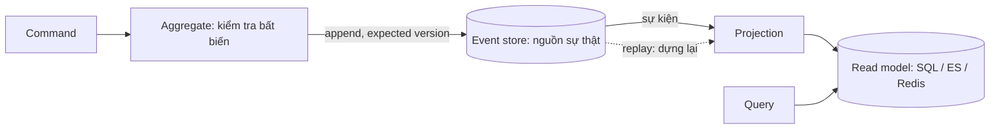

## 1. Core Concept

**CQRS (Command Query Responsibility Segregation)** tách **mô hình ghi** (xử lý **command**, bảo vệ nghiệp vụ) khỏi **mô hình đọc** (phục vụ **query**, tối ưu cho hiển thị) — vì nhu cầu ghi (kiểm tra bất biến, giao dịch) và đọc (join, tổng hợp, tốc độ) **mâu thuẫn nhau**. **Event Sourcing (ES)** lưu **chuỗi sự kiện bất biến** làm nguồn sự thật thay vì lưu trạng thái hiện tại; trạng thái = **gấp (fold) các sự kiện**. Hai kỹ thuật **độc lập** nhưng hay đi cùng; cả hai chỉ đáng dùng cho **miền phức tạp**, không phải CRUD thông thường.

**Mental model:** event sourcing như **sổ cái kế toán**: bạn không xoá/sửa số dư, chỉ **ghi thêm từng giao dịch**; số dư hiện tại là **tổng các giao dịch**, và bạn có thể **tua lại bất kỳ thời điểm nào**. CQRS như **tách quầy nhận đơn (ghi) khỏi bảng thông tin trưng bày (đọc)**: bảng trưng bày được vẽ lại từ sổ cái, rất tiện cho khách xem nhưng **có thể cập nhật trễ vài giây**.

## 2. How It Works

**CQRS → Hai mô hình**
- **Command side**: nhận lệnh (`PlaceOrder`), **kiểm tra bất biến** trên **aggregate**, ghi. **Query side**: **read model (projection) phi chuẩn hoá** theo đúng màn hình (SQL/Elasticsearch/Redis), cập nhật **bất đồng bộ** từ sự kiện → **eventual consistency** giữa ghi và đọc. Cho phép **scale và chọn công nghệ riêng** cho đọc/ghi.

**Event sourcing → Trạng thái là hàm của sự kiện**
- Lưu `OrderPlaced`, `ItemAdded`, `OrderPaid`… theo **stream của aggregate**; khôi phục = **replay** các sự kiện. Lợi ích: **audit đầy đủ, truy vấn theo thời điểm, debug "chuyện gì đã xảy ra", dựng lại read model mới từ lịch sử**. Cái giá: phức tạp, **tiến hoá schema sự kiện**, thay đổi mô hình tư duy.

**Projection và rebuild**
- **Projection** biến sự kiện thành read model; có thể **xoá và dựng lại toàn bộ** bằng replay khi đổi yêu cầu hiển thị. Phải **idempotent** (xử lý trùng) và theo dõi **vị trí đã xử lý**.

**Snapshot**
- Replay hàng nghìn sự kiện mỗi lần tải aggregate chậm → lưu **snapshot** (ví dụ mỗi 100 sự kiện) và chỉ replay phần sau.

**Optimistic concurrency → Expected version**
- Khi **append** sự kiện, gửi **expected version** của stream; nếu stream đã có sự kiện mới (version khác) → **từ chối** và retry/hợp nhất. Bảo vệ bất biến mà không khoá.

**Tiến hoá sự kiện → Upcasting**
- Sự kiện đã lưu **bất biến**, nhưng schema đổi → **upcaster** chuyển sự kiện phiên bản cũ sang mới khi đọc; **không sửa sự kiện cũ**.

**Quyền riêng tư → Crypto-shredding**
- GDPR "quyền bị lãng quên" xung đột với log bất biến → **mã hoá dữ liệu cá nhân bằng khoá riêng của từng chủ thể**, muốn xoá thì **xoá khoá** (dữ liệu còn đó nhưng không đọc được).

```python
class Account:
    def __init__(self): self.balance, self.version = 0, 0
    def apply(self, e):                       # trạng thái = fold(sự kiện)
        if e["type"] == "Deposited": self.balance += e["amount"]
        elif e["type"] == "Withdrawn": self.balance -= e["amount"]
        self.version += 1
def withdraw(acc, amount):                    # command: kiểm tra bất biến rồi phát sự kiện
    if acc.balance < amount: raise InsufficientFunds()
    return {"type": "Withdrawn", "amount": amount}
store.append(stream_id, [event], expected_version=acc.version)   # từ chối nếu version đã đổi
```

## 3. Visual Diagram



## 4. Rules of Thumb & Trade-offs

| Tình huống / Nhu cầu | Chọn gì |
| --- | --- |
| CRUD đơn giản | Không cần CQRS/ES |
| Đọc và ghi cần mô hình/scale khác nhau | CQRS |
| Cần audit đầy đủ, truy vấn theo thời điểm, miền phức tạp | Event sourcing |
| Aggregate có nhiều sự kiện | Snapshot |
| Chống ghi đè đồng thời | Expected version (optimistic) |
| Schema sự kiện đổi | Upcasting |
| Xoá dữ liệu cá nhân trong log bất biến | Crypto-shredding |

- **Được gì:** audit, khả năng dựng lại, đọc/ghi tối ưu riêng. **Mất gì:** độ phức tạp lớn, eventual consistency giữa ghi và đọc, khó truy vấn ad-hoc trên event store, tiến hoá schema.

## 5. Must Remember / Production Pitfalls

- **Dùng CQRS/ES cho CRUD đơn giản → phức tạp không cần thiết → chỉ dùng cho miền phức tạp có nhu cầu rõ**.
- **Người dùng ghi xong không thấy kết quả ngay → read model cập nhật trễ → thiết kế UI chấp nhận trễ (optimistic UI), hoặc đọc từ write side cho trường hợp đặc biệt**.
- **Sự kiện cũ không đọc được sau khi đổi schema → không có upcasting → versioning sự kiện và upcaster, chỉ thêm trường tuỳ chọn**.
- **Replay chậm khi aggregate dài → không snapshot → snapshot định kỳ**.
- **Projection xử lý trùng làm sai số liệu → không idempotent → theo dõi vị trí/khử trùng**.
- **Yêu cầu xoá dữ liệu cá nhân → log bất biến không xoá được → crypto-shredding, hoặc không đưa PII thô vào sự kiện**.
- Interview trap: "CQRS có bắt buộc dùng event sourcing không?" → **không, hai kỹ thuật độc lập**; "expected version để làm gì?" → **optimistic concurrency khi append sự kiện**; "xoá dữ liệu cá nhân trong event store?" → **crypto-shredding**.

## 6. Search Hooks

- `CQRS pattern` — tách mô hình ghi và đọc.
- `event sourcing` — lưu chuỗi sự kiện làm nguồn sự thật.
- `projections read model rebuild` — dựng read model từ sự kiện.
- `event upcasting schema evolution` — tiến hoá schema sự kiện.
- `optimistic concurrency expected version` — chống ghi đè khi append.
- `crypto-shredding GDPR event sourcing` — xoá dữ liệu cá nhân trong log bất biến.
