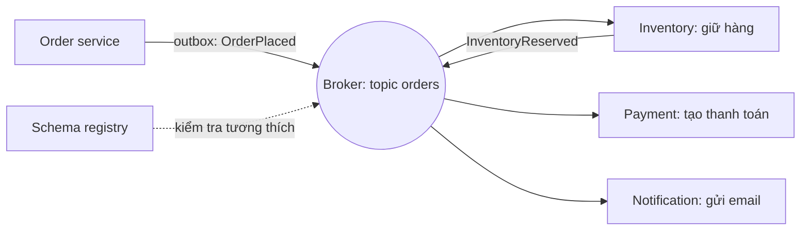

## 1. Core Concept

**Event-driven architecture (EDA)** cho các thành phần giao tiếp bằng **sự kiện (event)** — "một điều đã xảy ra" (`OrderPlaced`) — thay vì gọi nhau trực tiếp. Producer **phát sự kiện mà không biết ai nhận**; các consumer **tự quyết phản ứng**. Kết quả: **lỏng lẻo (loose coupling)**, dễ thêm consumer mới, chịu đột biến nhờ hàng đợi — đổi lại là **tính nhân quả khó thấy**, **eventual consistency** và bài toán **thứ tự/trùng lặp**.

**Mental model:** như **bảng thông báo ở khu chung cư**: ai dán thông báo ("tầng 3 sắp cúp nước") không cần biết những ai đọc; nhà nào quan tâm tự xử lý. Dễ thêm người đọc mới, nhưng để biết **tin này gây ra những hậu quả gì** bạn phải lần theo từng nhà.

## 2. How It Works

**Event vs command**
- **Command**: yêu cầu làm gì, gửi **tới một nơi nhận cụ thể** ("PlaceOrder"). **Event**: **sự thật đã xảy ra**, đặt tên **thì quá khứ** (`OrderPlaced`), phát cho **nhiều người nghe**, bất biến.

**Event notification vs Event-carried state transfer**
- **Notification**: sự kiện **mỏng** (chỉ id), consumer **gọi lại API** lấy chi tiết — dữ liệu luôn mới nhưng **phụ thuộc runtime** vào producer. **Event-carried state transfer**: sự kiện **mang đủ dữ liệu**, consumer giữ **bản sao cục bộ** — giảm gọi chéo, tự chủ cao, đổi lại **trùng lặp dữ liệu** và sự kiện lớn hơn.

**Choreography vs Orchestration**
- **Choreography**: mỗi dịch vụ phản ứng với sự kiện và phát sự kiện tiếp theo — **không có trung tâm**, lỏng lẻo nhưng **luồng nghiệp vụ khó nhìn** khi nhiều bước. **Orchestration**: một **orchestrator** điều phối từng bước rõ ràng (state machine) — dễ hiểu và theo dõi hơn, đổi lại có thành phần trung tâm.

**Giao hàng và nhất quán**
- Phần lớn broker **at-least-once** → consumer phải **idempotent**. Phát sự kiện đáng tin cậy cùng ghi DB dùng **Transactional Outbox**. **Thứ tự** chỉ có trong một partition/khoá. Dữ liệu **nhất quán cuối cùng**.

**Hợp đồng sự kiện → Schema registry**
- Sự kiện là **API công khai**: dùng **Avro/Protobuf/JSON Schema** kèm **schema registry** kiểm tra **tương thích** khi thay đổi (**backward**: consumer mới đọc dữ liệu cũ; **forward**; **full**). Quy tắc an toàn: **chỉ thêm trường tuỳ chọn có giá trị mặc định**, không xoá/đổi kiểu. **CloudEvents** chuẩn hoá phần **envelope** (`id`, `source`, `type`, `specversion`, `time`, `data`) để tương tác giữa hệ thống.

```json
{ "specversion": "1.0", "id": "evt-7f3a", "source": "/orders-service",
  "type": "com.example.order.placed.v1", "time": "2026-11-21T09:30:00Z",
  "datacontenttype": "application/json",
  "data": { "orderId": "o-1001", "customerId": "c-42", "total": 250000 } }
```

## 3. Visual Diagram



## 4. Rules of Thumb & Trade-offs

| Tình huống / Nhu cầu | Chọn gì |
| --- | --- |
| Nhiều hệ thống cần phản ứng với một thay đổi | Phát sự kiện (pub/sub) |
| Consumer cần dữ liệu mới nhất, chấp nhận gọi lại | Event notification |
| Giảm phụ thuộc runtime, consumer tự chủ | Event-carried state transfer |
| Ít bước, lỏng lẻo tối đa | Choreography |
| Quy trình nhiều bước cần theo dõi/bù trừ | Orchestration (saga) |
| Phát sự kiện đáng tin cậy cùng ghi DB | Transactional Outbox |
| Hợp đồng sự kiện tiến hoá | Schema registry + thay đổi tương thích |

- **Được gì:** lỏng lẻo, mở rộng dễ, chịu đột biến. **Mất gì:** khó theo dõi luồng, eventual consistency, phải xử lý trùng/thứ tự, debug khó hơn.

## 5. Must Remember / Production Pitfalls

- **Không ai biết một sự kiện gây ra gì ("event spaghetti") → choreography nhiều bước không tài liệu/quan sát → distributed tracing, correlation id, tài liệu hoá luồng, hoặc orchestration**.
- **Consumer xử lý trùng gây tác dụng phụ → at-least-once → idempotent consumer (khử trùng theo event id)**.
- **Producer đổi schema làm consumer hỏng → thay đổi không tương thích → schema registry, chỉ thêm trường tuỳ chọn có mặc định**.
- **Replay lại sự kiện kích hoạt tác dụng phụ (gửi email lần nữa) → consumer không phân biệt replay → idempotency và cờ replay**.
- **Sự kiện quá lớn hoặc chứa quá nhiều → khó tiến hoá → giữ sự kiện gọn, mang đủ dữ liệu cần thiết**.
- Interview trap: "event khác command?" → **event là sự thật đã xảy ra, nhiều người nghe; command là yêu cầu gửi tới một nơi**; "choreography vs orchestration?" → **không trung tâm (khó nhìn luồng) vs có điều phối (dễ theo dõi)**; "thay đổi schema an toàn?" → **thêm trường tuỳ chọn có mặc định**.

## 6. Search Hooks

- `event-driven architecture` — kiến trúc giao tiếp bằng sự kiện.
- `event notification vs event-carried state transfer` — sự kiện mỏng so với mang trạng thái.
- `choreography vs orchestration` — hai cách phối hợp dịch vụ.
- `schema registry Avro compatibility` — quản lý tiến hoá schema sự kiện.
- `CloudEvents specification` — chuẩn envelope sự kiện.
- `transactional outbox pattern` — phát sự kiện đáng tin cậy cùng ghi DB.
