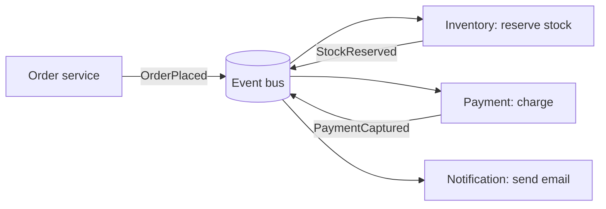

## 1. Core Concept

**Event-driven architecture (EDA)**: các thành phần giao tiếp bằng **sự kiện** — "điều đã xảy ra" (`OrderPlaced`) — qua broker, thay vì gọi trực tiếp nhau. Producer không biết ai tiêu thụ; consumer phản ứng theo cách riêng. Nó giảm **coupling** và cho phép thêm tính năng mới (chỉ cần subscribe) mà không sửa service gốc. Mental model: *thay vì "hãy làm X" (command), service **thông báo sự thật** và để người khác tự quyết định phản ứng.*

## 2. How It Works

- **Ba loại thông điệp**: **Command** (yêu cầu làm gì, một người nhận, có thể bị từ chối), **Event** (sự thật đã xảy ra, bất biến, nhiều người nhận, đặt tên thì quá khứ), **Query** (hỏi dữ liệu).
- **Các kiểu sự kiện**: **event notification** (chỉ báo "có gì đó đổi", consumer gọi lại lấy chi tiết), **event-carried state transfer** (kèm đủ dữ liệu để consumer khỏi gọi lại), **event sourcing** (sự kiện chính là nguồn sự thật).
- **Choreography** (mỗi service tự phản ứng với event của service khác, không có người điều phối) vs **orchestration** (một bộ điều phối ra lệnh từng bước).
- **Broker** (Kafka, RabbitMQ, SNS/SQS, EventBridge) lưu và phân phối; ngữ nghĩa **at-least-once** → consumer phải **idempotent**.
- **Phát event tin cậy**: dùng **transactional outbox** để ghi dữ liệu và event nguyên tử.
- **Tiến hoá schema**: **schema registry** (Avro/Protobuf/JSON Schema), quy tắc **tương thích ngược/xuôi**, thêm field tuỳ chọn thay vì đổi/xoá.
- **Truy vết**: gắn **correlation ID/trace ID** vào mọi event để lần theo luồng xuyên service.

## 3. Visual Diagram

## 4. Rules of Thumb & Trade-offs

- Dùng EDA khi nhiều hệ thống cần phản ứng với cùng một sự kiện, cần **tách rời**, **làm dịu đỉnh tải**, hoặc xử lý bất đồng bộ.
- Cần **kết quả ngay và rõ ràng cho người dùng** (đăng nhập, thanh toán đồng bộ) → request/response; EDA phù hợp cho phần hệ quả phía sau.
- **Choreography** hợp luồng ngắn, ít bước; **orchestration** hợp luồng dài/nhiều nhánh cần nhìn rõ trạng thái.
- Trade-off: **Loose coupling & scalability vs. Observability & eventual consistency**.

## 5. Must Remember / Production Pitfalls

- **"Event spaghetti"**: luồng xử lý rải rác qua chục consumer, không ai thấy bức tranh tổng → ghi tài liệu luồng, dùng tracing và event catalog.
- **Mất event** do dual write (ghi DB xong crash trước khi publish) → outbox.
- **Trùng event** → consumer idempotent; **sai thứ tự** giữa các partition → thiết kế để không phụ thuộc thứ tự toàn cục hoặc dùng key.
- **Breaking schema change** làm hỏng consumer âm thầm → registry + kiểm tra tương thích trong CI.
- **Event quá to/kèm dữ liệu nhạy cảm** → coupling và rủi ro; chỉ chứa thứ consumer cần.
- Coupling ẩn: consumer phụ thuộc vào **ý nghĩa và thời điểm** của event dù không gọi nhau trực tiếp.
- Interview trap: "EDA có làm hệ thống đơn giản hơn?" → **không**: đơn giản hoá phụ thuộc, nhưng tăng độ khó debug và nhất quán.

## 6. Search Hooks

- `event-driven architecture` — kiến trúc giao tiếp bằng sự kiện qua broker.
- `event notification vs event-carried state transfer` — hai kiểu mang dữ liệu trong event.
- `choreography vs orchestration` — phối hợp tự phát hay có người điều phối.
- `schema registry Avro compatibility` — quản lý tiến hoá schema của event.
- `CloudEvents specification` — chuẩn mô tả sự kiện liên thông giữa hệ thống.
- `transactional outbox` — phát event nguyên tử cùng thay đổi dữ liệu.
