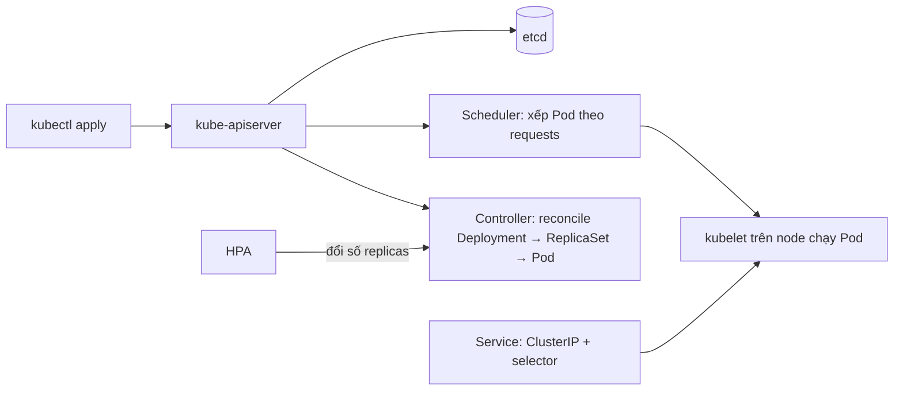

## 1. Core Concept

**Kubernetes (K8s)** là nền tảng **điều phối container**: bạn **khai báo trạng thái mong muốn** ("chạy 3 bản sao của app này, mỗi bản 500 MB RAM") và Kubernetes **liên tục điều chỉnh thực tế cho khớp** — tự khởi động lại, thay thế, scale, cập nhật không downtime và phân phối traffic. Cốt lõi là **mô hình khai báo + vòng lặp điều hoà (reconciliation loop)**, không phải "lệnh chạy container".

**Mental model:** Kubernetes như **người quản lý toà nhà tự động**: bạn đưa **bản vẽ yêu cầu** (YAML), quản lý liên tục **so sánh với hiện trạng** — thiếu một căn thì dựng thêm, hỏng thì thay, quá tải thì mở thêm tầng. Bạn không ra lệnh từng việc; bạn **mô tả đích đến**.

## 2. How It Works

**Kiến trúc**
- **Control plane**: **kube-apiserver** (cổng duy nhất vào cluster), **etcd** (kho trạng thái, dựa trên Raft), **scheduler** (chọn node cho Pod), **controller-manager** (các vòng điều hoà). **Node**: **kubelet** (chạy Pod trên node), **kube-proxy** (mạng Service), **container runtime** (containerd). Mọi thứ nói chuyện qua API server.

**Pod, ReplicaSet, Deployment**
- **Pod**: đơn vị nhỏ nhất, một hoặc vài container **chia sẻ mạng và volume**, **dùng một lần** (không nên coi là bền). **ReplicaSet** giữ đúng **N bản sao** Pod. **Deployment** quản lý ReplicaSet, hỗ trợ **rolling update** (`maxSurge`, `maxUnavailable`) và **rollback**. Khác: **StatefulSet** (danh tính ổn định, volume riêng), **DaemonSet** (mỗi node một Pod), **Job/CronJob**.

**Service, ClusterIP và Ingress**
- Pod đến-đi, **IP đổi**; **Service** cho **IP/DNS ổn định** và cân bằng tải tới các Pod khớp **label selector**: **ClusterIP** (trong cluster), **NodePort**, **LoadBalancer** (cloud). **Ingress** (+ **Ingress Controller** như nginx/Envoy) định tuyến **HTTP L7** theo host/path và kết thúc TLS. **ConfigMap/Secret** tách cấu hình khỏi image.

**Probes → Ba loại, ba mục đích**
- **Liveness**: container còn sống không (**thất bại → restart**). **Readiness**: sẵn sàng nhận traffic chưa (**thất bại → gỡ khỏi Service**, không restart). **Startup**: bảo vệ ứng dụng **khởi động chậm** khỏi bị liveness giết sớm.

**Requests và limits**
- **Requests**: lượng tài nguyên **đảm bảo**, dùng để **lập lịch** (scheduler chỉ xếp Pod vào node đủ chỗ). **Limits**: **trần**: vượt **CPU** thì bị **throttle**, vượt **memory** thì **OOMKilled**. QoS: **Guaranteed** (requests = limits), **Burstable**, **BestEffort** (bị đuổi đầu tiên khi thiếu).

**Autoscaling**
- **HPA** thay đổi số Pod: `desired = ceil(current × currentMetric / targetMetric)`; ví dụ 4 Pod CPU 90% mục tiêu 60% → `ceil(4 × 90/60) = 6`. HPA tính theo **% so với requests** nên **phải đặt requests**. **VPA** chỉnh requests/limits; **Cluster Autoscaler/Karpenter** thêm node khi Pod **Pending**. **PodDisruptionBudget** giữ tối thiểu số Pod khi bảo trì.

```yaml
apiVersion: apps/v1
kind: Deployment
metadata: { name: api }
spec:
  replicas: 3
  strategy: { rollingUpdate: { maxSurge: 1, maxUnavailable: 0 } }
  selector: { matchLabels: { app: api } }
  template:
    metadata: { labels: { app: api } }
    spec:
      containers:
      - name: api
        image: registry/api:1.4.2
        resources: { requests: { cpu: 250m, memory: 256Mi }, limits: { memory: 512Mi } }
        readinessProbe: { httpGet: { path: /ready, port: 8080 }, periodSeconds: 5 }
        livenessProbe:  { httpGet: { path: /healthz, port: 8080 }, initialDelaySeconds: 20 }
```

## 3. Visual Diagram



## 4. Rules of Thumb & Trade-offs

| Tình huống / Nhu cầu | Chọn gì |
| --- | --- |
| Ứng dụng stateless | Deployment |
| Cần danh tính/volume ổn định (DB) | StatefulSet (hoặc DB managed) |
| Chạy trên mọi node (agent log) | DaemonSet |
| Chỉ nhận traffic khi sẵn sàng | Readiness probe |
| Khởi động chậm | Startup probe |
| Scale theo tải | HPA (đặt requests!) |
| Định tuyến HTTP theo path/host | Ingress |
| Giảm gián đoạn khi bảo trì | PodDisruptionBudget |

- **Được gì:** tự phục hồi, scale, cập nhật không downtime, di động. **Mất gì:** độ phức tạp vận hành lớn (mạng, bảo mật, nâng cấp), đường cong học tập dốc; nhiều dự án nhỏ dùng PaaS/Container service là đủ.

## 5. Must Remember / Production Pitfalls

- **Pod bị OOMKilled liên tục → memory limit thấp hơn nhu cầu → đo và đặt requests/limits hợp lý**.
- **App chậm dù CPU node rảnh → CPU limit gây throttle → cân nhắc bỏ CPU limit, giữ requests**.
- **HPA không scale → không có requests nên không tính được % → đặt requests CPU/memory**.
- **Pod bị restart ngay khi khởi động chậm → liveness quá khắt khe → startup probe/`initialDelaySeconds`**.
- **Traffic tới Pod chưa sẵn sàng → thiếu readiness → readiness probe thật sự kiểm tra phụ thuộc**.
- **Pod `Pending` mãi → không node đủ requests → thêm node/Cluster Autoscaler, giảm requests**.
- **`CrashLoopBackOff` / `ImagePullBackOff` → lỗi ứng dụng / sai image hoặc thiếu quyền pull → `kubectl logs/describe`**.
- Interview trap: "liveness vs readiness?" → **liveness quyết định restart, readiness quyết định có nhận traffic không**; "requests vs limits?" → **requests để lập lịch (đảm bảo), limits là trần (throttle CPU, OOM memory)**; "Deployment vs StatefulSet?" → **stateless vs danh tính/volume ổn định**.

## 6. Search Hooks

- `Kubernetes architecture control plane` — thành phần control plane và node.
- `Pod ReplicaSet Deployment` — ba lớp quản lý workload.
- `Kubernetes Service ClusterIP Ingress` — mạng và định tuyến.
- `liveness readiness startup probes` — ba loại kiểm tra sức khoẻ.
- `Kubernetes resource requests limits` — lập lịch và giới hạn tài nguyên.
- `Horizontal Pod Autoscaler` — tự scale theo metric.
