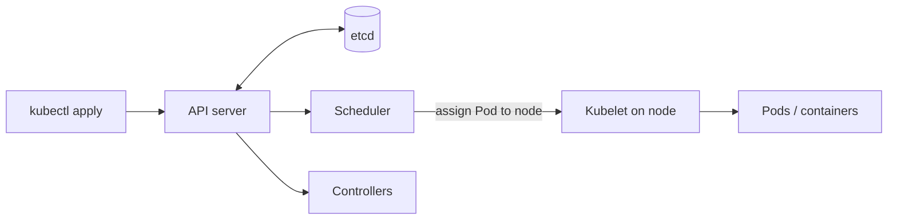

## 1. Core Concept

**Kubernetes (K8s)** là nền tảng **điều phối container**: bạn khai báo **trạng thái mong muốn** ("chạy 3 bản của dịch vụ này"), Kubernetes liên tục **so sánh với thực tế và sửa cho khớp** (vòng **reconciliation**). Nó lo lập lịch, tự phục hồi, scale, rolling update và service discovery. Mental model: *bạn không "chạy" container — bạn mô tả cái mình muốn và để controller lo phần còn lại.*

## 2. How It Works

- **Kiến trúc**: **Control plane** gồm **API server** (cổng duy nhất), **etcd** (lưu trạng thái, dựa Raft), **scheduler** (chọn node cho Pod), **controller manager** (các vòng reconcile). **Node** chạy **kubelet** (thực thi Pod), container runtime và **kube-proxy**/CNI (mạng).
- **Pod**: đơn vị nhỏ nhất — một hoặc vài container **chia sẻ mạng và volume**; ngắn ngủi, IP thay đổi. **Deployment** quản lý ReplicaSet → duy trì số bản, **rolling update** và **rollback**.
- **Service**: địa chỉ ổn định (**ClusterIP** + DNS) cân bằng tải tới các Pod khớp label; **NodePort/LoadBalancer** mở ra ngoài; **Ingress** định tuyến HTTP theo host/path.
- **Cấu hình & dữ liệu**: **ConfigMap**, **Secret**, **PersistentVolume/PVC**; **StatefulSet** cho workload có danh tính và lưu trữ ổn định; **DaemonSet**, **Job/CronJob**.
- **Probes**: **liveness** (khởi động lại khi treo), **readiness** (chỉ nhận traffic khi sẵn sàng), **startup** (cho ứng dụng khởi động chậm).
- **Tài nguyên**: **requests** (dùng để lập lịch) và **limits** (CPU bị throttle, vượt memory bị OOMKilled); **HPA** tự scale theo metric.
- **An toàn**: **namespace**, **RBAC**, **NetworkPolicy**, **PodDisruptionBudget**.

```yaml
apiVersion: apps/v1
kind: Deployment
metadata: { name: orders }
spec:
  replicas: 3
  selector: { matchLabels: { app: orders } }
  template:
    metadata: { labels: { app: orders } }
    spec:
      containers:
        - name: orders
          image: registry.example.com/orders:1.4.2
          readinessProbe: { httpGet: { path: /ready, port: 8080 } }
          resources: { requests: { cpu: 250m, memory: 256Mi }, limits: { memory: 512Mi } }
```

## 3. Visual Diagram



## 4. Rules of Thumb & Trade-offs

- Luôn dùng **Deployment + Service**, ≥ 2 replica cho dịch vụ quan trọng, kèm **readiness probe** và **PodDisruptionBudget**.
- Đặt **requests hợp lý** (lập lịch đúng) và cẩn thận với **CPU limit** (gây throttle); memory limit nên ≥ nhu cầu thật.
- Dùng **managed Kubernetes** (EKS, AKS, GKE) thay vì tự vận hành control plane.
- Trade-off: **tự động hoá, scale và chuẩn hoá** đổi lấy **độ phức tạp vận hành đáng kể**; ứng dụng nhỏ có thể không cần K8s (PaaS/serverless).

## 5. Must Remember / Production Pitfalls

- **Thiếu readiness probe** → traffic đổ vào Pod chưa sẵn sàng khi rolling update.
- **Liveness probe quá gắt** giết ứng dụng khởi động chậm, gây crash loop; tách startup probe.
- **CPU limit thấp** làm throttle và tăng độ trễ dù node còn rảnh; **memory limit thấp** gây OOMKilled.
- Image tag **`latest`** làm triển khai không lặp lại được; dùng tag cố định/digest.
- **Secret chỉ là base64**, không phải mã hoá; bật encryption at rest và kiểm soát RBAC.
- Chạy **1 replica** hoặc không có PDB → mất dịch vụ khi node bảo trì.
- Pod là **ephemeral**: không lưu dữ liệu quan trọng trong filesystem container.
- Interview trap: "Service khác Ingress thế nào?" → Service là cân bằng tải **L4** ổn định nội bộ; Ingress định tuyến **L7** HTTP từ ngoài vào.

## 6. Search Hooks

- `Kubernetes architecture control plane` — thành phần của control plane và node.
- `Pod Deployment ReplicaSet` — quan hệ giữa các đối tượng workload.
- `Kubernetes Service ClusterIP Ingress` — cách phơi dịch vụ trong và ngoài cluster.
- `liveness readiness startup probes` — ba loại probe và cách dùng.
- `requests and limits CPU throttling OOMKilled` — tài nguyên, lập lịch và hậu quả khi vượt.
- `Horizontal Pod Autoscaler` — tự scale số Pod theo tải.
