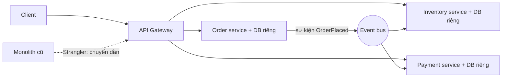

## 1. Core Concept

**Microservices** chia một hệ thống thành nhiều **dịch vụ nhỏ, triển khai độc lập**, mỗi dịch vụ **sở hữu một năng lực nghiệp vụ và dữ liệu của riêng nó**. Mục tiêu là **tự chủ của đội nhóm, triển khai thường xuyên và scale từng phần** — đổi lại bạn nhận toàn bộ độ phức tạp của **hệ phân tán** (mạng lỗi từng phần, nhất quán cuối cùng, quan sát, vận hành). Với nhiều tổ chức, **modular monolith** mới là điểm bắt đầu đúng; microservices là **giải pháp cho vấn đề tổ chức/quy mô**, không phải mục tiêu.

**Mental model:** monolith như **một nhà hàng một bếp**: dễ phối hợp, nhưng cả bếp phải cùng thay thực đơn. Microservices như **khu ẩm thực nhiều quầy độc lập**: mỗi quầy tự quyết món, mở/đóng riêng, nhưng muốn một "bữa trọn vẹn" thì khách phải đi qua nhiều quầy và **nếu quầy nào đóng cửa**, bữa ăn thiếu món.

## 2. How It Works

**Monolith → Modular monolith → Microservices**
- **Monolith**: một đơn vị triển khai, gọi hàm trong tiến trình (nhanh, giao dịch ACID dễ). **Modular monolith**: vẫn một đơn vị triển khai nhưng **ranh giới module rõ**, ít phụ thuộc chéo — nhiều lợi ích mà không có chi phí mạng. **Microservices**: nhiều đơn vị triển khai giao tiếp qua mạng.

**Bounded context → Ranh giới dịch vụ đúng**
- Từ **Domain-Driven Design**: mỗi **bounded context** là một vùng nghiệp vụ có **mô hình và ngôn ngữ riêng** (ví dụ "Sản phẩm" ở Catalog khác "Sản phẩm" ở Billing). Ranh giới dịch vụ nên **trùng bounded context** để **cohesion cao, coupling thấp**; cắt theo tầng kỹ thuật (service "database", service "UI") là sai.

**Database per service → Sở hữu dữ liệu**
- **Mỗi dịch vụ sở hữu schema riêng**, không ai khác đọc/ghi trực tiếp; truy cập qua **API hoặc sự kiện**. **Dùng chung database** biến dịch vụ thành **distributed monolith** (đổi schema là phá nhiều dịch vụ). Hệ quả: **không có join/giao dịch xuyên dịch vụ** → dùng **saga** và **eventual consistency**.

**Giao tiếp**
- **Đồng bộ** (REST/gRPC): đơn giản nhưng **gắn kết thời gian chạy** — một dịch vụ chậm kéo theo cả chuỗi (cần timeout, circuit breaker). **Bất đồng bộ** (sự kiện/hàng đợi): lỏng lẻo hơn, chịu lỗi tốt hơn, nhưng khó suy luận.

**Strangler fig → Di chuyển dần từ monolith**
- Đặt **facade/proxy** phía trước, **chuyển dần từng chức năng** sang dịch vụ mới (route theo URL/feature flag), monolith **thu nhỏ dần** tới khi bị thay thế — thay vì "viết lại toàn bộ" rủi ro cao.

**Anti-pattern: distributed monolith**
- Nhiều dịch vụ nhưng **phụ thuộc đồng bộ chặt, chung DB, phải deploy cùng lúc** → có **mọi chi phí** của microservices mà **không có lợi ích**.

**Conway's law**
- "Hệ thống phản chiếu cấu trúc giao tiếp của tổ chức tạo ra nó." Muốn kiến trúc nào, **tổ chức đội nhóm** theo đó (**inverse Conway maneuver**): một đội sở hữu một hoặc vài dịch vụ **end-to-end** (build, run).

**Cái giá phải trả**
- Độ trễ và lỗi mạng (**fallacies of distributed computing**), **tracing/log tập trung**, **CI/CD từng dịch vụ**, **contract testing** (Pact), quản lý phiên bản API, nền tảng (service discovery, config, secrets).

```yaml
# Dấu hiệu distributed monolith: mọi dịch vụ phải deploy cùng nhau, cùng đọc một DB
order-service:    { db: shared-db, depends-sync: [inventory, payment, shipping] }
inventory-service:{ db: shared-db }
```

## 3. Visual Diagram



## 4. Rules of Thumb & Trade-offs

| Tình huống / Nhu cầu | Chọn gì |
| --- | --- |
| Đội nhỏ, sản phẩm mới, miền chưa rõ | Modular monolith |
| Nhiều đội cần tự triển khai độc lập, điểm nóng scale khác nhau | Microservices |
| Di chuyển hệ thống cũ | Strangler fig |
| Xác định ranh giới dịch vụ | Bounded context (DDD) |
| Cần dữ liệu của dịch vụ khác | API hoặc sự kiện, không đọc DB trực tiếp |
| Giao dịch xuyên dịch vụ | Saga + eventual consistency |

- **Được gì:** tự chủ đội, triển khai độc lập, scale chọn lọc, cô lập lỗi. **Mất gì:** độ phức tạp phân tán, vận hành/quan sát, nhất quán dữ liệu, chi phí hạ tầng; **tổ chức nhỏ thường lỗ**.

## 5. Must Remember / Production Pitfalls

- **Phải deploy nhiều dịch vụ cùng lúc mới chạy → distributed monolith (gắn kết đồng bộ, chung DB) → database per service, giao tiếp lỏng, contract testing**.
- **Một dịch vụ chậm kéo sập cả chuỗi → gọi đồng bộ nối đuôi không timeout → timeout, circuit breaker, bulkhead, bất đồng bộ khi có thể**.
- **Dữ liệu không nhất quán giữa dịch vụ → mong chờ giao dịch ACID xuyên dịch vụ → saga, outbox, chấp nhận eventual consistency**.
- **Cắt dịch vụ quá nhỏ ("nanoservices") → chi phí mạng/vận hành vượt lợi ích → cắt theo bounded context, bắt đầu thô**.
- **Không có quan sát khi sự cố → không tracing → distributed tracing và log tập trung ngay từ đầu**.
- Interview trap: "khi nào KHÔNG nên dùng microservices?" → **đội nhỏ, miền chưa rõ, chưa có nền tảng vận hành**; "distributed monolith là gì?" → **nhiều dịch vụ nhưng gắn chặt (chung DB/deploy cùng nhau)**; "strangler fig?" → **chuyển dần từng chức năng qua facade**.

## 6. Search Hooks

- `microservices vs monolith vs modular monolith` — ba mức kiến trúc triển khai.
- `bounded context domain-driven design` — cách xác định ranh giới dịch vụ.
- `database per service pattern` — mỗi dịch vụ sở hữu dữ liệu riêng.
- `strangler fig pattern` — di chuyển dần từ monolith.
- `distributed monolith anti-pattern` — microservices mà vẫn gắn chặt.
- `Conway's law` — kiến trúc phản chiếu cấu trúc tổ chức.
