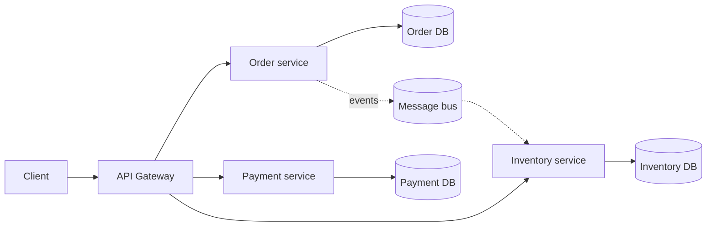

## 1. Core Concept

**Microservices** chia hệ thống thành các service **nhỏ, triển khai độc lập, mỗi service sở hữu dữ liệu và một năng lực nghiệp vụ** (bounded context). Mục đích chính không phải kỹ thuật mà là **tổ chức**: cho nhiều đội phát triển và deploy song song mà không giẫm chân nhau. Mental model: *bạn đổi **độ phức tạp trong code** lấy **độ phức tạp của hệ phân tán** — chỉ đáng khi chi phí đầu nhỏ hơn lợi ích.*

## 2. How It Works

- **Ranh giới theo nghiệp vụ** (DDD **bounded context**), không theo tầng kỹ thuật: `Order`, `Payment`, `Inventory`, không phải "service DB", "service UI".
- **Database per service**: mỗi service tự sở hữu dữ liệu; **không đọc/ghi thẳng DB của service khác** — chỉ qua API hoặc sự kiện.
- **Giao tiếp**: **đồng bộ** (REST/gRPC — đơn giản, nhưng nối chặt về thời gian) hoặc **bất đồng bộ** (queue/event — tách rời, chịu lỗi tốt hơn, eventually consistent).
- **Hạ tầng đi kèm**: **API Gateway** (cổng vào, auth, rate limit), **service discovery**, cấu hình tập trung, **CI/CD độc lập từng service**, **observability** (log, metric, distributed tracing).
- **Conway's Law**: kiến trúc phản chiếu cấu trúc tổ chức → "đội nhỏ sở hữu trọn vòng đời một service" (*you build it, you run it*).
- **Đường đi phổ biến**: **modular monolith** trước → tách dần bằng **Strangler Fig** (bọc và thay thế từng chức năng) khi có lý do rõ ràng.

## 3. Visual Diagram

## 4. Rules of Thumb & Trade-offs

- **Nên tách khi**: nhiều đội cần deploy độc lập, các phần có **nhu cầu scale rất khác nhau**, hoặc có ranh giới nghiệp vụ rõ và ổn định.
- **Không nên tách khi**: đội nhỏ, sản phẩm còn đang tìm hướng, ranh giới chưa rõ → **modular monolith** rẻ và nhanh hơn nhiều.
- Lợi ích: deploy/scale độc lập, cô lập lỗi, tự do công nghệ. Chi phí: **gọi qua mạng, nhất quán dữ liệu, vận hành, debug, versioning API**.
- Trade-off: **Team autonomy vs. Operational/consistency complexity**.

## 5. Must Remember / Production Pitfalls

- **Distributed monolith**: tách service nhưng vẫn **dùng chung DB** hoặc phải deploy cùng nhau → có mọi chi phí của microservices mà không có lợi ích.
- **Chuỗi gọi đồng bộ dài**: availability nhân lên (5 service 99.9% → ≈ 99.5%) và latency cộng dồn; cần timeout, circuit breaker và hạn chế độ sâu của chuỗi.
- **Giao dịch xuyên service không còn là ACID**: cần Saga/outbox và chấp nhận eventual consistency.
- **Chatty services**: tách quá nhỏ, mỗi thao tác gọi chục service → gộp lại hoặc dùng sự kiện.
- Thiếu **observability** (correlation ID, tracing) thì không thể debug lỗi xuyên service.
- Interview trap: "Có nên bắt đầu bằng microservices?" → thường **không**; bắt đầu monolith có module rõ ràng, tách khi có áp lực thực.

## 6. Search Hooks

- `microservices vs monolith vs modular monolith` — so sánh các kiểu kiến trúc và thời điểm chuyển.
- `bounded context domain-driven design` — ranh giới nghiệp vụ để tách service.
- `database per service pattern` — mỗi service sở hữu dữ liệu riêng.
- `strangler fig pattern` — thay thế dần hệ thống cũ bằng service mới.
- `distributed monolith anti-pattern` — tách service nhưng vẫn phụ thuộc chặt.
- `Conway's Law` — kiến trúc phản chiếu cấu trúc tổ chức.
