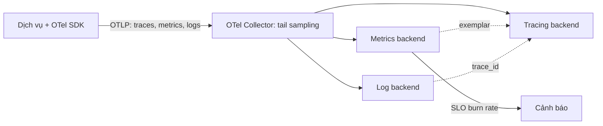

## 1. Core Concept

**Observability** là khả năng **hiểu trạng thái bên trong hệ thống từ dữ liệu nó phát ra**, đặc biệt để trả lời **câu hỏi bạn chưa lường trước** ("vì sao request của khách X chậm lúc 3 giờ sáng?"). Ba loại tín hiệu bổ trợ nhau: **logs** (sự kiện chi tiết), **metrics** (số liệu tổng hợp theo thời gian) và **traces** (đường đi của một request qua nhiều dịch vụ). Monitoring trả lời câu hỏi đã biết; observability giúp khám phá **"unknown unknowns"**.

**Mental model:** metrics là **đồng hồ trên bảng điều khiển** (cho biết có vấn đề), traces là **bản đồ hành trình** của một chuyến đi (cho biết **ở đoạn nào** chậm), logs là **nhật ký ghi chi tiết** (cho biết **chuyện gì xảy ra** ở đoạn đó). Bạn cần cả ba, nối với nhau bằng **cùng một trace id**.

## 2. How It Works

**Ba tín hiệu**
- **Logs**: nên **có cấu trúc (JSON)**, kèm `trace_id`, mức log, ngữ cảnh; đắt khi khối lượng lớn. **Metrics**: **counter** (chỉ tăng), **gauge** (giá trị hiện tại), **histogram** (phân phối độ trễ → p95/p99); rẻ, hợp cảnh báo. **Traces**: một **trace** gồm nhiều **span** (mỗi thao tác một span, có cha–con), cho thấy **thời gian ở từng dịch vụ**.

**Distributed tracing và W3C `traceparent`**
- Header chuẩn **`traceparent: 00-<trace-id 32 hex>-<span-id 16 hex>-<flags>`** được **truyền qua mọi lời gọi** (HTTP, message) để các span cùng trace nối được với nhau. Thiếu **context propagation** ở một dịch vụ là **đứt trace**.

**OpenTelemetry (OTel)**
- Chuẩn **mở, không phụ thuộc nhà cung cấp**: **API + SDK** (instrument code, auto-instrumentation), **Collector** (nhận, xử lý, xuất), giao thức **OTLP**. Giúp **đổi backend** (Jaeger, Tempo, Datadog…) mà không đổi code.

**Sampling → Kiểm soát chi phí**
- **Head-based**: quyết định giữ trace **ngay khi bắt đầu** (ví dụ 1%) — rẻ, nhưng **có thể bỏ lỡ trace lỗi/chậm**. **Tail-based**: **chờ trace hoàn tất** rồi mới quyết định (giữ **mọi trace lỗi và chậm**) — hữu ích hơn nhưng cần **Collector buffer** toàn bộ span.

**High-cardinality metrics**
- Mỗi tổ hợp nhãn (label) là **một time series**. Gắn nhãn như `user_id`, `request_id` tạo **hàng triệu series** → bùng nổ chi phí/làm sập Prometheus. **Nhãn có ít giá trị** (route, status, method); dữ liệu cardinality cao đưa vào **logs/traces**. **Exemplar** nối một điểm metric tới một trace cụ thể.

**SLI, SLO và error budget**
- **SLI**: chỉ số đo (tỉ lệ request thành công, p99 < 300 ms). **SLO**: mục tiêu (**99,9% trong 30 ngày**). **Error budget** = 1 − SLO: 99,9% / 30 ngày ≈ **43,2 phút** cho phép lỗi. **Cảnh báo theo burn rate** (đốt budget quá nhanh) thay vì ngưỡng thô; **cảnh báo theo triệu chứng người dùng thấy**, không theo nguyên nhân nội bộ. **RED** cho dịch vụ, **USE** cho tài nguyên.

```yaml
# OpenTelemetry Collector: tail sampling giữ trace lỗi và chậm
processors:
  tail_sampling:
    decision_wait: 10s
    policies:
      - { name: errors, type: status_code, status_code: { status_codes: [ERROR] } }
      - { name: slow,   type: latency,     latency: { threshold_ms: 1000 } }
      - { name: rest,   type: probabilistic, probabilistic: { sampling_percentage: 5 } }
```

## 3. Visual Diagram



## 4. Rules of Thumb & Trade-offs

| Tình huống / Nhu cầu | Chọn gì |
| --- | --- |
| Biết có vấn đề, cảnh báo | Metrics (RED/USE, SLO burn rate) |
| Biết request chậm ở dịch vụ nào | Distributed tracing |
| Biết chi tiết chuyện gì xảy ra | Logs có cấu trúc + trace_id |
| Giữ trace lỗi/chậm với chi phí thấp | Tail-based sampling |
| Không bị khoá nhà cung cấp | OpenTelemetry |
| Dữ liệu theo user/request | Logs/traces, không phải nhãn metric |

- **Được gì:** chẩn đoán nhanh, cảnh báo đúng, đo độ tin cậy. **Mất gì:** chi phí lưu trữ và ingest, overhead instrument, độ phức tạp vận hành Collector.

## 5. Must Remember / Production Pitfalls

- **Prometheus quá tải bộ nhớ → nhãn high-cardinality (user_id) → chỉ nhãn ít giá trị, đưa chi tiết sang logs/traces**.
- **Trace bị đứt giữa chừng → một dịch vụ không truyền `traceparent` → đảm bảo context propagation ở mọi lời gọi (HTTP, message)**.
- **Không thấy trace của request lỗi → head sampling quá thấp → tail-based sampling giữ lỗi/chậm**.
- **Cảnh báo ồn, mệt mỏi → cảnh báo theo ngưỡng/nguyên nhân → cảnh báo theo triệu chứng và SLO burn rate**.
- **Log không có cấu trúc, không tìm được → text tự do → JSON + trace_id**.
- Interview trap: "ba trụ cột observability?" → **logs, metrics, traces**; "head vs tail sampling?" → **head quyết sớm (rẻ, bỏ sót), tail chờ hết trace (giữ lỗi/chậm)**; "99,9% là bao nhiêu error budget?" → **~43,2 phút/30 ngày**.

## 6. Search Hooks

- `observability logs metrics traces` — ba loại tín hiệu.
- `OpenTelemetry OTel` — chuẩn mở thu thập tín hiệu.
- `distributed tracing W3C traceparent` — truyền ngữ cảnh trace giữa dịch vụ.
- `SLI SLO error budget` — đo độ tin cậy và ngân sách lỗi.
- `tail-based sampling` — giữ trace lỗi/chậm theo kết quả cuối.
- `high cardinality metrics` — bùng nổ time series do nhãn.
