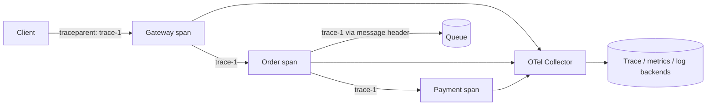

## 1. Core Concept

**Observability** là khả năng hiểu trạng thái bên trong hệ thống từ dữ liệu nó phát ra, để trả lời câu hỏi bạn **chưa lường trước** ("vì sao request của khách X chậm?"). Trong microservices, một request đi qua nhiều service nên log của từng máy không đủ. Ba tín hiệu chính: **logs, metrics, traces**. Mental model: *metrics cho biết **có vấn đề**, traces chỉ **ở đâu**, logs giải thích **vì sao**.*

## 2. How It Works

- **Logs**: bản ghi sự kiện rời rạc; dùng **structured logging (JSON)** và gắn **correlation/trace ID** để lọc theo một request. Không log dữ liệu nhạy cảm.
- **Metrics**: số liệu tổng hợp theo thời gian (counter, gauge, **histogram**) — rẻ, dùng cho dashboard và cảnh báo; áp dụng **RED** (Rate, Errors, Duration) cho service và **USE** cho tài nguyên.
- **Distributed tracing**: một **trace** là toàn bộ hành trình request, gồm nhiều **span** (một đơn vị công việc, có thời gian bắt đầu/kết thúc và cha). **Context propagation** truyền `trace-id` qua mọi lời gọi (header chuẩn **W3C `traceparent`**) — cả HTTP, gRPC lẫn message queue.
- **OpenTelemetry (OTel)**: chuẩn mở cho API/SDK/Collector để thu thập cả ba tín hiệu, tách khỏi vendor (Jaeger, Tempo, Datadog, Grafana…).
- **Sampling**: **head-based** (quyết định ngay khi bắt đầu, rẻ nhưng bỏ sót trace lỗi) và **tail-based** (quyết định sau khi trace hoàn tất, giữ các trace lỗi/chậm nhưng tốn tài nguyên).
- **SLI / SLO / error budget**: **SLI** là chỉ số (tỉ lệ request < 300 ms), **SLO** là mục tiêu (99.9%), **error budget** là phần sai lệch được phép — quyết định tốc độ ra tính năng so với độ ổn định.
- **Cảnh báo**: dựa trên **triệu chứng người dùng thấy** (lỗi, độ trễ) và **burn rate** của error budget, không dựa trên mọi nguyên nhân (CPU 80%).

## 3. Visual Diagram

## 4. Rules of Thumb & Trade-offs

- Bắt đầu với **metrics + log có trace ID + tracing** cho các đường quan trọng; tự động hoá bằng thư viện OTel thay vì viết tay.
- **Đo theo trải nghiệm người dùng** (SLO) và cảnh báo khi đốt error budget nhanh.
- Mỗi tín hiệu có chi phí: log dồi dào đắt, metrics rẻ nhưng mất chi tiết, trace chi tiết nhất nhưng cần **sampling**.
- Trade-off: **độ chi tiết vs. chi phí lưu trữ/overhead**.

## 5. Must Remember / Production Pitfalls

- **High cardinality** (gắn `user_id`, `request_id` vào label metric) làm bộ nhớ và chi phí **nổ tung**; ID chi tiết thuộc về log/trace.
- **Mất context ở ranh giới bất đồng bộ**: quên truyền trace ID qua queue/thread pool/job nền làm trace bị cắt đứt.
- **Alert fatigue**: quá nhiều cảnh báo không hành động được khiến đội bỏ qua cả cảnh báo thật.
- **Head sampling 1%** có thể bỏ sót đúng những trace lỗi hiếm; cân nhắc tail-based.
- Interview trap: "Monitoring khác observability thế nào?" → monitoring theo dõi **câu hỏi đã biết**; observability cho phép **khám phá câu hỏi chưa biết**.

## 6. Search Hooks

- `observability three pillars logs metrics traces` — ba loại tín hiệu và vai trò của chúng.
- `OpenTelemetry collector` — chuẩn mở thu thập telemetry.
- `distributed tracing W3C traceparent` — truyền context qua các service.
- `SLI SLO error budget burn rate` — đo độ tin cậy theo mục tiêu.
- `tail-based sampling` — giữ trace lỗi/chậm khi lấy mẫu.
- `high cardinality metrics` — rủi ro nổ chi phí khi gắn label chi tiết.
