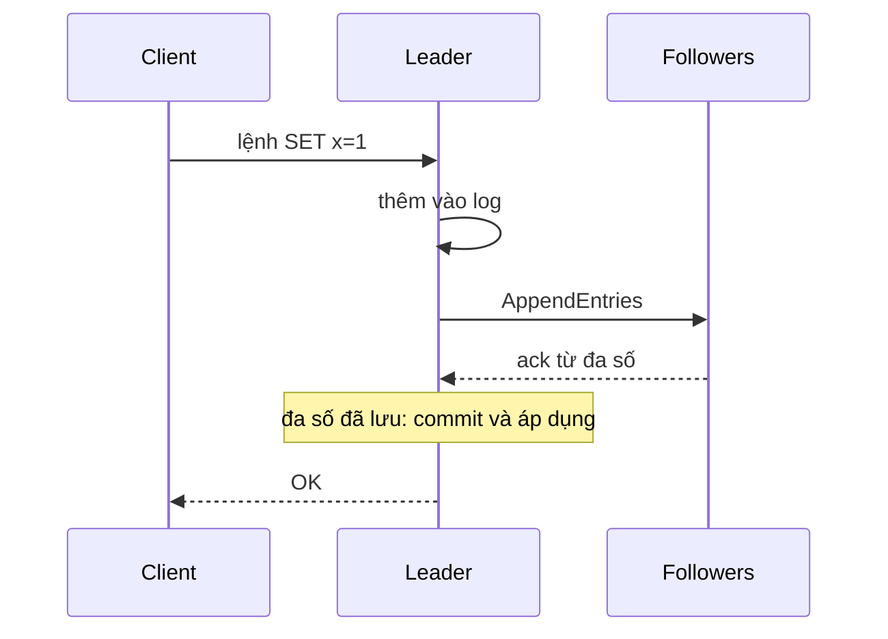

## 1. Core Concept

**Consensus** là bài toán để **nhiều node thống nhất một giá trị/một chuỗi lệnh** dù **một số node hoặc mạng bị lỗi**. **Raft** là thuật toán consensus **dễ hiểu** (thay thế Paxos trong thực tế) dùng để dựng **replicated state machine**: mọi node áp dụng **cùng một log lệnh theo cùng thứ tự** nên đạt **cùng trạng thái**. Raft là nền của **etcd, Consul, CockroachDB, TiKV** — tức nền của Kubernetes và nhiều hệ phân tán. Nó **ưu tiên nhất quán (CP)**: không có đa số thì **không tiến triển**.

**Mental model:** một **hội đồng bỏ phiếu có chủ toạ**: chỉ một **leader** nhận đề xuất, ghi vào sổ chung và chỉ coi là **chính thức** khi **đa số thành viên** đã chép vào sổ. Chủ toạ biến mất thì hội đồng **bầu người mới**, và luật bầu đảm bảo **người mới luôn có đủ các quyết định đã chính thức**.

## 2. How It Works

**Vai trò và term**
- Mỗi node là **follower**, **candidate** hoặc **leader**. Thời gian chia thành các **term** (số tăng dần); mỗi term có **tối đa một leader**. Gặp **term cao hơn** thì node lập tức **hạ xuống follower**.

**Leader election**
- Leader gửi **heartbeat** (AppendEntries rỗng). Follower **không nghe heartbeat trong election timeout (ngẫu nhiên, ví dụ 150–300 ms)** thì thành **candidate**: **tăng term, bỏ phiếu cho chính mình, gửi `RequestVote`**. **Nhận phiếu của đa số → thành leader.** Timeout **ngẫu nhiên** giảm khả năng nhiều candidate cùng lúc (split vote). Mỗi node chỉ bỏ **một phiếu mỗi term**, và **chỉ bỏ cho candidate có log ít nhất cập nhật bằng mình** (đảm bảo leader mới có mọi entry đã commit).

**Log replication → Commit khi đa số**
- Client gửi lệnh cho **leader** → leader **thêm vào log** và gửi **`AppendEntries`** cho follower → khi entry được lưu ở **đa số node**, nó được **commit** rồi **áp dụng vào state machine** và trả lời client. **Log matching**: nếu hai log có entry cùng index và term thì mọi entry trước đó giống nhau; leader **ép follower khớp log** của mình.

**Quorum và chịu lỗi (2f + 1)**
- **Cụm N = 2f + 1 node chịu được f node lỗi**: 3 node chịu 1, **5 node chịu 2**. **Số chẵn không tăng khả năng chịu lỗi** (4 node vẫn chỉ chịu 1) nên dùng **số lẻ**. Phân vùng mạng: **phía thiểu số không commit được** → tránh **split brain**; leader cũ bị cô lập sẽ **không thể commit** và hạ xuống khi thấy term mới.

**Hiệu năng và vận hành**
- Commit tốn **1 RTT tới đa số + fsync** của log → độ trễ phụ thuộc mạng/đĩa; **trải Region** làm commit chậm theo RTT xa nhất trong đa số. **Snapshot/log compaction** giữ log không phình. **Đọc** nhất quán qua leader (read index/lease), đọc từ follower có thể cũ. Thay đổi thành viên dùng **joint consensus**.

**Paxos vs Raft và hệ sinh thái**
- Cùng an toàn như Paxos nhưng Raft **tách rõ** election/replication nên dễ cài đặt. **etcd** (Kubernetes), **Consul**, **ZooKeeper** (dùng ZAB) cung cấp **khoá phân tán, bầu chọn leader, cấu hình** — **đừng tự cài consensus**, hãy dùng chúng.

```bash
etcdctl endpoint status --cluster -w table     # xem leader, term, raft index
etcdctl member list
```

## 3. Visual Diagram



## 4. Rules of Thumb & Trade-offs

| Tình huống / Nhu cầu | Chọn gì |
| --- | --- |
| Cần khoá phân tán, bầu leader, cấu hình nhất quán | etcd / Consul / ZooKeeper |
| Chịu lỗi 1 node | 3 node |
| Chịu lỗi 2 node | 5 node |
| Số node của cụm consensus | Số lẻ |
| Đa Region | Cân nhắc độ trễ commit theo RTT xa nhất trong đa số |
| Cần hiểu thuật toán dễ | Raft hơn Paxos |

- **Được gì:** nhất quán mạnh, chịu lỗi tự động, không split brain. **Mất gì:** **không khả dụng khi mất đa số**, độ trễ ghi bằng 1 RTT tới đa số, thông lượng thấp hơn một node; không scale ghi (chỉ có một leader).

## 5. Must Remember / Production Pitfalls

- **Cụm không ghi được khi mất đa số → đúng thiết kế CP → duy trì ≥ f+1 node khoẻ, tách rack/AZ**.
- **Dùng 4 hoặc 6 node tưởng tốt hơn → số chẵn không tăng chịu lỗi → dùng 3 hoặc 5**.
- **Leader liên tục đổi (flapping) → độ trễ mạng/đĩa cao, timeout quá nhạy → điều chỉnh election/heartbeat timeout theo RTT, đĩa nhanh**.
- **Ghi chậm khi trải đa Region → RTT tới đa số → đặt đa số gần nhau, cân nhắc kiến trúc khác**.
- **Đọc từ follower thấy dữ liệu cũ → đọc không qua leader → đọc linearizable qua leader/read-index**.
- **Tự cài consensus → bug tinh vi về an toàn → dùng etcd/Consul/ZooKeeper**.
- Interview trap: "Raft cần bao nhiêu node chịu 2 lỗi?" → **5 (2f+1)**; "Raft đảm bảo CP hay AP?" → **CP, mất đa số thì dừng**; "Raft chống split brain thế nào?" → **chỉ phía đa số commit được, leader cũ hạ xuống khi thấy term cao hơn**.

## 6. Search Hooks

- `Raft consensus algorithm` — thuật toán consensus dễ hiểu.
- `Raft leader election` — bầu leader bằng term và timeout ngẫu nhiên.
- `replicated state machine` — cùng log lệnh dẫn tới cùng trạng thái.
- `quorum fault tolerance 2f+1` — số node chịu được lỗi.
- `Paxos vs Raft` — so sánh hai thuật toán consensus.
- `etcd ZooKeeper Consul coordination` — dịch vụ điều phối dựa trên consensus.
