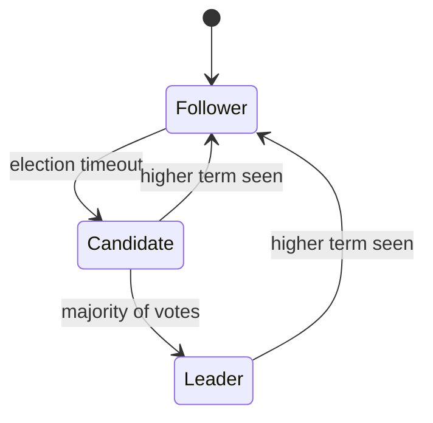

## 1. Core Concept

**Consensus** là bài toán để nhiều node **cùng đồng ý một dãy giá trị** (một **replicated log**) dù có node chết hoặc mạng bị chia cắt. **Raft** là thuật toán consensus được thiết kế **dễ hiểu**, nền tảng của etcd, Consul, CockroachDB và Kafka KRaft. Nó cho phép xây **replicated state machine**: mọi node áp dụng cùng một log theo cùng thứ tự nên cùng trạng thái. Mental model: *một leader duy nhất nhận mọi ghi và chỉ coi là xong khi **quá nửa** số node đã lưu.*

## 2. How It Works

- **Ba vai trò**: **Follower** (thụ động), **Candidate** (đang ứng cử), **Leader** (nhận ghi, gửi heartbeat). Thời gian chia thành các **term** đánh số tăng dần.
- **Bầu leader**: follower không nhận heartbeat trong **election timeout ngẫu nhiên** (thường 150–300 ms) → thành candidate, tăng term, xin phiếu. **Đủ đa số phiếu** thì thành leader. Timeout ngẫu nhiên giảm xung đột chia phiếu.
- **Nhân bản log**: client gửi lệnh tới leader → leader **append vào log** → gửi `AppendEntries` cho follower → khi **đa số (quorum)** đã lưu thì entry được **commit** và áp dụng vào state machine, rồi trả kết quả.
- **An toàn**: node chỉ bỏ phiếu cho candidate có **log ít nhất cũng mới như mình**, nên leader mới luôn chứa mọi entry đã commit (**leader completeness**).
- **Chịu lỗi**: cluster `2f + 1` node chịu được `f` node hỏng; **3 node chịu 1**, **5 node chịu 2**. Phía **thiểu số** của partition không thể bầu leader hay commit.
- **Đọc nhất quán**: đọc qua leader sau khi xác nhận mình vẫn là leader (**ReadIndex**) hoặc **lease**; đọc từ follower có thể cũ.
- **Thay đổi thành viên** thực hiện qua chính log (joint consensus/từng node một).

## 3. Visual Diagram

## 4. Rules of Thumb & Trade-offs

- Dùng consensus cho **metadata quan trọng cần nhất quán mạnh**: cấu hình, leader election, khoá phân tán, coordination (etcd, ZooKeeper). **Không** dùng để lưu dữ liệu lớn khối lượng cao.
- Chọn **số node lẻ** (3 hoặc 5); số chẵn không tăng khả năng chịu lỗi.
- Trải node qua **3 AZ** để chịu mất một AZ; trải qua Region làm **mỗi commit tốn RTT liên Region**.
- Trade-off: **Consistency & fault tolerance vs. Latency/Throughput** — mỗi ghi cần quorum và fsync; ở CAP, Raft chọn **C** khi partition.

## 5. Must Remember / Production Pitfalls

- **Mất quorum = ngừng ghi** (cluster 3 node mất 2 node): hệ thống chọn nhất quán thay vì sẵn sàng.
- **Disk fsync chậm** hoặc mạng chập chờn làm leader mất heartbeat → **bầu lại liên tục** (leader flapping).
- **Cluster quá lớn** làm commit chậm hơn (cần nhiều ack); thường 3–7 node.
- Đừng nhầm **số bản sao dữ liệu** với **số node consensus**; nhiều hệ thống chạy Raft theo từng partition/range.
- Interview trap: "Vì sao 4 node không tốt hơn 3?" → quorum 4 node là 3, vẫn chỉ chịu **1** node hỏng, nhưng tốn thêm tài nguyên.

## 6. Search Hooks

- `Raft consensus algorithm` — thuật toán đồng thuận dễ hiểu dựa trên leader.
- `leader election election timeout term` — cơ chế bầu leader trong Raft.
- `replicated state machine log replication` — cách dùng log để đồng bộ trạng thái.
- `quorum majority fault tolerance 2f+1` — số node cần để chịu f lỗi.
- `Paxos vs Raft` — so sánh hai thuật toán consensus.
- `etcd ZooKeeper Consul coordination` — các hệ coordination dựa trên consensus.
