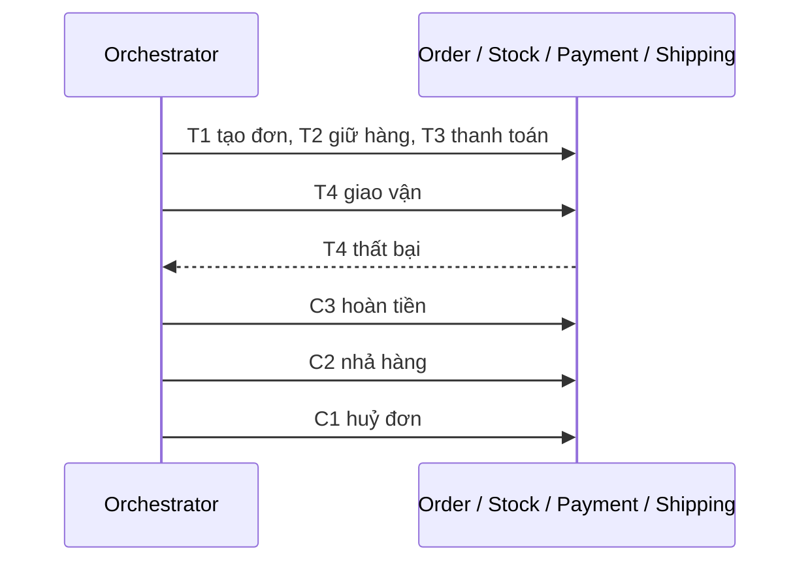

## 1. Core Concept

Khi một nghiệp vụ trải qua **nhiều dịch vụ, mỗi dịch vụ có DB riêng**, không còn **giao dịch ACID** xuyên dịch vụ. **Saga** giải quyết bằng cách chia nghiệp vụ thành **chuỗi giao dịch cục bộ**; nếu một bước thất bại, chạy các **giao dịch bù trừ (compensating transaction)** để **hoàn tác về mặt nghiệp vụ** các bước đã xong. Saga đảm bảo **tính nhất quán cuối cùng**, **không** có cô lập (I trong ACID).

**Mental model:** như **đặt tour du lịch trọn gói**: đặt vé máy bay → khách sạn → thuê xe. Nếu bước thuê xe hỏng, bạn **không "rollback" như chưa từng xảy ra** mà phải **huỷ khách sạn rồi hoàn tiền vé** — những hành động bù trừ có thể mất phí, mất thời gian, và trong lúc đó **người khác có thể thấy trạng thái dở dang**.

## 2. How It Works

**Vì sao không dùng 2PC**
- **Two-Phase Commit** (chuẩn bị rồi commit) **khoá tài nguyên và chặn** khi coordinator chết, **không khả thi** qua nhiều dịch vụ/DB/broker khác nhau, giảm khả dụng và **không scale**. Saga đánh đổi **cô lập** lấy **khả dụng và tự chủ**.

**Chuỗi giao dịch cục bộ + bù trừ**
- Ví dụ đơn hàng: **T1** tạo đơn → **T2** giữ hàng → **T3** thanh toán → **T4** giao vận. Mỗi bước có **bù trừ**: **C1** huỷ đơn, **C2** nhả hàng, **C3** hoàn tiền. Nếu **T4 lỗi**, chạy **C3 → C2 → C1** theo thứ tự ngược.
- **Bù trừ phải idempotent và có thể retry** (có thể chạy nhiều lần mà không gây hại) vì nó cũng có thể lỗi; nó là **hoàn tác ngữ nghĩa** (hoàn tiền, không phải xoá bản ghi thanh toán). Có bước **không bù trừ được** (gửi email) → đặt ở **cuối**. **Pivot transaction** là bước quyết định "đi tiếp hay không"; các bước sau nó là **retriable** (phải thành công).

**Choreography vs Orchestration**
- **Choreography**: mỗi dịch vụ phản ứng với sự kiện rồi phát sự kiện tiếp (không trung tâm; khó theo dõi). **Orchestration**: một **saga orchestrator** (state machine) ra lệnh từng bước và bù trừ — **dễ hiểu, dễ quan sát**, thành phần trung tâm cần HA.

**Thiếu cô lập → Dị thường và đối phó**
- Vì các bước commit cục bộ ngay, giao dịch khác có thể **thấy dữ liệu dở dang** (dirty read), **ghi đè** (lost update). **Biện pháp (countermeasures)**: **semantic lock** (cờ `PENDING` trên bản ghi), **commutative updates**, **pessimistic view** (sắp xếp bước giảm rủi ro), **reread value**, **versioning**, **by-value** (chọn mức bảo vệ theo rủi ro).

**Độ bền của saga**
- Trạng thái saga phải **được lưu bền** để sống sót khi crash: dùng **bảng trạng thái + outbox** hoặc **durable execution** (**Temporal**, **AWS Step Functions**) tự lưu tiến trình, retry, timeout và bù trừ. Dùng **correlation id** để theo dõi.

```python
saga = [("create_order", "cancel_order"), ("reserve_stock", "release_stock"),
        ("charge_payment", "refund_payment"), ("ship", None)]
done = []
for step, compensate in saga:
    try: run(step); done.append(compensate)
    except Exception:
        for comp in reversed(done):          # bù trừ ngược thứ tự
            if comp: run_with_retry(comp)    # idempotent, retry
        raise
```

## 3. Visual Diagram



## 4. Rules of Thumb & Trade-offs

| Tình huống / Nhu cầu | Chọn gì |
| --- | --- |
| Nghiệp vụ xuyên nhiều dịch vụ có DB riêng | Saga |
| Ít bước, lỏng lẻo | Choreography |
| Nhiều bước, cần theo dõi và bù trừ rõ | Orchestration |
| Cần độ bền và retry tự động | Durable execution (Temporal/Step Functions) |
| Tránh đọc dữ liệu dở dang | Semantic lock (`PENDING`) |
| Trong một DB duy nhất | Giao dịch ACID thường |

- **Được gì:** nhất quán cuối cùng xuyên dịch vụ, khả dụng cao. **Mất gì:** **không cô lập**, phải thiết kế bù trừ cho từng bước, phức tạp và khó test; không phải mọi thứ đều bù trừ được.

## 5. Must Remember / Production Pitfalls

- **Saga kẹt giữa chừng sau khi crash → trạng thái không bền → lưu trạng thái + outbox hoặc dùng durable execution**.
- **Bù trừ chạy hai lần gây hoàn tiền kép → không idempotent → idempotency key, kiểm tra trạng thái trước khi bù**.
- **Người dùng thấy đơn "đã giữ hàng" rồi biến mất → thiếu cô lập → semantic lock (PENDING), thông báo trạng thái trung gian**.
- **Bù trừ lỗi và không ai biết → thiếu giám sát → retry có backoff, cảnh báo, DLQ cho can thiệp thủ công**.
- **Đặt bước không bù trừ được (gửi email) ở đầu → không hoàn tác được → để ở cuối sau pivot**.
- Interview trap: "vì sao không dùng 2PC giữa microservices?" → **chặn, coordinator là điểm lỗi, không scale, không hỗ trợ đa hệ thống**; "saga có cô lập không?" → **không, cần biện pháp như semantic lock**; "bù trừ khác rollback?" → **bù trừ là hoàn tác ngữ nghĩa bằng giao dịch mới, không xoá lịch sử**.

## 6. Search Hooks

- `saga pattern microservices` — giao dịch xuyên dịch vụ bằng chuỗi giao dịch cục bộ.
- `compensating transaction` — hoàn tác ngữ nghĩa các bước đã xong.
- `two-phase commit vs saga` — vì sao 2PC không hợp microservices.
- `saga isolation countermeasures semantic lock` — đối phó thiếu cô lập.
- `durable execution Temporal` — lưu bền tiến trình saga.
- `choreography vs orchestration` — hai cách điều phối saga.
