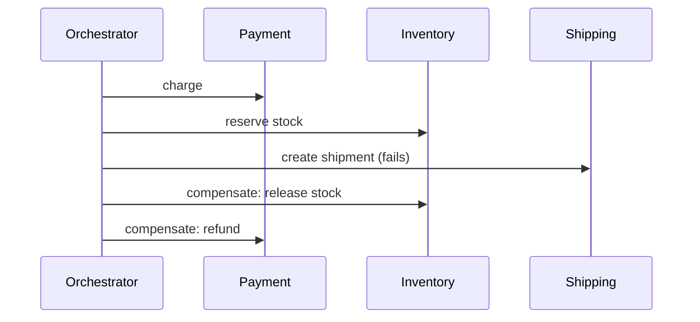

## 1. Core Concept

Khi mỗi service có DB riêng, một nghiệp vụ như "đặt hàng" trải qua nhiều service và **không thể dùng một ACID transaction**. **Saga** chia nó thành chuỗi **local transaction**; nếu một bước thất bại, chạy các **compensating transaction** để hoàn tác các bước trước đó. Nó thay thế **2PC (two-phase commit)** vốn chặn và khó scale. Mental model: *Saga đạt **atomicity ở mức nghiệp vụ** bằng cách "làm rồi xin lỗi", chứ không bằng khoá toàn cục.*

## 2. How It Works

- **Chuỗi bước**: `T1 → T2 → T3 …`, mỗi `Ti` là local transaction và có `Ci` (compensation) hoàn tác ngữ nghĩa của nó. Thất bại ở `Tk` → chạy `C(k-1) … C1` theo thứ tự ngược.
- **Hai cách phối hợp**:
  - **Choreography**: mỗi service nghe event của service trước và phát event kết quả — đơn giản với ít bước, khó theo dõi khi nhiều bước.
  - **Orchestration**: một **orchestrator** (state machine) ra lệnh từng bước, nhận kết quả, quyết định tiếp hoặc bù — dễ nhìn trạng thái, tập trung logic (Temporal, AWS Step Functions, Camunda).
- **Phát lệnh/event tin cậy** bằng **transactional outbox**; mỗi bước phải **idempotent** vì có retry.
- **Compensation phải retryable và luôn thành công** (hoặc chuyển cho người xử lý): hoàn tiền, nhả tồn kho, huỷ đặt chỗ.
- **Thiếu cô lập (the "I" in ACID)**: trạng thái trung gian nhìn thấy được → biện pháp: **semantic lock** (trạng thái `PENDING`), **commutative updates**, **pessimistic view** (sắp thứ tự bước), **re-read giá trị** trước khi ghi.
- Mỗi saga có **trạng thái được lưu bền** và **timeout** cho từng bước.

## 3. Visual Diagram

## 4. Rules of Thumb & Trade-offs

- Nghiệp vụ xuyên nhiều service và chấp nhận **eventual consistency** → Saga. Nếu phải ACID thật sự → cân nhắc **gộp dữ liệu vào một service** thay vì ép Saga.
- **Sắp xếp bước**: đặt bước **khó hoặc không thể hoàn tác** (gửi email, giao hàng) ở **cuối**; bước dễ bù ở đầu. Bước không bù được gọi là **pivot transaction**.
- 2–3 bước → choreography; nhiều nhánh/điều kiện → **orchestration**.
- Trade-off: **Availability & scalability vs. Isolation/simplicity** — bạn tự gánh việc xử lý trạng thái trung gian.

## 5. Must Remember / Production Pitfalls

- **Compensation không phải rollback**: không thể "thu hồi" email đã gửi; hoàn tác là **bù ngữ nghĩa** (gửi email đính chính, hoàn tiền).
- **Không idempotent** → retry làm hai lần trừ tiền/hoàn tiền; mỗi bước và mỗi compensation cần khoá idempotency.
- **Không có timeout** → saga treo vĩnh viễn ở trạng thái trung gian; cần timeout + cơ chế người xử lý (**manual intervention**).
- **Người dùng thấy trạng thái dở dang**: thiết kế trạng thái rõ ràng (`PENDING`, `CONFIRMED`, `CANCELLED`) và cập nhật UX.
- **Orchestrator thành "god service"** chứa logic nghiệp vụ của mọi service → chỉ điều phối, logic nằm ở service.
- Interview trap: "Saga có đảm bảo ACID không?" → **không**: chỉ có **A, C, D** ở mức nghiệp vụ; thiếu **I** (isolation).

## 6. Search Hooks

- `saga pattern microservices` — giao dịch phân tán bằng chuỗi local transaction và bù.
- `compensating transaction` — hoàn tác ngữ nghĩa các bước đã làm.
- `saga orchestration vs choreography` — hai cách phối hợp saga.
- `two-phase commit 2PC vs saga` — đánh đổi giữa khoá toàn cục và eventual consistency.
- `semantic lock saga isolation countermeasures` — xử lý thiếu cô lập trong saga.
- `Temporal workflow durable execution` — nền tảng điều phối saga bền vững.
